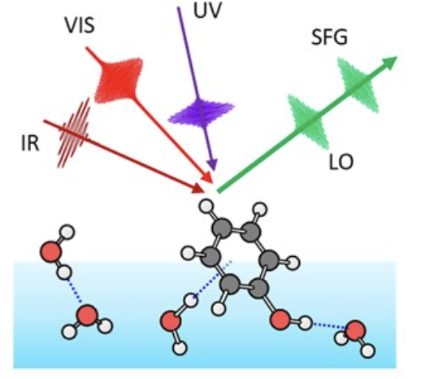

# 光激发界面水振动能否加速电子转移？

*面向 SFG 实验人员的简明模型与数量级估计*

## 问题与结论

假如用红外 Pump 选择性激发空气/水界面约 **3700 cm⁻¹ 的自由 OH** 或约 **1650 cm⁻¹ 的 HOH 弯曲振动**，能否在不直接激发电子供受体的情况下加快电子转移（ET）？我们的简化模型给出一个有条件的答案：**某些反应的瞬时 ET 速率可以显著增大，但由于水振动弛豫很快，实际新增的 ET 产物可能极少，未必能被 SFG 直接分辨。**

这里的计算是数量级探索，而不是已经观测到的光控 ET 实验结果。建模思路来自振动耦合 ET 理论及界面水 SFG 研究；分子内振动选择性激发影响 ET 已有实验先例，但不能直接视作界面水促进 ET 的证据。[1](https://doi.org/10.1126/science.1259995)、[2](https://doi.org/10.1021/jp0133438)、[3](https://doi.org/10.1063/1.473037), [7](https://doi.org/10.1021/jp105223j), [8](https://doi.org/10.1016/j.cplett.2012.05.054)

## 1. 我们得到的三个关键关系

**（1）HD-SFG 与 ET 能隙涨落的联系。** 若同一个水振动坐标 $q$ 同时决定共振 SFG 响应和供受体能隙 $X=X_0-gq$，则一系列近似下：

$$
\boxed{
K_{XX}^{\mathrm{sym}}(t)=\frac{\hbar g^2}{\pi}\int_0^\infty\!d\omega\;
\operatorname{Im}\!\left[\frac{\chi_{\mathrm{SFG}}^{(2),\mathrm{res}}(\omega)}{\mathcal N ab}\right]
\coth\!\left(\frac{\beta\hbar\omega}{2}\right)\cos(\omega t)
}
$$

$K_{XX}^{\mathrm{sym}}(t)$ 表示**溶剂振动引起的电子能隙涨落相关性**，不是 SFG 本身测到的电子转移速率。也就是说一个有SFG响应的振动如何不断的敲打电子转移中心的能量。

$\chi_{\mathrm{SFG}}^{(2),\mathrm{res}}$ 是 HD-SFG 得到的复数共振响应；$a$为振动引起极化率变化的能力，也就是 **Raman** 活性，$b$为振动引起偶极矩变化的能力也就是 **IR** 活性。，$\mathcal N$ 包含界面取向及光学归一化因子；$g=-\partial X/\partial q$ 是该振动改变 ET 能隙的强度。对于单个振动模式，还可得到其重组能：

$$
\boxed{
\lambda_\alpha=\frac{g_\alpha^2}{\pi}\int_0^\infty\frac{d\omega}{\omega}\;
\operatorname{Im}\!\left[\frac{\chi_{\mathrm{SFG},\alpha}^{(2),\mathrm{res}}(\omega)}{\mathcal N_\alpha a_\alpha b_\alpha}\right],\qquad
S_\alpha=\frac{\lambda_\alpha}{\hbar\omega_\alpha}
}
$$

这使 SFG 测得的**振动频率、线形和相位信息**可以约束 ET 模型。**但 SFG 不能单独给出** $g$：它需要特定反应的AIMD计算或额外实验。[2](https://doi.org/10.1021/jp0133438)、[4](https://doi.org/10.1146/annurev-physchem-040412-110110)

**（2）光激发如何影响 ET 速率。** 在弱电子耦合的 Fermi Golden Rule 近似下：

$$
\boxed{
k_{\mathrm{ET}}^{\mathrm{pump}}=\frac{2|V_{if}|^2}{\hbar^2}
\operatorname{Re}\int_0^\infty C_{if}^{\mathrm{pump}}(t)\,dt
}
$$

电子转移能否发生，取决于周围溶剂运动能否帮助初态和终态满足能量匹配。Pump 光激发 OH/HOH 振动后，会改变溶剂振动量子态的布居，从而改变电子转移的振动跃迁通道及其权重，最终可能加速或抑制电子转移。

这个公式可以拆成三个具有明确物理意义的部分：

$$
\boxed{
\begin{aligned}
C_{if}^{\mathrm{pump}}(t)
={}&
\underbrace{C_s(t)}_{\text{低频溶剂浴}}\\
&\times
\prod_\alpha
\underbrace{C_\alpha^{(0)}(t)}_{\text{高频量子振动}}
\underbrace{F_\alpha^{\mathrm{pump}}(t)}_{\text{光激发修正}}
\end{aligned}
}
$$

$V_{if}$ 是供体与受体的电子耦合，$C_{if}$ 包含了低频经典 Gaussian 溶剂振动的贡献、还有高频独立量子振动贡献。且 Pump 使其中比例 $f_\alpha$ 从振动基态进入 $v=1$，可写为：

$$
\boxed{
\begin{aligned}
C_{if}^{\mathrm{pump}}(t)={}&
\exp\!\left[\frac{i(\Delta G^0+\lambda_s)t}{\hbar}-\frac{\lambda_s k_BTt^2}{\hbar^2}\right]\\
&\times\prod_{\alpha=\mathrm{OH,HOH}}
\exp\!\left[S_\alpha(e^{i\omega_\alpha t}-1)\right]
\left[1-2f_\alpha S_\alpha(1-\cos\omega_\alpha t)\right].
\end{aligned}
}
$$

这里 $\Delta G^0$ 是 ET 反应自由能，$\lambda_s$ 是低频溶剂重组能，$S_\alpha$ 表示高频振动对能隙的耦合强度，$f_\alpha$ 是**参与反应的局域振动模式**的激发布居（不等于全界面 OH 的平均激发比例）。物理上，Pump 改变振动初态布居，进而改变允许的 Franck–Condon 跃迁通道及 ET 速率。[3](https://doi.org/10.1063/1.473037)、[5](https://doi.org/10.1063/1.432142)

**（3）Pump–probe 延迟时间如何影响观测。** 若只激发一个模式，且振动布居按 $T_1$ 衰减，用 $k_0,k_1$ 表示相关振动初态分别为 $v=0,1$ 时的 ET 速率，则：

$$
\boxed{
k_{\mathrm{ET}}(t_d)=k_0+f_0e^{-t_d/T_1}(k_1-k_0)
}
$$

若实验读数在 $0$ 至 $t$ 时间窗口内积累，更相关的量是平均有效速率：

$$
\boxed{
\frac{\overline{k}(t)}{k_0}
=1+(R_0-1)\frac{T_1}{t}\left(1-e^{-t/T_1}\right),\qquad
R_0\equiv\frac{k_{\mathrm{ET}}(0)}{k_0}
}
$$

这是一种**瞬时速率/population动力学近似**，不是任意超快非平衡 ET 过程都严格满足的动力学定律。[6](https://doi.org/10.1038/s41467-024-45388-8)

## 2. 代入参数后，究竟加速多少？

采用一组粗略的参数：$T=300$ K、$\lambda_s=0.40$ eV、自由 OH 为 3700 cm⁻¹、HOH 为 1650 cm⁻¹、$S_{\mathrm{OH}}=0.03$、$S_{\mathrm{HOH}}=0.10$。它们对应的模式重组能分别约为 **0.0127 eV** 和 **0.0205 eV**。这些 $S$ 和激发布居均为**假设值，并非由 SFG 得到，也不是由AIMD计算得到**。

先看**单个 3700 cm⁻¹ 自由 OH 模式**，假定 Pump 使参与反应的局域 OH 中有 $f_0=1.5\%$ 被激发，并令 $T_1=0.84$ ps：

| ET 反应自由能 | Pump 后瞬时速率比 $R_0$ | 前 1 ps 平均速率比 | 前 1 ps 新增 ET 概率 |
|:-----------------|-----------------:|-----------------:|-----------------:|
| $\Delta G^0=+0.1$ eV | 1.186 | 1.108 | $5.98\times10^{-6}$ |
| $\Delta G^0=+0.2$ eV | 2.687 | 1.986 | $3.81\times10^{-6}$ |

同一模型中，$\Delta G^0=-0.4$ eV 时初始速率比约为 **0.999**，即几乎没有促进。**因此振动激发不是普遍的加速开关**：它是否有效强烈依赖反应自由能、振电耦合以及哪些振动跃迁通道能够补偿能量差。

例如对 $\Delta G^0=+0.2$ eV 的情形，前 1 ps 预测的 ET 概率由 $3.86\times10^{-6}$ 增至 $7.67\times10^{-6}$。虽然速率比接近 2，却只相当于每百万个初态反应分子多出约 **4 个 ET 事件**。

作为另一种情形，在包含**OH 与 HOH 两个高频模式**的模型中，假定两者各有 5% 激发布居、$\Delta G^0=+0.2$ eV，则仅激发 OH、仅激发 HOH、同时激发两者的速率比分别约为 **5.205、1.678、5.886**。这是更强 Pump 条件下的示例，不能与上述 1.5% 单模式结果直接当作同一实验条件比较。

## 3. SFG 实验能否看到这种加速？

**在上述弱产额示例下，直接通过产物诱导的 SFG 变化来证明 ET 加速，预计很困难，但目前不能给出普适的“不可观测”结论。** 原因是：

1.  **振动寿命短。** 时间分辨 HD-VSFG 研究指出，自由 OH 激发可在约 0.9 ps 的时间尺度上通过重取向转入氢键 OH，氢键 OH 振动弛豫约为 0.2–0.4 ps。Pump 作用的窗口有限。[6](https://doi.org/10.1038/s41467-024-45388-8)
2.  **相对速率大不等于产物数多。** 在上面的 +0.2 eV 示例中，速率约翻倍，但新增产物比例仅约 $4\times10^{-6}$。Pump 引起的**水自身振动响应**可能远大于 ET 产物带来的 SFG 差分信号。
3.  **信号强弱还取决于光谱对比度。** 产物和反应物的界面数密度、取向、$\chi^{(2)}$ 对比度、Pump 背景与仪器噪声未被这个动力学模型包含，所以不能仅凭新增概率推断实际检测极限。

更可行的验证方式是：**TR-HD-SFG 监测界面水的振动激发、弛豫与取向变化；瞬态吸收（TA）或其他产物选择性探测负责确认 ET 产物与电子态动力学。** 实验应比较 OH 共振与失谐 Pump，并控制直接激发溶质及泵浦加热的影响。

## 4. 实验上最值得寻找的体系

目标不是单纯选择 SFG 峰最强的界面，而是选择满足以下条件的供受体：**反应中心与被激发水振动空间重叠、该振动对 ET 能隙的耦合** $g$ 足够强、振动辅助通道能够显著提高速率，并且在亚皮秒时间窗口内产生足够多、具有可区分光谱特征的 ET 产物。

本文最有用的结果是把 **HD-SFG 的振动信息与 ET 模型中的** $\lambda_\alpha,S_\alpha$ 联系起来，并给出一个可检验的数量级判断：**光激发界面 OH 在理论上可以使特定 ET 反应加速，但要让这种加速在实验上可见，必须同时满足振电耦合、反应产额和光谱对比度三项条件。**

## 参考文献（选自原稿）

1.  Delor, M. *et al.* Toward control of electron transfer in donor-acceptor molecules by bond-specific infrared excitation. *Science* **2014**, *346*, 1492–1495. [DOI](https://doi.org/10.1126/science.1259995).
2.  Morita, A.; Hynes, J. T. A theoretical analysis of the sum frequency generation spectrum of the water surface. II. Time-dependent approach. *J. Phys. Chem. B* **2002**, *106*, 673–685. [DOI](https://doi.org/10.1021/jp0133438).
3.  Ando, K. Quantum energy gap law of outer-sphere electron transfer reactions: A molecular dynamics study on aqueous solution. *J. Chem. Phys.* **1997**, *106*, 116–126. [DOI](https://doi.org/10.1063/1.473037).
4.  Shen, Y. R. Phase-sensitive sum-frequency spectroscopy. *Annu. Rev. Phys. Chem.* **2013**, *64*, 129–150. [DOI](https://doi.org/10.1146/annurev-physchem-040412-110110).
5.  Jortner, J. Temperature dependent activation energy for electron transfer between biological molecules. *J. Chem. Phys.* **1976**, *64*, 4860–4867. [DOI](https://doi.org/10.1063/1.432142).
6.  Sung, W.; Inoue, K.; Nihonyanagi, S.; Tahara, T. Unified picture of vibrational relaxation of OH stretch at the air/water interface. *Nat. Commun.* **2024**, *15*, 1258. [DOI](https://doi.org/10.1038/s41467-024-45388-8).
7.  Rao, Y.; Turro, N. J.; Eisenthal, K. B. Solvation Dynamics at the Air/Water Interface with Time-Resolved Sum-Frequency Generation. J. Phys. Chem. C 2010, 114, 17703–17708. [DOI](https://doi.org/10.1021/jp1052367).
8.  Rao, Y.; Xu, M.; Jockusch, S.; Turro, N. J.; Eisenthal, K. B. Dynamics of Excited State Electron Transfer at a Liquid Interface Using Time-Resolved Sum Frequency Generation. Chem. Phys. Lett. 2012, 544, 1–6. [DOI](https://doi.org/10.1016/j.cplett.2012.05.054).