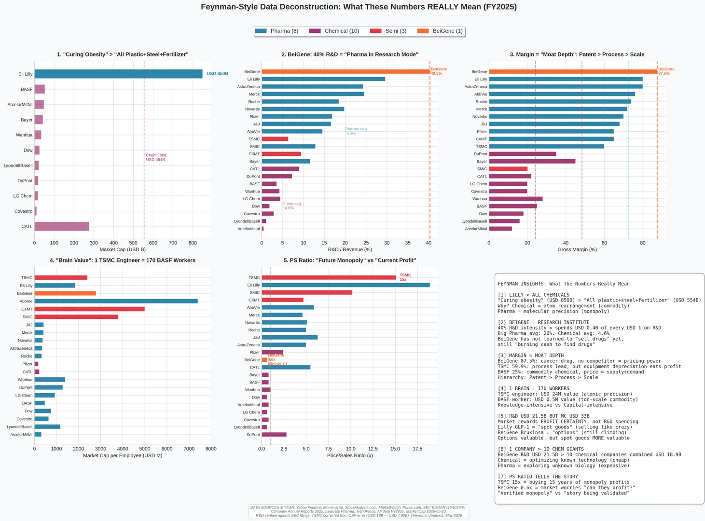
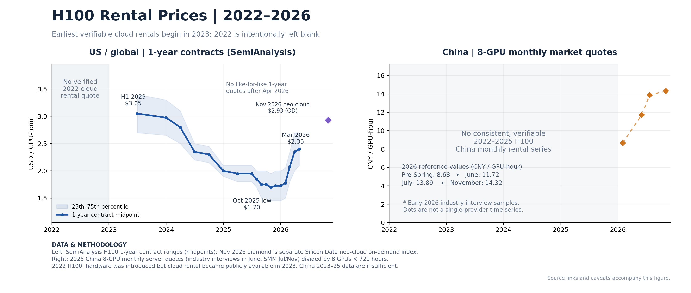

# My Insights on Putting AI4S into Practice

**Date: September 14**

**Abstract:** In an era of compute depreciation and AI Recursive Self-Improvement (RSI), the AI4S 1.0 model—training small-to-medium models on pure computational data and selling them like industrial software—has come to an end; post-2026, the best breakthrough point for AI4S is to tap into high-R&D-premium biomedicine (like mRNA), borrow the "large + small model synergy" paradigm from embodied AI, and run a "Reinforcement Learning (RL) closed loop" inside Self-Driving Labs (SDL) to capture and understand the "discrepancy (Gap) between computation and real-world experiments"—and the ultimate moat in driving this new paradigm comes down to "people."

Because the R&D-to-investment ratio in bio is so much higher than in chemicals, materials, or semiconductors, while traditional industries care way more about efficiency innovation. This makes traditional industries focus on AI that interprets production line data. Meanwhile, pharma's "10 years, $1 billion" R&D commitment ensures they are much more willing to spend big on early-stage drug discovery. So if an AI4S company wants to break into a sector right now, the best entry point is biomedicine—especially non-traditional chemical drugs, namely mRNA drugs.

In an interview a while ago, DP Technology mentioned that one possibility for an AI4S company is to build a software platform, just like Dassault’s SolidWorks. That’s basically what Schrödinger has already finished doing with Free Energy Perturbation. That was the first era: build great computational chemistry and biology software and sell it directly for cash.

So in the agent era, what core tech is actually the core for an AI4S company? How do I convince the broader B2B users—beyond just academic users in universities—to actually use my product? It seems like as A100s and H100s get completely retired from LLM companies, the price of these GPUs is going to tank hard over the next 3–4 years. Combine that with the development of RSI (AI self-iteration), and an AIMD potential function that can be trained on a few dozen A100 nodes will become something one person can knock out in just a few nights. By then, the cost-effectiveness for B2B users to go out and buy these mid-to-small models will keep dropping. But we need to notice that right now in 2026, the embodied AI industry uses large and small models together—a local small model ensures the robot's real-time running speed, while the large model handles long-term path planning and semantic understanding. So in the AI4S space, is there also a scenario for having a small model? In SDL labs, there are two paths right now: one is doing dry-lab high-throughput screening first, and then moving to wet-lab experiments. The other is a reinforcement learning path: experiment, computational understanding, spectral calculation, and then the next step. Personally, I think post-2026 it should be about positioning for the latter, which is also the AI agent path. In other words, building models based purely on computational data again might just be out of touch with the times. We should give up static "pure computational prediction" and pivot toward a dynamic "physical-world interaction loop."

So we don’t just need an AlphaFold; we need a domain-specific model following a reinforcement learning mindset to actually run AlphaFold inside the continuous iteration of an SDL, when the model and the experiments keep producing gaps. Even if we have *the bitter lessons*, we still need to understand this gap first, and only then comes the scaling law. This specific part of the data and assets is the most valuable thing in AI4S.

Finally, in the bio space right now, Schrödinger is pretty much the only pure-play AI4S company that has achieved stable positive cash flow (along with a few pioneering Biotechs). Meanwhile, AI tech giants (throwing their weight around with compute and general foundation models) and traditional Big Pharma (bringing their own pipelines, capital, and wet-lab data) are personally jumping into the ring to do AI4S—where will AI4S startups go from here? What is the real moat for a traditional AI4S startup, I think it’s a group of people who truly believe in AI4S, not the data and not the automated lab.

Static data and bought automation hardware aren't a moat in themselves (these are dead); the real moat is the dynamic cognitive loop built by 'a group of people who truly believe in AI4S' (this is alive). Only this group of people knows how to design experiments to efficiently expose the model's blind spots, and continuously generate 'the dry-to-wet lab discrepancy (The Gap)'—the most valuable data asset of all.
