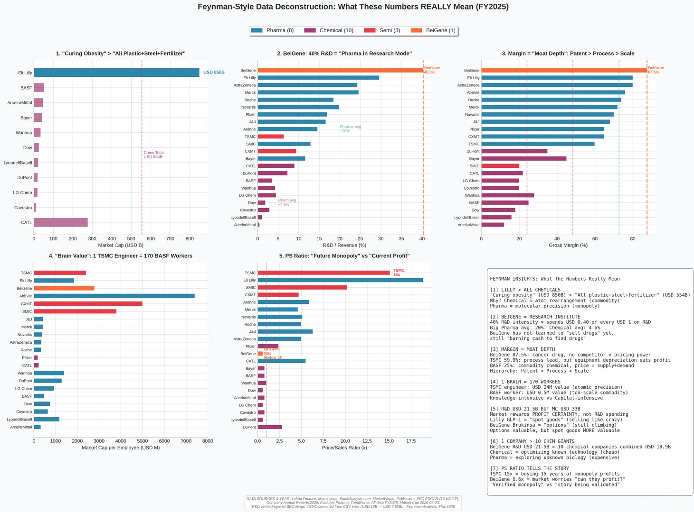
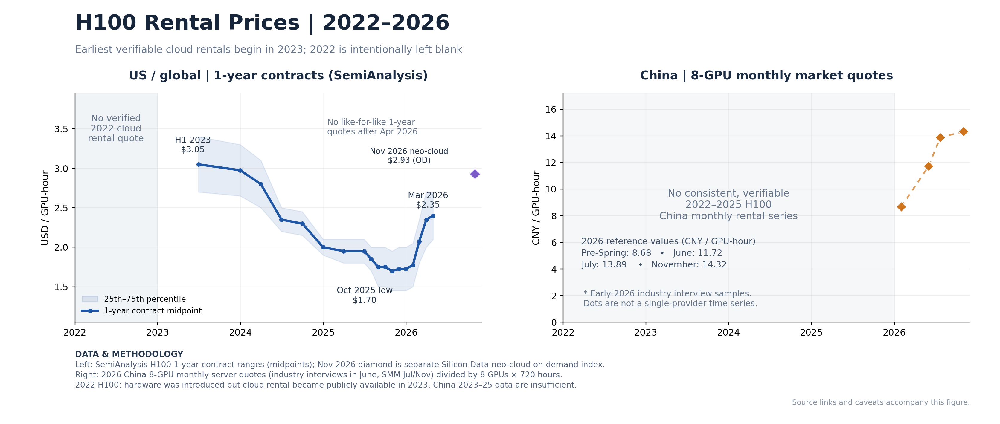

# 我对AI4S的落地的洞见

**日期：9月14日**

**摘要：** 在算力贬值与AI自我迭代（RSI）的时代，靠“纯计算数据训练中小模型”并像工业软件一样售卖的AI4S 1.0模式已走向终结；2026年之后，AI4S的最佳破局点是切入高研发溢价的生物医药（如mRNA）领域，借鉴具身智能“大小模型协同”范式，在自动化实验室（SDL）中跑通“强化学习（RL）闭环”，去捕捉和理解“计算与真实实验之间的误差（Gap）”——而驾驭这一新范式的核心壁垒，最终在于“人”。

因为生物的投入研发比相比于化工材料半导体行业高的多，而传统行业更关注效率创新。这使得传统行业更关注的AI是去解读生产线数据的。而药企10年10亿美金的研发投入，确保了他们更愿意在初步药物探索花的更多。所以如果一家AI4S公司目前最好接入的领域就是生物医药，尤其是非传统化学药物，既mRNA药物。

前段时间深势科技的采访说到，AI4S公司有一种可能，像达索的solidworks一样，构建一个软件平台。这就是薛定谔的Free Energy Perturbation已经做完的事情。这是第一个时代，做出好的计算化学生物软件直接卖钱。

那么在agent时代，什么核心技术是AI4S公司的核心呢？ 我要怎么说服除了学校用户之外的广大B端用户，使用我的产品呢？似乎随着未来A100 H100，彻底从LLM公司的退役，在未来3-4年这类显卡价格将会下滑的厉害。再结合RSI（AI自我迭代）的发展，对于一个可以用几十张A100节点训练的AIMD势函数将会是一个人几个晚上就能做到的事情。到时候B端用户再去购买这样的中小模型的性价比在降低。但是需要注意到，目前2026年的具身智能行业是大小模型一起使用，本地小模型确保机器人实时运行速度，大模型负责长期路径规划和语义理解。那么AI4S领域，是否也有具有一个小模型的场景呢？在SDL实验室中，现在有两条路径，一是干实验高通量筛选后，再进行湿实验。还有一条是强化学习的路径，实验，计算理解，光谱计算再下一步。我个人认为2026之后应该是后者的布局，这也是AI agent的路径。也就是说再搭建基于纯计算数据的模型，可能是不合时宜的。我们应该放弃静态的“纯计算预测”，转向动态的“物理世界交互闭环”。

所以我们不只是需要一个AlphaFold，我们更需要一个遵循强化学习思路的特定领域模型把AlphaFold真的跑在SDL不断迭代的过程中，当模型和实验不断产生差距。那怕我们有the bitter lessons，但是我们需要去理解这部分差距，然后才是scaling law。这部分的数据和资产才是AI4S最值钱的地方。

最后，目前生物领域几乎只有薛定谔一家纯正AI4S公司实现了稳定正现金流（外加少数先锋Biotech）。与此同时，AI科技巨头（挟算力与通用大模型自重）和传统大药企（自带管线、资金与湿实验数据）都在亲自下场做AI4S，AI4S初创公司将走向何方？什么才是传统AI4S初创公司护城河，我觉得是一群真的相信AI4S的人，而不是数据也不是自动化实验室。

静态的数据和买来的自动化硬件本身不是护城河（这是死的）；真正的护城河，是‘一群真正相信AI4S的人’所构建的动态认知闭环（这是活的）。只有这群人，才知道如何设计实验去高效暴露模型的盲区，并源源不断地生产出‘干湿实验误差（The Gap）’这一最值钱的数据资产。
