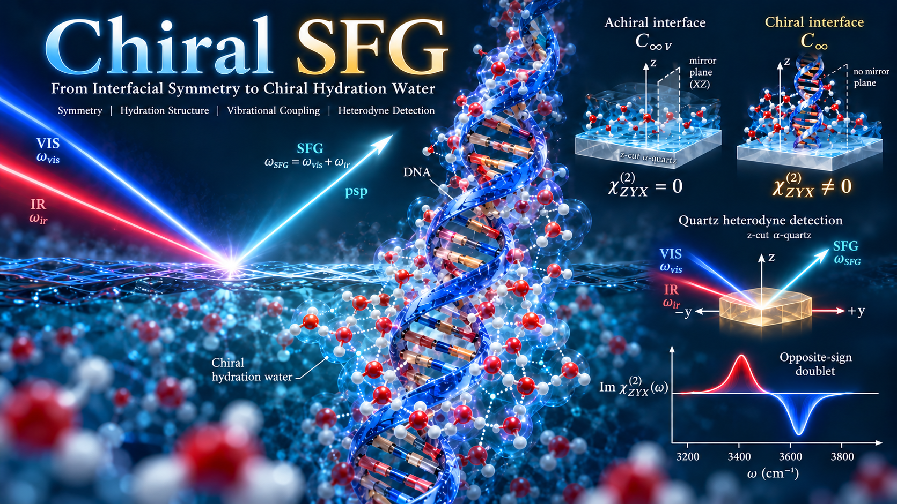
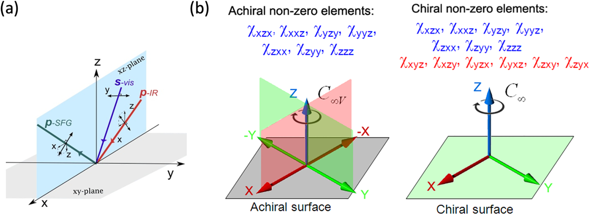

------------------------------------------------------------------------

# 第一章：宏观对称性——为什么手性界面允许额外的二阶极化率？

**本章核心问题**：在 27 个二阶非线性极化率张量元 $\chi_{IJK}^{(2)}$ 中，究竟有哪些可以在界面存活？为什么 $\chi_{ZYX}^{(2)}$ 是宏观手性界面的“专属指纹”？

当我们试图用和频光谱（SFG）去探测生物大分子（如 DNA 或蛋白质）周围的水合层时，遇到的第一个门槛不是复杂的量子力学，而是**宏观对称性**。对称性就像一个冷酷的“守门人”：不管微观分子的振动多么剧烈，只要宏观对称性不允许，对应的光学信号在实验室里就严格为零。

这一章，我们依据 Simpson 的手性非线性光学对称性理论以及 Elsa Yan 教授 2014 年的 *Chemical Reviews* 综述，不写一行繁琐的旋转矩阵，仅凭**两次简单的空间变换**，把这个“守门人”的规则彻底看穿。

#### 1. 建立实验室的“舞台”：坐标系与二阶极化

想象一束可见光（VIS）和一束红外光（IR）同时打在样品界面上，产生一束频率之和的出射光（$\omega_{\mathrm{SFG}} = \omega_{\mathrm{VIS}} + \omega_{\mathrm{IR}}$）。我们在实验室里建立如下笛卡尔坐标系： \* $Z$ 轴：垂直于界面（界面法线方向）； \* $X$ 轴：位于界面平面内，且在激光的入射面内（因此 $XZ$ 平面就是光学入射面）； \* $Y$ 轴：位于界面平面内，但垂直于入射面（即对应 $s$ 偏振电场的方向）。

在偶极近似下，界面产生的二阶非线性极化强度 $P_I^{(2)}$ 与入射光电场的关系为：

$$
P_I^{(2)}(\omega_{\mathrm{SFG}})
=
\varepsilon_0\sum_{J,K \in \{X,Y,Z\}}
\chi_{IJK}^{(2)}
E_J^{\mathrm{VIS}}E_K^{\mathrm{IR}}
$$

这里的下标 $I, J, K$ 分别代表 SFG、VIS 和 IR 电场在实验室坐标系 $(X, Y, Z)$ 中的分量。因为每个下标都有 3 种选择，二阶极化率张量 $\chi_{IJK}^{(2)}$ 一共有 $3 \times 3 \times 3 = 27$ 个笛卡尔分量。

*(顺便一提：为什么体相纯水没有 SFG，只有界面才有？因为体相液体具有空间反演对称性：*$(X,Y,Z) \to (-X,-Y,-Z)$。在反演操作下，所有三个下标同时变号，$\chi_{IJK}^{(2)} \to (-1)^3\chi_{IJK}^{(2)} = -\chi_{IJK}^{(2)}$，所以 27 个分量在体相中全军覆没。而在界面处，上方是空气，下方是水，上下不对称打破了 $Z$ 方向的反演，SFG 才得以诞生。)

#### 2. 第一道筛子：面内旋转各向同性（$C_\infty$）对 27 个分量的约束

对于绝大多数液体界面或生物膜界面，分子虽然在垂直方向（$Z$）有取向偏好，但在水平面（$XY$ 平面）内是没有固定朝向的——你把样品台绕着法线 $Z$ 轴旋转任意角度，测到的宏观性质完全一样。这就是**宏观面内旋转各向同性（**$C_\infty$ 对称性）。

怎么快速判断 27 个分量里谁能通过 $C_\infty$ 这道筛子？不需要算积分，我们只需要做一个最简单的动作：**把坐标系绕** $Z$ 轴旋转 $180^\circ$。 在这个操作下，垂直方向不变，水平方向全部反向：

$$
Z \to +Z, \qquad X \to -X, \qquad Y \to -Y
$$

这意味着，在 $\chi_{IJK}^{(2)}$ 的三个下标里，每出现一次 $X$ 或 $Y$，张量就会乘以一个 $(-1)$。如果一个张量元在旋转 $180^\circ$ 后保持不变（$\chi_{IJK}^{(2)} = +\chi_{IJK}^{(2)}$），那么**水平下标（**$X$ 和 $Y$）出现的总次数必须是偶数（0 次或 2 次）！换句话说，**法向下标** $Z$ 必须出现奇数次（1 次或 3 次）。

仅凭这一条“数下标”规则，27 个分量瞬间死掉一多半（所有不含 $Z$ 或含两个 $Z$ 的 14 个分量全部清零），只剩下 **13 个允许非零的分量**，我们可以把它们分为两组： 1. **含** $Z$ 但 $X, Y$ 不混杂（或成对出现）的 7 个分量： \* 3 个 $Z$：$\chi_{ZZZ}$ （1 个） \* 1 个 $Z$ + 2 个相同水平下标：$\chi_{XXZ}, \chi_{YYZ}, \chi_{XZX}, \chi_{YZY}, \chi_{ZXX}, \chi_{ZYY}$ （6 个）。 由于绕 $Z$ 轴转 $90^\circ$ 时 $X$ 与 $Y$ 等价，这 6 个分量两两相等（如 $\chi_{XXZ}=\chi_{YYZ}$），因此这 7 个分量共给出 $1 + 3 = \mathbf{4}$ **个独立系数**。 2. **三个下标互不相同（**$X, Y, Z$ 各出现一次）的 6 个正交分量： \* $\chi_{XYZ}, \chi_{YXZ}, \chi_{ZXY}, \chi_{ZYX}, \chi_{XZY}, \chi_{YZX}$ （6 个）。 如果我们把坐标系绕 $Z$ 轴逆时针转 $90^\circ$（即 $X \to Y, Y \to -X, Z \to Z$），你会发现 $\chi_{ZYX}$ 变成了 $-\chi_{ZXY}$。因此这 6 个分量两两反号配对（$\chi_{XYZ}=-\chi_{YXZ}, \chi_{ZXY}=-\chi_{ZYX}, \chi_{XZY}=-\chi_{YZX}$），共给出 **3 个独立系数**。

至此，一个仅具有面内旋转对称性 $C_\infty$ 的界面，共有 $7 + 6 = 13$ 个非零张量元，对应 $4 + 3 = 7$ 个独立系数。

#### 3. 第二道筛子：垂直镜面对称性（$C_{\infty v}$）——区分手性与非手性的分水岭

现在，关键问题来了：普通的纯水界面，和铺满了 DNA 的手性界面，在宏观对称性上到底差在哪里？ 差在**一面镜子**。

普通的非手性界面不仅转圈一样（$C_\infty$），而且如果你垂直于界面放一面镜子（比如就以我们的入射面 $XZ$ 平面作为镜面），镜子里的界面和真实的界面是完全重合的。这就叫 $C_{\infty v}$ 对称性。

让我们对着 $XZ$ 镜面做一次反射操作：

$$
X \to +X \text{（在镜面内，不变）}, \qquad Z \to +Z \text{（在镜面内，不变）}, \qquad Y \to -Y \text{（垂直于镜面，反向！）}
$$

看！$Y$ 下标成了检验镜面对称性的唯一探针： \* 前面留下的第一组 7 个分量（$\chi_{ZZZ}, \chi_{XXZ}, \chi_{YYZ} \dots$）中，$Y$ 要么出现 **0 次**，要么出现 **2 次**（偶数次）。在镜面反射下，$(-1)^0 = (-1)^2 = +1$，它们安然无恙！这就是为什么所有常规非手性界面都能测到这 7 个分量。 \* 而第二组那 6 个三个方向全正交的分量（如 $\chi_{ZYX}^{(2)}$）中，$X, Y, Z$ 各占一个，意味着 $Y$ 恰好只出现了 1 次（奇数次）！在 $XZ$ 镜面反射下：

$$
  \chi_{ZYX}^{(2)} \xrightarrow{\text{镜面反射 } Y\to -Y} (-1)^1 \chi_{ZYX}^{(2)} = -\chi_{ZYX}^{(2)}
  $$

如果界面是非手性的（具有镜面对称性），镜面反射后物理量必须等于自身，即 $\chi_{ZYX}^{(2)} = -\chi_{ZYX}^{(2)}$。唯一满足自己等于负自己的数就是 **0**！

于是，我们得到了界面非线性光学最著名的一张对称性判决表：

| 界面宏观对称性 | 物理图像举例 | 允许非零的笛卡尔张量元 | 独立系数 |
|:-----------------|:-----------------|:----------------:|:----------------:|
| **非手性** $C_{\infty v}$ | 旋转不变 + 垂直镜面对称（如普通纯水界面） | **7 个** | **4 个** |
| **手性** $C_\infty$ | 旋转不变，但**无镜面对称**（如 DNA/蛋白水合层界面） | **13 个** | **7 个** |

在普通非手性界面中：

$$
\chi_{ZYX}^{(2)}=0
$$

而对于打破了垂直镜面对称性的宏观手性界面：

$$
\boxed{\chi_{ZYX}^{(2)}\ne0\ \text{被允许}}
$$

不仅如此，如果把界面上的右手螺旋分子换成它的镜像（左手螺旋对映体），相当于对体系做了一次镜面反射，$\chi_{ZYX}^{(2)}$ 就会严格变号（$\chi_{\mathrm{D}}^{(2)} = -\chi_{\mathrm{L}}^{(2)}$）。

#### 4. 物理追问：水分子本身没有手性，为什么“水合层”能打破镜面对称？

水分子虽然是非手性的，但当它们通过氢键锚定在 DNA 沟槽或蛋白质骨架周围时，生物大分子作为**手性模板**，迫使周围的水分子排布成了没有镜面对称性的超分子手性结构（Supramolecular Chiral Hydration Structure）。即便成千上万个这样的“DNA-水合壳”复合物在界面 $XY$ 平面内随机旋转（保持 $C_\infty$），**一个右手螺旋无论在水平面内怎么转，它依然是右手螺旋**，镜面对称性依然是破缺的。这就是手性水合层能够开启 $\chi_{ZYX}^{(2)}$ 通道的宏观物理根源。