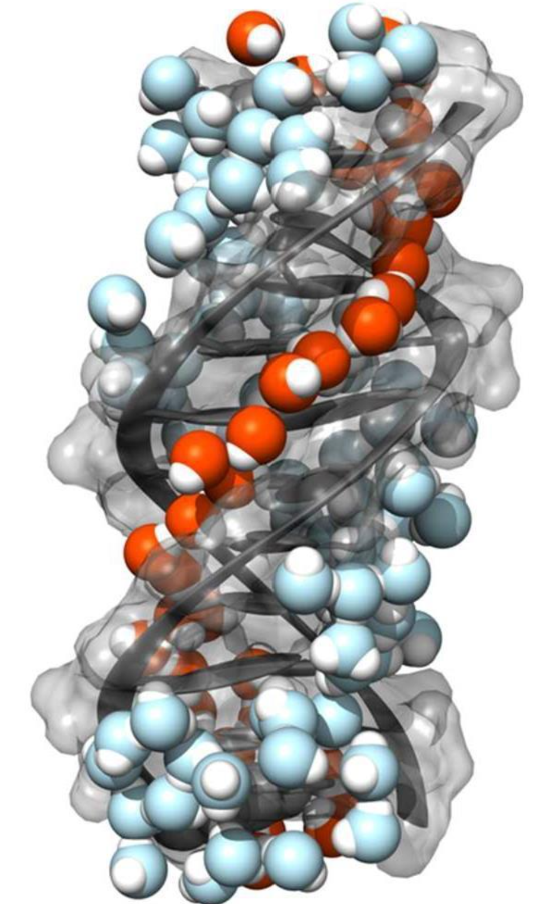
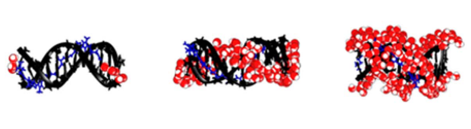

# Chapter 3. The Spatial Origin of Chirality: How Can Achiral Water Form a Chiral Hydration Structure?

{width="109"}

**The question we want to answer:** A single $\mathrm{H_2O}$ molecule is not chiral. So how can the water molecules surrounding DNA form a chiral structure? And if countless DNA molecules are randomly oriented within the interfacial plane, why doesn't their chirality disappear when we average over all of them?

In the first two chapters, we started from macroscopic group theory and polarization selection rules. We found that when an interface loses its vertical mirror symmetry—going from $C_{\infty v}$ to $C_\infty$—the chiral susceptibility component $\chi_{ZYX}^{(2)}$ becomes allowed. We also saw how psp polarization can isolate this component.

But now consider the O–H stretching spectrum of water. There is an apparent paradox: **water itself is not a chiral molecule.** If our experiment measures the vibrations of achiral water molecules, where does the chirality come from?

In this chapter, we will leave the microscopic hyperpolarizability $\beta_{ZYX}^{(2)}$, Raman tensors, and vibrational coupling aside for the moment. Instead, we will use **spatial geometry and statistical distributions** to work through four basic questions about *chirality transfer*.

## 3.1 Intrinsic Molecular Chirality vs. Supramolecular Chirality: Bricks and a Spiral Staircase

Let us start with a simple picture from architecture.

An ordinary rectangular brick has no handedness. There is no such thing as an intrinsically left-handed or right-handed brick. But if you arrange hundreds of these bricks around a central column to build a spiral staircase, the staircase can turn either clockwise or counterclockwise. **The individual building blocks are achiral, but the structure they form can be chiral.**

In chemistry and physics, we need to distinguish two different levels of chirality:

1.  **Intrinsic molecular chirality:** This is determined by the geometry of the covalent bonds within an individual, isolated molecule. A single water molecule ($\mathrm{H_2O}$) has a bent, planar structure and belongs to the $C_{2v}$ point group. It has two mutually perpendicular mirror planes: the molecular plane and the plane perpendicular to it that bisects the H–O–H bond angle. If we put a water molecule in front of a mirror, we can rotate its mirror image until it perfectly overlaps with the original. So an isolated water molecule is **achiral**.

2.  **Supramolecular structural chirality:** This is determined by how many molecules are positioned and oriented relative to one another in three-dimensional space. When hundreds or thousands of achiral water molecules form a hydrogen-bond network, their collective arrangement can become helical or twisted. Such an arrangement may no longer have mirror symmetry, even though every water molecule in it is achiral.

$$
\boxed{\text{Intrinsic molecular chirality} \ne \text{Supramolecular structural chirality}}
$$

This is the first point we need to understand about chiral hydration water. **When we ask whether a hydration layer is chiral, we are not asking whether an isolated** $\mathrm{H_2O}$ molecule is chiral. We are asking whether the three-dimensional arrangement of the entire hydration structure is chiral.

## 3.2 How Does DNA Transfer Its Helical Chirality to Water?

{width="320"}

Water molecules at an ordinary water interface do not spontaneously organize into a spiral staircase with one preferred handedness. So what acts as the scaffold that guides them into a chiral arrangement?

The answer is a **chiral molecular template**. A particularly familiar example is double-stranded DNA.

Natural B-DNA forms a right-handed double helix. When it is immersed in water or adsorbed at an interface, it presents three rather different hydration environments to the surrounding water molecules:

- **Minor groove:** A narrow, relatively deep helical groove containing polar hydrogen-bonding sites associated with bases such as adenine (A) and thymine (T).
- **Major groove:** A wider helical groove where water can form multiple hydrogen-bond networks.
- **Phosphate backbone:** The negatively charged sugar–phosphate chains winding around the outside of the double helix.

How does DNA imprint its handedness onto nearby water? Three physical effects work together: **directional hydrogen bonding, local electrostatic fields, and steric confinement within the grooves**. They influence not only **where** a water molecule sits (its position), but also **which way** it points (its orientation) and how its orientation is **twisted relative to neighboring water molecules**.

Here we need to make an important distinction between two kinds of ordered interfacial water:

- **Achiral oriented water:** Consider water next to an ordinary charged surface, such as a silica/water interface. The electric field can make the water dipoles preferentially point upward or downward, breaking inversion symmetry across the interface. Yet the statistical distribution within the interfacial plane can still be left–right symmetric. Reflect the entire water layer in a vertical mirror, and the statistical structure remains unchanged.

- **DNA-templated chiral hydration water:** Water molecules occupying the minor groove, major groove, or regions along the phosphate backbone can develop positional and orientational correlations that follow the right-handed structure of DNA. Reflect the entire hydration shell in a vertical mirror, and a right-handed hydration network becomes left-handed. The reflected structure can no longer be superimposed on the original.

In 2017, McDermott, Vanselous, Corcelli, Petersen, and colleagues published the well-known study *DNA's Chiral Spine of Hydration* in *ACS Central Science*. Using chiral vibrational spectroscopy, they reported a chiral supramolecular water structure templated by the DNA minor groove under room-temperature solution conditions. The picture is striking: achiral water molecules can form a chiral chain along the helical groove of DNA, rather like beads threaded onto a necklace.

## 3.3 Why Doesn't Random In-Plane Rotation Necessarily Destroy Chirality?

At this point, another question naturally comes up.

Even if the hydration shell around one DNA molecule is chiral, a real interfacial experiment contains many DNA molecules. They are not lined up in the same horizontal direction. Instead, they may point in every possible direction within the $XY$ plane. **Wouldn't averaging over all these random orientations cancel the chiral signal?**

This is a statistical-mechanics question. To answer it, we need to separate two things: **what random rotation averages away, and what it can leave intact**.

Suppose there are $N$ DNA molecules at the interface, all with the same helical handedness—for example, all right-handed B-DNA. Their in-plane azimuthal angles are

$$
\phi_1,\ \phi_2,\ \ldots,\ \phi_N.
$$

If the sample is macroscopically isotropic within the interface, as assumed for $C_\infty$ symmetry in Chapter 1, the azimuthal angle $\phi$ is uniformly distributed over $[0,2\pi)$:

$$
p(\phi)=\frac{1}{2\pi}.
$$

Now imagine ten thousand right-handed screws scattered randomly across a table. Each screw represents a DNA molecule surrounded by a right-handed hydration shell, and each has a random in-plane angle $\phi$.

- **What does random rotation cancel?** An **in-plane polar vector**. If one screw points along $+X$ ($\phi=0$), an equally probable screw points along $-X$ ($\phi=\pi$). Their horizontal vector components cancel when we average over the distribution.

- **What does random rotation not change?** The **handedness of the screw thread**. Pick up a right-handed screw and rotate it by any angle around the table's surface normal, $Z$. Can that rotation turn it into a left-handed screw? No. And rotating right-handed DNA around $Z$ cannot turn it into left-handed DNA either.

In linear algebra and group theory, an ordinary spatial rotation is called a **proper rotation**, with determinant $\det R=+1$. Proper rotations preserve handedness. A mirror reflection or spatial inversion, on the other hand, is an **improper transformation**, with $\det R=-1$. Such a transformation can map a right-handed object onto its left-handed mirror image.

So if all the DNA molecules at the interface have the same handedness—for example, the natural D-DNA form—randomizing their in-plane angles does not itself create equal populations of right- and left-handed structures. **Averaging ten thousand differently oriented right-handed structures does not automatically make the sample achiral.**

$$
\boxed{\text{Random in-plane orientation} \ne \text{Necessary cancellation of chirality}}
$$

**An important limitation:** This is a conclusion about geometry and statistical symmetry, not yet a proof that the SFG signal is nonzero. A $C_\infty$ orientational average can preserve net chirality; it does not require chirality to cancel as it would in an equal, racemic mixture of D-DNA and L-DNA. But what additional microscopic optical conditions must be satisfied before that geometric chirality produces a nonzero $\chi_{ZYX}^{(2)}$? That is what we will examine in Chapters 4 and 5.

## 3.4 Why Doesn't Orientationally Ordered Water Necessarily Have Net Chirality?

There is one more distinction we need to make before the physical picture of chiral water SFG becomes clear: **orientational order** and **structural chirality** are not the same statistical property.

The average dipole orientation of water, $\langle\boldsymbol{\mu}\rangle$, and the chirality of a hydration structure tell us different things about the distribution of water molecules.

- Consider the negatively charged phosphate backbone on the outside of DNA. It produces a local electrostatic field that can orient nearby water dipoles, potentially including water in the second or third hydration layer. The field biases the water molecules toward particular directions, giving a nonzero average dipole orientation:

  $$
  \left\langle\boldsymbol{\mu}\right\rangle\ne0.
  $$

- But **having a preferred direction is not the same as being chiral**. Suppose the water molecules simply tend to orient with their hydrogen atoms pointing toward the negative charge and their oxygen atoms pointing away. If their spatial and orientational distribution is still symmetric under reflection in a vertical plane, then

  $$
  \text{Net chiral response}=0.
  $$

The two types of SFG therefore respond to different kinds of order:

- **Conventional achiral SFG (such as ssp):** It is sensitive to interfacial inversion-symmetry breaking and orientational order, represented here by $\langle\mu_Z\rangle\neq0$. In this picture, it can receive contributions from the first hydration layer, the second layer, and more distant water molecules whose orientations are influenced by the electrostatic field.

- **Chiral SFG (such as the** $\chi_{ZYX}^{(2)}$ response measured with psp): A simple upward or downward orientational bias is not sufficient. This channel is sensitive to the part of the hydration structure that breaks **vertical mirror symmetry**, rather than merely having a preferred direction along $Z$.

This distinction is also central to the 2024 experimental and molecular-dynamics (MD) study of DNA hydration by Elsa Yan's group, which we will discuss in more detail in Chapter 6. According to the interpretation presented there, the water molecules closest to the DNA grooves and backbone—in the first hydration shell—inherit the chiral spatial correlations responsible for the $\chi_{ZYX}^{(2)}$ response. Water farther away may still feel DNA's electrostatic field and retain an orientational preference ($\langle\boldsymbol{\mu}\rangle\neq0$), but its statistical distribution becomes mirror-symmetric, so its contribution to the chiral SFG response vanishes.

## 3.5 What Have We Learned, and What Comes Next?

We can now summarize the geometric and statistical argument for chirality transfer:

$$
\boxed{
\begin{gathered}
\text{DNA has helical chirality}\\
\Downarrow\\
\text{Nearby water develops chiral spatial correlations}\\
\Downarrow\\
\text{Chirality can survive macroscopic rotational averaging}\\
\Downarrow\\
\chi_{ZYX}^{(2)}\text{ is allowed by symmetry}
\end{gathered}
}
$$

So far, everything seems to fit together. Chapter 1 tells us that macroscopic symmetry allows $\chi_{ZYX}^{(2)}\neq0$. Chapter 2 tells us how psp polarization can access this component. And Chapter 3 explains how the water surrounding DNA can acquire chiral spatial organization even though individual water molecules are achiral.

**But here is the real theoretical puzzle.** Suppose we now take a pen and paper and treat every O–H bond in the hydration layer as an independent local oscillator. We calculate its molecular hyperpolarizability $\beta_{ZYX}^{(2)}$ and average over the molecular orientations. What happens?

**The result is exactly zero. Why?**

That is the key theoretical turning point of this discussion—and the question we will take up in Chapter 4.