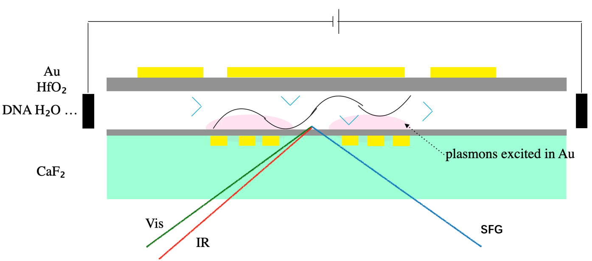

# Conclusion

Plasmon-enhanced SFG is unlikely to match the performance of commercial DNA nanopore sequencing, primarily because its signal-to-noise ratio (SNR) is too low over the required short acquisition times.

# Abstract

Commercial DNA nanopore sequencing typically operates at 400–450 nucleotides per second (nt/s) per pore, corresponding to approximately 2.2–2.5 ms per nucleotide \[1\]. Ionic-current readout supports long reads but does not separately resolve DNA vibrational signatures and the surrounding hydration environment. This proposal examines whether a **semiconductor-fabricated planar nanochannel** could support a localized, asymmetric Au-plasmon-enhanced SFG detection region at the interface between flowing DNA and HfO₂/water.

The proposed stack is **CaF₂ (or sapphire) IR window / patterned Au antenna / HfO₂ passivation / planar channel containing water, DNA, and ions / HfO₂ passivation / optional asymmetric Au antenna / upper chip cover**. **DNA, water, and ions contact only HfO₂; Au is not exposed to the solution.** IR (3000–3700 cm⁻¹) and VIS (e.g., 800 nm) light are preferentially coupled through the IR-transparent substrate, while SFG light (approximately 630 nm) is collected in an optimized reflection or transmission geometry. The target observable is the complex vibrational amplitude arising jointly from base N–H groups, hydration-water O–H groups, and water at the HfO₂ surface, rather than isolated vibrational peaks from only a few dozen molecules.

We estimate the photon budget and discrimination limits using geometric water counts, a Boyd–Hamm reference model for vibrational hyperpolarizability, three-frequency near-field coupling, and thermal and shot-noise models.

Four performance targets are evaluated: a local temperature rise no greater than 5 K, single-event SNR ≥ 5, effective optical contrast ≥ 10% for the most difficult base pair, and a target readout window ≤ 3 ms. **These are design targets, not demonstrated planar-channel performance.** Unlike a \~3 nm nanopore, a conventional planar channel does not inherently straighten DNA or move its bases sequentially through a hotspot. We therefore propose **sequence-dependent spectra from immobilized or position-controlled DNA** as the first milestone; continuous sequencing of individual DNA strands remains a higher-risk long-term objective.

# 1. Motivation: Can Plasmon-Enhanced SFG Compete with Commercial Nanopores?

## 1.1 Commercial Readout Speed and Research Goals

At 400 nt/s, the ideal translocation time of a 100 kb DNA strand is approximately 250 s. An optical readout time of 3 ms/nt corresponds to 333 nt/s, or about 300 s for 100 kb. Thus, 3 ms approaches—but does not quite match—the readout speed of a commercial single pore \[1\]. A planar channel could accommodate multiple DNA molecules, optical hotspots, and continuous sample flow. Its potential advantage is therefore parallel, multiparameter sensing, not necessarily faster single-strand sequencing.

SERS has resolved single-base vibrations in nanoslits \[2\]. In 2025, Khabarov et al. reported approximately 20 μs temporal resolution and \~89% single-event four-class classification accuracy for free nucleotides flowing through permeable plasmonic films \[3\]. Neither study demonstrates continuous sequencing of an unknown long DNA strand. Together, they establish an experimental basis for single-molecule vibrational identification and a **Raman benchmark that SFG must address**.

A potential advantage of SFG is the simultaneous detection of DNA-base N–H and interfacial/hydration-water O–H vibrations. Its sensitivity to molecular orientation and coherent phase may reveal DNA–water–surface interactions inaccessible to intensity-only measurements.

## 1.2 Four Target Metrics

Air/water-interface SFG experiments often require liquid-level control because heating and evaporation can affect the measurement. The device must likewise control temperature and provide sufficient SNR, nucleotide contrast, and acquisition speed.

| Metric | Initial target | Qualification |
|:-----------------------|-----------------------:|:-----------------------|
| Local temperature rise $\Delta T_{\max}$ | $\le 5\ \mathrm K$ | Assess steady-state and transient temperatures near Au, the liquid, and DNA |
| Signal-to-noise ratio (SNR) | $\ge 5$ | Per event, not after averaging multiple events |
| A/T/G/C contrast or discriminability $\delta_{\min}$ | $\ge 10\%$ | Include interfacial-water and metal backgrounds |
| Integration time per position $\tau$ | $\le 3\ \mathrm{ms}$ | Total DNA transit time through the channel is not the dwell time of one base |

The proposed progression is to establish a DNA-dependent spectral difference in interfacial water, demonstrate discrimination at one controlled DNA position, and only then test continuous dynamic base readout.

# 2. Planar Nanochannel Design and Preliminary Validation

## 2.1 Device Architecture and Fabrication

$$
\boxed{\mathrm{CaF_2\ /\ Au_{patterned}\ /\ HfO_2\ /\ (DNA+H_2O+ions)\ /\ HfO_2\ /\ Au_{optional}\ /\ cover}}
$$

Preliminary dimensions are:

| Parameter | Candidate range | Purpose |
|:-----------------------|:-----------------------|:-----------------------|
| Channel height $h$ | 10, 30, 100 nm | Balance water confinement, DNA accessibility, and fabrication yield |
| Channel width $W_c$ | 0.1–5 μm | Compatible with etching, bonding, and microfluidic injection |
| Channel length | 10–500 μm | Connect to macroscopic reservoirs; only part of the channel is illuminated |
| HfO₂ passivation thickness $t_d$ | 1–3 nm | Isolate Au from solution while keeping the hotspot close to water |
| In-plane optical hotspot size | 5–50 nm (parameter sweep) | Balance localization against the number of effective vibrational sources |
| IR, VIS, SFG | \~3 μm, 800 nm, 630 nm | Calculate field overlap and far-field outcoupling separately |

The 10 nm-high channel is intended to investigate confined water and macromolecular transport, **not** to ensure automatic single-base stepping. For ssDNA of known length, entrance-induced alignment, wall adhesion, flow velocity, and conformational distributions must also be examined.

## 2.2 Relevant Fabrication and Optical Studies

Six prior studies provide fabrication and spectroscopic precedents for Au planar nanochannels with CaF₂ or sapphire, surface-enhanced infrared absorption (SEIRA), confined-water vibrations, interfacial reaction kinetics, and SERS nucleobase identification \[2–7\]. However, they do not demonstrate single-molecule SFG detection in an Au/HfO₂ planar nanochannel.

## 2.3 Why HfO₂?

HfO₂ can be conformally deposited on etched channel walls by atomic layer deposition (ALD), offering a relatively straightforward passivation route. Its optical properties may be compatible with the selected IR, VIS, and SFG wavelengths, and it may slow DNA motion. Relative to common channel materials such as SiO₂ and SiNₓ, its possible advantages should be assessed against measurable criteria: OH-SFG amplitude and phase of interfacial water, hydroxyl background, salt and pH response, near-field attenuation after conformal coating, and stability under sustained flow. These advantages remain to be established for the proposed device.

## 2.4 IR and VIS Illumination Through CaF₂

Backside illumination through CaF₂ reduces the IR propagation distance in bulk water at wavelengths near 3 μm, an approach commonly used to limit water absorption. Taking a reference absorption coefficient $\alpha_{\mathrm{IR}}=1.25\ \mu\mathrm m^{-1}$ in the OH region, a minimal propagation model gives

$$
T_{\mathrm{IR}}(h)=\exp(-\alpha_{\mathrm{IR}}h).
$$

| Water optical path | IR intensity transmission (reference model) |
|:-------------------|--------------------------------------------:|
| 10 nm              |                                      98.76% |
| 30 nm              |                                      96.32% |
| 100 nm             |                                      88.25% |
| 0.6 μm             |                                      47.24% |

# 3. DNA–Hydration-Water Vibrations and Water Counts in Planar Geometry

## 3.1 Candidate Vibrational Signals

| IR range | Potential dominant response | Relevance to the device |
|:-----------------|:--------------------------|:--------------------------|
| 3000–3350 cm⁻¹ | DNA N–H; strongly hydrogen-bonded water O–H | Overlap of direct base response and water reorganization |
| 3350–3500 cm⁻¹ | Amino N–H; interfacial-water O–H | Principal candidate detection band |
| 3500–3650 cm⁻¹ | Weakly hydrogen-bonded water; some oxide OH groups | Comparison band for hydration states |
| 3650–3700 cm⁻¹ | Weakly hydrogen-bonded water and surface OH | Possible hydroxylation marker; assignment requires caution |

In 2024, Yan and co-workers used **chiral SFG** to detect N–H vibrations of DNA base pairs and O–H vibrations in the first hydration shell \[8\]. Their experiments probed a much larger DNA/water ensemble than is expected in the proposed hotspot.

## 3.2 Number of Water Molecules in a Planar Channel

Consider two parallel HfO₂ walls separated by height $h$, with a local optical hotspot of in-plane area $A_{\mathrm{hot}}=w\ell$. Let the water number density be $\rho_w=33.4\ \mathrm{nm}^{-3}$ and the first water layer at each wall have thickness $d_w=0.30$ nm. Neglecting volume excluded by DNA and ions,

$$
\begin{aligned}
N_{\mathrm{all}}&\simeq\rho_w A_{\mathrm{hot}}h,\\
N_{\mathrm{wall,one}}&\simeq\rho_w A_{\mathrm{hot}}d_w,\\
N_{\mathrm{wall,two}}&\simeq2\rho_w A_{\mathrm{hot}}d_w.
\end{aligned}
$$

**Table 1.** Geometric counts for $h=10$ nm and a square effective hotspot $w=\ell=a$:

| Hotspot $a\times a$ | Water molecules in channel | Water in the 0.3 nm layers at both walls | Nucleotides spanning hotspot length$^*$ |
|:-----------------|-----------------:|-----------------:|-----------------:|
| 5×5 nm² | 8,350 | 501 | \~9 |
| 10×10 nm² | 33,400 | 2,004 | \~18 |
| 20×20 nm² | 133,600 | 8,016 | \~36 |
| 50×50 nm² | 835,000 | 50,100 | \~91 |

$^*$Assuming an extended axial spacing of 0.55 nm/nt.

{#fig-watercounts width="85%"}

For a 20×20 nm² hotspot, the first water layers at both walls already contain approximately **8,000 water molecules**. A given base may directly perturb only \~6–10 hydration waters and indirectly reorient several dozen more. If all molecules were weighted equally, this large static background would dilute the single-base difference. However, SFG weights depend on orientation, cancellation between opposite walls, and localized near fields. The geometric count of 8,000 molecules cannot simply be inserted into an $N^2$ intensity law.

To illustrate geometric dilution, consider a deliberately idealized model in which **15 water molecules reverse their orientation completely**, while all remaining wall waters carry equal weights:

$$
\delta_{\mathrm{water}}^{\mathrm{toy}}\simeq
2\frac{15}{N_{\mathrm{wall,two}}}.
$$

For square hotspots of side lengths 5, 10, 20, and 50 nm, this gives approximately **6.0%, 1.50%, 0.37%, and 0.060%**, respectively. This illustrative model assumes coherent contributions from the upper and lower interfaces and an observable absolute background. It is **not a prediction of experimental contrast between the four bases**; differences in water counts also cannot be identified directly with changes in net orientational amplitude.

## 3.3 Effective Complex Amplitude

For a controlled DNA state $b$,

$$
\begin{aligned}
A_b(\omega)={}&A_{\mathrm{Au,NR}}(\omega)
+A_{\mathrm{HfO_2}}(\omega)
+A_{\mathrm{water,upper},b}(\omega)\\
&+A_{\mathrm{water,lower},b}(\omega)
+A_{\mathrm{DNA},b}(\omega).
\end{aligned}
$$

$A_{\mathrm{DNA},b}$ includes N–H modes and possible backbone contributions. The water response may also contain nonlocal $\chi^{(3)}E_{\rm DC}$ terms, as discussed in prior work on charged aqueous interfaces, including that of Hongfei Wang and Franz Geiger. Because the surface normals of the two walls are opposed, their OH amplitudes may partially cancel in a given polarization channel. **An asymmetric Au antenna changes the spatial weighting; it does not ensure that the molecular orientations at the two walls contribute in phase.** Additional contributions, including possible chiral hydration-water responses around DNA inside the nanochannel, are not yet included in this simplified model.

At a selected frequency and collection mode, define the complex amplitude in units of the reference SFG field of one OH oscillator:

$$
\mathcal N_b\equiv A_{\mathrm{molecular},b}/A_{\mathrm{OH,ref}},
\qquad
\Delta\mathcal N_{bb'}=\mathcal N_b-\mathcal N_{b'}.
$$

$|\mathcal N_b|$ may increase with hotspot area. **Base discrimination, however, depends on** $|\Delta\mathcal N_{bb'}|$ and its phase projection, not simply on the total water count.

# 4. Signal-to-Noise Ratio of Au/HfO₂-Enhanced SFG

Starting from the water and DNA vibrations inside the plasmonic hotspot, this section estimates the Au-enhanced SFG photon rate, optical contrast between base states, and achievable SNR over 10 ms and 3 ms. If these windows are insufficient, we estimate the integration time needed for immobilized DNA. All calculations use the same reference OH oscillator at 3400 cm⁻¹, laser conditions, and detection efficiency. They represent **device-design scenarios**, not measured device performance.

## 4.1 How Many Water Molecules, O–H Bonds, and DNA N–H Bonds Contribute?

Using the geometry from Section 3, take a planar channel of height $h=10\ \mathrm{nm}$ and a square hotspot of side length $a$. With water number density $\rho_w=33.4\ \mathrm{nm^{-3}}$ and a first water layer of thickness $d_w=0.30\ \mathrm{nm}$ at each HfO₂ wall,

$$
\begin{aligned}
N_{\mathrm{water}}&=\rho_w a^2h,\\
N_{\mathrm{wall,two}}&=2\rho_w a^2d_w,\\
N_{\mathrm{OH,wall}}&=2N_{\mathrm{wall,two}}=4\rho_w a^2d_w.
\end{aligned}
$$

**Table 4-1. Geometric counts of water molecules and first-layer O–H bonds inside the hotspot.**

| Hotspot area | All water molecules | First-layer water at both walls | First-layer O–H at both walls | ssDNA bases along the flow direction\* |
|:--------------|--------------:|--------------:|--------------:|--------------:|
| $5\times5\ \mathrm{nm^2}$ | 8,350 | 501 | 1,002 | \~9 |
| $10\times10\ \mathrm{nm^2}$ | 33,400 | 2,004 | 4,008 | \~18 |
| $20\times20\ \mathrm{nm^2}$ | 133,600 | 8,016 | 16,032 | \~36 |
| $50\times50\ \mathrm{nm^2}$ | 835,000 | 50,100 | 100,200 | \~91 |

\*Estimated using an axial projection of $0.55\ \mathrm{nm/nt}$ between successive nucleotides of extended ssDNA. These are volume-based counts; they do not imply that all OH bonds generate coherent SFG.

The approximate number of N–H bonds per base is A: 2, G: 3, C: 2, and T: 1. Simulations of isolated hydrated bases by Furmanchuk et al. give mean first-shell water counts of 6.87 (A), 8.52 (G), 6.12 (C), and 6.42 (T) \[10\]. For single-base discrimination, the relevant question is not the total number of waters near the hotspot, but **the effective O–H/N–H vibrational response induced by that base**.

## 4.2 SFG Response of a Single O–H Oscillator

In Boyd's driven-oscillator model, an IR field drives the O–H stretch, while the VIS field couples through the bond-length dependence of the electronic polarizability, producing an SFG dipole \[1,2\]:

$$
p_{\mathrm{SFG},1}=\beta_{\mathrm{OH}}^{(2)}E_{\mathrm{IR}}E_{\mathrm{VIS}}.
$$

The resonant hyperpolarizability is

$$
\left|\beta_{\mathrm{OH}}^{(2)}\right|\simeq\frac{|\alpha'\mu'|}{2m\gamma\omega_0}.
$$

Using $\tilde\nu_0=3400\ \mathrm{cm^{-1}}$, $m=1.56\times10^{-27}\ \mathrm{kg}$, $\mu'=2\ \mathrm{D/\mathring A}$, a polarizability-volume derivative $\alpha'_{\mathrm{vol}}=1\ \mathrm{\mathring A^2}$, and damping parameter $\gamma/(2\pi c)=100\ \mathrm{cm^{-1}}$ gives

$$
\boxed{|\beta_{\mathrm{OH,ref}}^{(2)}|\simeq1.97\times10^{-51}\ \mathrm{C\,m^3/V^2}.}
$$

Hydrogen bonding, confinement, and the surface electrical double layer can alter the vibrational transition dipole, Raman polarizability, and vibrational coupling of water \[3,4\]. Holding other parameters fixed, increases of 1.5 or 2 in the dipole derivative would multiply photon rates by 2.25 or 4, because the rate scales with $|\beta^{(2)}|^2$. We therefore examine three sensitivity scenarios:

$$
\boxed{q_\beta\equiv\left|\frac{\beta_{\mathrm{eff}}}{\beta_{\mathrm{OH,ref}}}\right|^2=1,\ 2.25,\ 4.}
$$

These correspond to 1, 2.25, and 4 times the reference photon rate; the larger values are deliberately optimistic. Because the reference oscillator is already chosen near 3400 cm⁻¹, where hydrogen-bonded water commonly absorbs, **the latter two cases are sensitivity tests, not established additional enhancements**.

From the radiation power of an oscillating dipole \[1\],

$$
P_{\mathrm{rad},1}=\frac{\omega_{\mathrm{SFG}}^4|p_{\mathrm{SFG},1}|^2}{12\pi\varepsilon_0c^3},\qquad
n_{\gamma,1}\simeq\frac{P_{\mathrm{rad},1}\tau_p}{\hbar\omega_{\mathrm{SFG}}}.
$$

Taking VIS at 800 nm, IR at $3400\ \mathrm{cm^{-1}}$, an effective pulse duration of 1 ps, VIS/IR pulse fluences of $0.4/0.6\ \mathrm{mJ\,cm^{-2}}$, a repetition rate of 37.6 MHz, and 10% overall collection and detection efficiency gives a detected rate per reference oscillator of

$$
\boxed{K_{0,\mathrm{ref}}=5.62\times10^{-12}\ \mathrm{photons/s}.}
$$

The three reference rate coefficients are:

| $q_\beta$ | Reference detected rate per oscillator $q_\beta K_{0,\mathrm{ref}}$ |
|------------------:|----------------------------------------------------:|
| 1 | $5.62\times10^{-12}\ \mathrm{s^{-1}}$ |
| 2.25 | $1.2645\times10^{-11}\ \mathrm{s^{-1}}$ |
| 4 | $2.248\times10^{-11}\ \mathrm{s^{-1}}$ |

Throughout, **the original reference OH oscillator** defines the amplitude unit, avoiding double-counting any change in effective OH number.

## 4.3 Water Orientation and Asymmetry Between the Two Walls

Interfacial O–H orientations determine whether SFG amplitudes add or partially cancel. Let $f_{\mathrm{ori}}$ describe the mean orientational projection of water oscillators and $\eta_{\mathrm{asym}}$ quantify the differential optical weighting introduced by the intentionally asymmetric plasmonic geometry.

Phase-resolved SFG has measured water orientation at SiO₂/water interfaces \[5\]. SFG and simulations have resolved adsorbed water and charge-dependent reorientation at TiO₂/water interfaces \[6,7\]. VSFG measurements on yttria-stabilized zirconia have also resolved adsorbed-water and hydroxyl vibrations \[8\]. Based on these related oxides, we provisionally choose

$$
\boxed{f_{\mathrm{ori}}=0.05}
$$

as the central scenario for first-layer water at HfO₂, with $0.01$–$0.15$ as a sensitivity range. **The value 0.05 is inferred from related oxide systems; it is not a measured HfO₂ value reported in \[5–8\].**

In a simplified model with comparable water responses but opposing net SFG directions at the two walls, set the lower-wall optical amplitude weight to 1 and the upper-wall weight to $r$. Then

$$
\begin{aligned}
|\mathcal N_0|&\simeq N_{\mathrm{OH,wall}}f_{\mathrm{ori}}\eta_{\mathrm{asym}},\\
\eta_{\mathrm{asym}}&\equiv\frac{|1-r|}{2}.
\end{aligned}
$$

For $\eta_{\mathrm{asym}}=0.25$, $r=0.50$: the lower-wall amplitude is twice that of the upper wall. For $\eta_{\mathrm{asym}}=0.40$, $r=0.20$: the lower-wall amplitude is five times larger. Varying the upper/lower HfO₂ thicknesses and Au antenna geometry may modify these weights, but the attainable ratios depend on the IR, VIS, and SFG near fields.

**Table 4-2. Effective OH-equivalent amplitudes with** $f_{\mathrm{ori}}=0.05$.

| Hotspot area | Geometric first-layer OH count | $\eta_{\mathrm{asym}}=0.25$ | $\eta_{\mathrm{asym}}=0.40$ |
|:-----------------|-----------------:|-----------------:|-----------------:|
| $5\times5\ \mathrm{nm^2}$ | 1,002 | 12.53 | 20.04 |
| $10\times10\ \mathrm{nm^2}$ | 4,008 | 50.10 | 80.16 |
| $20\times20\ \mathrm{nm^2}$ | 16,032 | **200.40** | **320.64** |
| $50\times50\ \mathrm{nm^2}$ | 100,200 | 1,252.5 | 2,004 |

We subsequently compare a **small hotspot**, $5\times5\ \mathrm{nm^2}$ with $\eta=0.40$ ($\mathcal N_0=20.04$), and a **large hotspot**, $20\times20\ \mathrm{nm^2}$ with $\eta=0.25$ ($\mathcal N_0=200.40$). The small hotspot offers greater spatial selectivity; the large one yields a stronger total resonant signal. A 50 nm hotspot spans approximately 91 bases, so its total photon rate cannot represent single-base readout directly.

An illustrative estimate of the surface second-order susceptibility of the first water layer at one wall is

$$
\chi_{s,\mathrm{OH}}^{(2)}\sim\frac{2\rho_wd_wf_{\mathrm{ori}}\beta_{\mathrm{OH,ref}}^{(2)}}{\varepsilon_0}
\simeq(4.46\times10^{-21})f_{\mathrm{ori}}\ \mathrm{m^2/V}.
$$

For $f_{\mathrm{ori}}=0.05$, this yields $|\chi_s^{(2)}|\sim2.23\times10^{-22}\ \mathrm{m^2/V}$.

## 4.4 Can Water O–H and DNA N–H Contribute to the Same SFG Signal?

Yes. At a **selected IR frequency**, the detector measures the SFG optical field generated by the accessible vibrations. Where O–H and N–H bands overlap, their amplitudes combine coherently with their relative phases; otherwise they can be probed separately by tuning the IR frequency. Perets et al. used chiral SFG to measure vibrational signatures of DNA base pairs and their first hydration shells \[11\].

Using the SFG field of one reference OH oscillator as the amplitude unit, define

$$
\mathcal N_b=\mathcal N_{\mathrm{water},b}+\mathcal N_{\mathrm{NH},b}+\mathcal N_{\mathrm{surface},b}.
$$

For sequencing, the objective is not to maximize the total signal alone, but to obtain a sufficiently large differential response between base states $b$ and $b'$: $\Delta\mathcal N_{bb'}=\mathcal N_{b'}-\mathcal N_b$.

## 4.5 How Many Photons Can Be Detected After Au Enhancement?

The effective three-frequency enhancement represents the combined effects of local IR and VIS excitation and SFG far-field outcoupling:

$$
G_{\mathrm{eff}}=|L_{\mathrm{IR}}L_{\mathrm{VIS}}L_{\mathrm{out}}|^2.
$$

The resonant SFG photon rate for base state $b$ is

$$
\boxed{R_b=K_{0,\mathrm{ref}}\,q_\beta\,G_{\mathrm{eff}}|\mathcal N_b|^2.}
$$

**Table 4-3. Detected counts for the large hotspot**, $20\times20\ \mathrm{nm^2}$, $f_{\mathrm{ori}}=0.05$, $\eta_{\mathrm{asym}}=0.25$ ($\mathcal N_0=200.4$).

| $G_{\mathrm{eff}}$ | $q_\beta=1$: photons/s | $q_\beta=1$: photons/10 ms | $q_\beta=2.25$: photons/10 ms | $q_\beta=4$: photons/10 ms |
|--------------:|--------------:|--------------:|--------------:|--------------:|
| $10^6$ | 0.226 | 0.00226 | 0.00508 | 0.00903 |
| $10^7$ | 2.26 | 0.0226 | 0.0508 | 0.0903 |
| $10^8$ | 22.57 | **0.2257** | **0.5078** | **0.9028** |

For stronger wall selectivity, $\eta_{\mathrm{asym}}=0.40$, the large hotspot has $|\mathcal N_0|=320.64$. At $G=10^8$, the predicted 10 ms photon counts are **0.578, 1.300, and 2.311** for $q_\beta=1,2.25,4$, respectively.

**Table 4-4. Ten-millisecond photon counts for the small hotspot**, $5\times5\ \mathrm{nm^2}$, $\eta_{\mathrm{asym}}=0.40$ ($\mathcal N_0=20.04$).

| $G_{\mathrm{eff}}$ | $q_\beta=1$ | $q_\beta=2.25$ | $q_\beta=4$ |
|-----------------:|-----------------:|-----------------:|-----------------:|
| $10^6$ | $2.26\times10^{-5}$ | $5.08\times10^{-5}$ | $9.03\times10^{-5}$ |
| $10^7$ | $2.26\times10^{-4}$ | $5.08\times10^{-4}$ | $9.03\times10^{-4}$ |
| $10^8$ | **0.00226** | **0.00508** | **0.00903** |

The small hotspot offers better spatial selectivity, but all modeled cases yield far fewer than one detected photon in 10 ms. Even the most optimistic large-hotspot case—$G=10^8$, $q_\beta=4$, and $\eta=0.40$—produces only about 2.31 resonant photons in 10 ms.

## 4.6 Discriminating Different DNA Bases

Assume that adjacent base states share most of their vibrational response and differ only by a small component. We test OH-equivalent differential amplitudes $|\Delta\mathcal N|=2,5,10,20$. Values of 2 and 5 represent weaker and stronger single-base test cases; 10 and 20 represent more pronounced cooperative water reorientation or multi-site changes. **These are photon-budget test cases, not experimental calibrations of A, T, G, or C.**

Define the optical contrast between base states as

$$
\delta_{bb'}=\frac{|R_{b'}-R_b|}{(R_b+R_{b'})/2}.
$$

For the most favorable phase relation, set $\mathcal N_b=\mathcal N_0$ and $\mathcal N_{b'}=\mathcal N_0+\Delta\mathcal N$.

**Table 4-5. Optical contrast for two hotspot sizes.**

| $|\Delta\mathcal N|$ | Small hotspot $\mathcal N_0=20.04$ | Large hotspot $\mathcal N_0=200.40$ |
|-----------------------:|-----------------------:|-----------------------:|
| 2 | 18.97% | 1.99% |
| 5 | 43.83% | 4.93% |
| 10 | 76.81% | 9.73% |
| 20 | 119.87% | 18.97% |

This symmetric intensity-contrast definition has an upper bound of 200%. Thus, a large differential response can produce greater than 100% contrast in the small hotspot, but does not imply easy detection because very few photons are collected. A larger $G$ or common $q_\beta$ increases photon counts but **does not automatically increase relative contrast** in this table.

Assuming a well-calibrated reference state and photon shot noise only,

$$
\boxed{\mathrm{SNR}_{bb'}\simeq\delta_{bb'}\sqrt{\bar R\tau},\qquad \bar R=\frac{R_b+R_{b'}}{2}.}
$$

**Table 4-6. Ideal single-event SNR in 10 ms for the large hotspot**, $\mathcal N_0=200.40$, $G=10^8$.

| $|\Delta\mathcal N|$ | $q_\beta=1$ | $q_\beta=2.25$ | $q_\beta=4$ |
|---------------------:|------------:|---------------:|------------:|
|                    2 |      0.0095 |         0.0142 |      0.0190 |
|                    5 |      0.0237 |         0.0356 |      0.0474 |
|                   10 |      0.0474 |         0.0711 |      0.0948 |
|                   20 |      0.0947 |         0.1421 |  **0.1894** |

For $G=10^6$ or $10^7$, multiply the listed SNR values by 0.1 or $\sqrt{0.1}\approx0.316$, respectively. For the small hotspot, $\mathcal N_0=20.04$, $G=10^8$, and $q_\beta=4$, the corresponding 10 ms ideal SNR values are 0.0189, 0.0471, 0.0930, and 0.1799 for differential amplitudes of 2, 5, 10, and 20. All remain well below 5.

## 4.7 Can Bases Be Distinguished Within 3 ms?

With other conditions fixed, SNR scales as the square root of integration time:

$$
\mathrm{SNR}_{3\mathrm{ms}}=\mathrm{SNR}_{10\mathrm{ms}}\sqrt{\frac{3}{10}}.
$$

**Table 4-7. Comparison of 10 ms and 3 ms integration for the large hotspot**, $\mathcal N_0=200.40$, $G=10^8$, $q_\beta=4$.

| $|\Delta\mathcal N|$ | Ideal SNR, 10 ms | Ideal SNR, 3 ms |
|---------------------:|-----------------:|----------------:|
|                    2 |           0.0190 |          0.0104 |
|                    5 |           0.0474 |          0.0260 |
|                   10 |           0.0948 |          0.0519 |
|                   20 |           0.1894 |      **0.1038** |

Under the stipulated scenarios with $G\le10^8$, the ideal single-event SNR is far below the target of 5 for both 10 ms and 3 ms acquisition.

## 4.8 Integration Time Required for Immobilized DNA

If the common background greatly exceeds the differential field and the phase relation maximizes the intensity change, a useful approximation is

$$
\mathrm{SNR}\simeq2|\Delta\mathcal N|\sqrt{K_{0,\mathrm{ref}}q_\beta G_{\mathrm{eff}}\tau}
$$

Using the complete contrast expression from the preceding section, the integration time required for SNR = 5 is:

**Table 4-8. Ideal integration time for SNR = 5 in the large hotspot**, $\mathcal N_0=200.40$, $G=10^8$.

| $|\Delta\mathcal N|$ | $q_\beta=1$ | $q_\beta=2.25$ | $q_\beta=4$ |
|---------------------:|------------:|---------------:|------------:|
|                    2 |    46.3 min |       20.6 min |    11.6 min |
|                    5 |    7.42 min |       3.30 min |   **111 s** |
|                   10 |       111 s |         49.5 s |  **27.8 s** |
|                   20 |      27.9 s |         12.4 s |  **6.97 s** |

Likewise, the effective enhancement required to reach SNR = 5 within 10 ms (taking $q_\beta=4$) is:

| $|\Delta\mathcal N|$ | Required $G_{\mathrm{eff}}$ (10 ms) | Required $G_{\mathrm{eff}}$ (3 ms) |
|-----------------------:|-----------------------:|-----------------------:|
| 2 | $6.95\times10^{12}$ | $2.32\times10^{13}$ |
| 5 | $1.11\times10^{12}$ | $3.71\times10^{12}$ |
| 10 | $2.78\times10^{11}$ | $9.27\times10^{11}$ |
| 20 | $6.97\times10^{10}$ | $2.32\times10^{11}$ |

These integration times, ranging from seconds to minutes, apply to immobilized DNA, a stable single state, or a repeatedly sampled identical specimen. A flowing DNA strand would not naturally keep a single base in the hotspot for so long.

## 4.9 How Much Enhancement Can Plasmonics Provide?

Guo et al. reported approximately 30-fold plasmon-enhanced SFG (PE-SFG) enhancement in Au nanohole arrays \[12\]. Sakurai et al. estimated tip-enhanced SFG (TE-SFG) enhancement factors of approximately $6.3\times10^6$–$1.3\times10^7$ \[13\]. Roelli et al. reported local SFG enhancement on the order of $10^{14}$ in a tip–nanoparticle-on-mirror (NPoM) nanocavity \[14\]. These figures refer to different geometries and reference systems and **cannot be equated directly with** $G_{\mathrm{eff}}$ at the solution-facing HfO₂ interface. We therefore treat $G=10^6$–$10^8$ as engineering scenarios requiring validation.

**Conclusion.** Under the unified assumptions $q_\beta=1,2.25,4$, $f_{\mathrm{ori}}=0.05$, and $\eta_{\mathrm{asym}}=0.25$ or 0.40, neither 10 ms nor 3 ms integration achieves the single-event SNR target of 5. Shrinking the hotspot improves spatial selectivity and relative optical contrast but sharply reduces detected photons. Increasing hotspot size raises the total signal but also averages over multiple nucleotides.

## References for Section 4

\[1\] Boyd, R. W. *Nonlinear Optics*, 4th ed. Academic Press (2020).

\[2\] Hamm, P. & Zanni, M. T. *Concepts and Methods of 2D Infrared Spectroscopy*. Cambridge University Press (2011).

\[3\] Schmidt, J. R., Corcelli, S. A. & Skinner, J. L. Pronounced non-Condon effects in the ultrafast infrared spectroscopy of water. *J. Chem. Phys.* **123**, 044513 (2005). https://doi.org/10.1063/1.1961472

\[4\] Auer, B. M. & Skinner, J. L. IR and Raman spectra of liquid water: Theory and interpretation. *J. Chem. Phys.* **128**, 224511 (2008). https://doi.org/10.1063/1.2925258

\[5\] Urashima, S.-h., Myalitsin, A., Nihonyanagi, S. & Tahara, T. The Topmost Water Structure at a Charged Silica/Aqueous Interface Revealed by Heterodyne-Detected Vibrational Sum Frequency Generation Spectroscopy. *J. Phys. Chem. Lett.* **9**, 4109–4114 (2018). https://doi.org/10.1021/acs.jpclett.8b01650

\[6\] Hosseinpour, S. et al. Chemisorbed and Physisorbed Water at the TiO₂/Water Interface. *J. Phys. Chem. Lett.* **8**, 2195–2199 (2017). https://doi.org/10.1021/acs.jpclett.7b00564

\[7\] Schlegel, S. J. et al. How water flips at charged titanium dioxide: an SFG-study on the water–TiO₂ interface. *Phys. Chem. Chem. Phys.* **21**, 8956–8964 (2019). https://doi.org/10.1039/C9CP01131E

\[8\] Adhikari, N. M., Hou, B. & Allen, H. C. Vibrational sum frequency generation (VSFG) spectroscopy of water adsorption on surfaces of yttria-stabilized cubic zirconia (YSZ). *J. Chem. Phys.* **161**, 194701 (2024). https://doi.org/10.1063/5.0231569

\[9\] Morita, A. & Hynes, J. T. A theoretical analysis of the sum frequency generation spectrum of the water surface. *Chem. Phys.* **258**, 371–390 (2000). https://doi.org/10.1016/S0301-0104(00)00127-0

\[10\] Furmanchuk, A., Isayev, O., Shishkin, O. V., Gorb, L. & Leszczynski, J. Hydration of nucleic acid bases: a Car–Parrinello molecular dynamics approach. *Phys. Chem. Chem. Phys.* **12**, 3363 (2010). https://doi.org/10.1039/B923930H

\[11\] Perets, E. A. et al. Beyond the “spine of hydration”: Chiral SFG spectroscopy detects DNA first hydration shell and base pair structures. *J. Chem. Phys.* **161**, 095104 (2024). https://doi.org/10.1063/5.0220479

\[12\] Guo, W. et al. Plasmonic Gold Nanohole Arrays for Surface-Enhanced Sum Frequency Generation Detection. *Nanomaterials* **10**, 2557 (2020). https://doi.org/10.3390/nano10122557

\[13\] Sakurai, A. et al. Tip-enhanced sum frequency generation spectroscopy using temporally asymmetric pulse for detecting weak vibrational signals. *J. Chem. Phys.* **164**, 074202 (2026). https://doi.org/10.1063/5.0310824

\[14\] Roelli, P. et al. In-operando control of sum-frequency generation in tip-enhanced nanocavities. *Light Sci. Appl.* **14**, 203 (2025). https://doi.org/10.1038/s41377-025-01855-5

## Final Numerical Audit: Calculations and Scope

1.  **Arithmetic checks completed.** Geometric water counts, $\beta_{\mathrm{OH,ref}}^{(2)}$, $K_{0,\mathrm{ref}}$, $q_\beta$, equivalent amplitudes, photon counts, intensity contrast, 10 ms/3 ms SNR, and required integration times were independently recalculated using a consistent set of equations. Complete data are provided in the accompanying script and CSV files.
2.  **Numerical corrections.** The $q_\beta=25,50$ cases were removed. With $f_{\mathrm{ori}}=0.05$ throughout, the small-hotspot amplitude is $|\mathcal N_0|=20.04$ (not 40), and the large-hotspot amplitude is $|\mathcal N_0|=200.4$ ($\eta=0.25$) or 320.64 ($\eta=0.40$). For the large hotspot at $G=10^8$ and 10 ms, the revised photon counts are 0.2257, 0.5078, and 0.9028.
3.  **Parameters requiring experimental or computational validation.** The assumptions $f_{\mathrm{ori}}=0.05$, $\eta_{\mathrm{asym}}=0.25/0.40$, $G=10^6$–$10^8$, and differential base amplitudes $|\Delta\mathcal N|=2$–20 are not measurements of HfO₂ single-base performance. Asymmetric weighting of the two walls is already included in $\mathcal N_0$, while $G$ represents the defined three-frequency enhancement at the lower wall, avoiding double-counting.
4.  **Unresolved engineering constraints.** The photon rates retain the original pulse fluences and 10% detection efficiency, but **do not establish a local temperature rise of** $\Delta T\le5\ \mathrm K$. Moreover, in the sparse-photon regime, actual single-event base classification requires a Poisson treatment rather than Gaussian SNR alone. The geometric baseline remains $h=10$ nm. Increasing the channel height to 20–30 nm to reduce DNA trapping would require new calculations of field distributions, DNA–lower-wall distance, and background.

# References

\[1\] Oxford Nanopore Technologies. *Continuous Development and Improvement.* <https://nanoporetech.com/about/continuous-development-and-improvement>

\[2\] Chen, C. et al. *High spatial resolution nanoslit SERS for single-molecule nucleobase sensing.* **Nature Communications** **9**, 1733 (2018). <https://doi.org/10.1038/s41467-018-04118-7>

\[3\] Khabarov, K. et al. *Raman identification of single nucleotides flowing through permeable plasmonic films.* **Nature Communications** **16**, 9113 (2025). <https://doi.org/10.1038/s41467-025-64165-9>

\[4\] Le, T. H. H. et al. *Fabrication of Infrared-Compatible Nanofluidic Devices for Plasmon-Enhanced Infrared Absorption Spectroscopy.* **Micromachines** **11**, 1062 (2020). <https://doi.org/10.3390/mi11121062>

\[5\] Le, T. H. H., Morita, A., Mawatari, K., Kitamori, T. & Tanaka, T. *Metamaterials-Enhanced Infrared Spectroscopic Study of Nanoconfined Molecules by Plasmonics–Nanofluidics Hybrid Device.* **ACS Photonics** **5**, 3179–3188 (2018). <https://doi.org/10.1021/acsphotonics.8b00398>

\[6\] Xu, J. et al. *Nanometer-Scale Heterogeneous Interfacial Sapphire Wafer Bonding for Enabling Plasmonic-Enhanced Nanofluidic Mid-Infrared Spectroscopy.* **ACS Nano** **14**, 12159–12172 (2020). <https://doi.org/10.1021/acsnano.0c05794>

\[7\] Duan, C. et al. *Label-Free Electrical Detection of Enzymatic Reactions in Nanochannels.* **ACS Nano** **10**, 7476–7484 (2016). <https://doi.org/10.1021/acsnano.6b02062>

\[8\] Perets, E. A. et al. *Beyond the “spine of hydration”: Chiral SFG spectroscopy detects DNA first hydration shell and base pair structures.* **Journal of Chemical Physics** **161**, 095104 (2024). <https://doi.org/10.1063/5.0220479>

\[9\] Guo, W. et al. *Plasmonic Gold Nanohole Arrays for Surface-Enhanced Sum Frequency Generation Detection.* **Nanomaterials** **10**, 2557 (2020). <https://doi.org/10.3390/nano10122557>

\[10\] Boyd, R. W. *Nonlinear Optics.* Academic Press.

\[11\] Hamm, P. & Zanni, M. T. *Concepts and Methods of 2D Infrared Spectroscopy.* Cambridge University Press.

------------------------------------------------------------------------

# Conclusion

Plasmon-enhanced SFG is unlikely to match commercial DNA nanopore sequencing performance, primarily because its SNR remains too low over the short integration times required for individual bases.