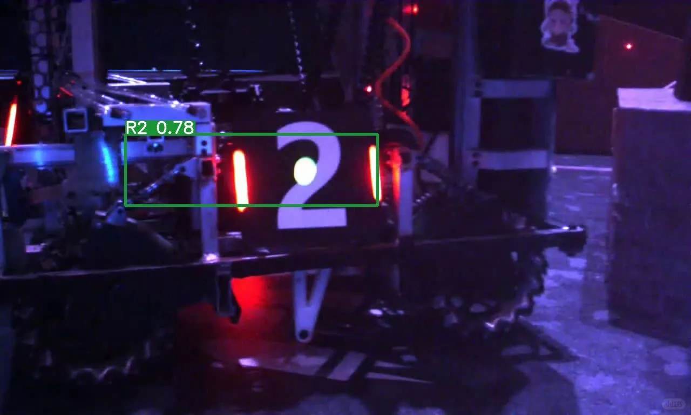
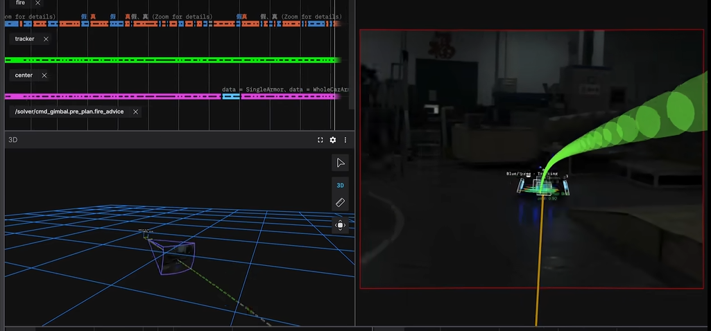

# Camera-Based Automatic Aiming

<a href="../files/robo/robomaster_coordinate_transform_matrix_tracker_latest_version.en.html" target="_blank" rel="noopener">Open Interactive Demo ↗</a> | <a href="../files/robo/robomaster_coordinate_transform_matrix_tracker_latest_version.en.html" download>Download HTML ↓</a>

*(Drag the target in 3D space to observe its real-time projection on the camera plane and the corresponding coordinate transformations.)*

During my undergraduate studies, I participated in the **RoboMaster** robotics competition, focusing primarily on mechanical design and embedded electronics. The subsystem I was most proud of was a compact **two-axis gimbal**. By carefully optimizing the mass distribution and aligning the center of gravity with the rotation axes, the gimbal achieved high rotational agility and stability within a tightly constrained volume.

For an automatic aiming system to hit a high-speed, maneuvering robot, mechanical agility is only half the battle—the control system must continuously translate what the **camera sees** into how the **gimbal rotates**. To make this geometric pipeline intuitive, I built the interactive HTML visualization above to demonstrate how matrix transformations bridge visual perception and mechanical control.

Competition videos: [Video 1](https://www.bilibili.com/video/BV1nX9kBxEaN/) · [Video 2](https://www.bilibili.com/video/BV1JconBaEkC/).

The robot I designed in SolidWorks:

## How Robot Vision Works: From 2D Pixels to 3D Gimbal Control

At its core, camera-based automatic aiming solves an inverse geometric problem: **the camera only captures a flat 2D image, but the gimbal motors require 3D angular commands (Yaw and Pitch) in the robot's mechanical frame.** Bridging this gap requires three sequential steps:

### 1. Forward Projection: How a 3D Target Becomes a 2D Pixel

When the camera observes an armor plate on an opposing robot, a 3D point in the camera coordinate system, $\mathbf{P}_c = [X_c, Y_c, Z_c]^T$, is projected onto the 2D image sensor at pixel coordinates $(u, v)$ through the pinhole camera model:

$$
Z_c \begin{bmatrix} u \\ v \\ 1 \end{bmatrix} = \mathbf{K} \mathbf{P}_c
$$

Here, $\mathbf{K}$ is the **camera intrinsic matrix**, which encodes the lens focal length $f$ and the optical center of the sensor.

### 2. Depth Recovery: Reconstructing 3D Camera Coordinates from 2D Pixels

Because projection compresses 3D space onto a 2D plane, a single pixel $(u, v)$ only tells us the **direction (ray)** of the target relative to the camera, while the depth $Z_c$ is lost. Fortunately, RoboMaster armor plates have standardized, known physical dimensions. Under the pinhole approximation, if an armor light bar of known physical height $L$ spans $l$ pixels on the image sensor, its distance $Z_c$ from the camera can be estimated directly:

$$
Z_c \approx \frac{f \cdot L}{l}
$$

*(In practice, utilizing the four corners of the armor plate turns this into the classical **Perspective-n-Point (PnP)** problem.)* Once the depth $Z_c$ is recovered, inverting the intrinsic projection yields the target's complete 3D position vector $\mathbf{P}_c$ inside the **camera coordinate system**.

### 3. Frame Transformation: From Camera Frame to Gimbal Frame

Knowing the target's position relative to the camera is still not enough to aim the barrel, because the camera is mounted at a physical offset from the gimbal's pivot center and rotates along with it. We must transform the target vector from the **camera coordinate system** ($\mathbf{P}_c$) into the **gimbal (or chassis) reference coordinate system** ($\mathbf{P}_g$):

$$
\mathbf{P}_g = \mathbf{R}_{c \to g} \mathbf{P}_c + \mathbf{t}_{c \to g}
$$

Here, $\mathbf{t}_{c \to g}$ is the translation vector representing the physical mounting offset between the camera optical center and the gimbal pivot, and $\mathbf{R}_{c \to g}$ is a $3 \times 3$ orthogonal rotation matrix belonging to the 3D rotation group $SO(3)$:

$$
\mathbf{R} \in SO(3), \quad \mathbf{R}^T \mathbf{R} = \mathbf{I}, \quad \det(\mathbf{R}) = 1
$$

Once the target's 3D coordinates $\mathbf{P}_g = [X_g, Y_g, Z_g]^T$ are expressed in the gimbal frame, converting this Cartesian vector into spherical angles directly provides the required **Yaw** and **Pitch** rotation commands to lock onto the target.

## A Shared Physical Background: Coordinate Transformations Across Scales

Looking back at this undergraduate robotics project later during my research in physical chemistry and machine learning, I realized that **robot vision, coordinate transformations in [SFG/SHS spectroscopy](SFG_QM%20math-cleaned-v2.en.md), group theory in quantum mechanics, and [$SO(3)$-equivariant neural networks](SO(3)-Equivariant%20Graph%20Neural%20Networks_new.en.md) all share the exact same explicit physical background**.

Across all four domains, the fundamental principle is identical: **we first describe a physical object in its most natural local coordinate system, and then apply $SO(3)$ group representations to transform those quantities into the global laboratory or control coordinate system.** The only difference lies in the mathematical rank of the object being rotated:

* **Robot Vision:** Transforms **rank-1 vectors** (3D target positions and rays $\mathbf{P}$) from the camera frame to the gimbal control frame via standard $3 \times 3$ rotation matrices $\mathbf{R} \in SO(3)$.
* **SFG/SHS Spectroscopy:** Transforms **higher-rank Cartesian tensors**—such as the second-order molecular hyperpolarizability $\beta_{ijk}$ in the local molecular frame—into the macroscopic susceptibility $\chi^{(2)}_{IJK}$ in the laboratory frame via $\chi^{(2)}_{IJK} = \sum \langle R_{Ii} R_{Jj} R_{Kk} \rangle \beta_{ijk}$.
* **Quantum Mechanics & $SO(3)$-Equivariant Neural Networks:** Generalizes this geometric invariance to quantum states and atomic environments using irreducible spherical representations. By expanding features on spherical harmonics and rotating them via **Wigner $D$-matrices**, $T^{(l)}_{m} = \sum_{m'} D^{(l)}_{mm'}(\Omega) T^{(l)}_{m'}$, along with the **Wigner–Eckart theorem**, physical observables and neural network representations strictly preserve rotational equivariance in 3D space.

Seen in this light, a classical robot aiming system serves as the most tangible geometric starting point for understanding Euler-angle rotations, Wigner $D$-matrices, and equivariant deep learning.

## References {#references}

- [Open Interactive Demo ↗](../files/robo/robomaster_coordinate_transform_matrix_tracker_latest_version.en.html)
- [RoboMaster official channel](https://www.youtube.com/@RoboMaster/featured)
- [Competition video 1](https://www.bilibili.com/video/BV1nX9kBxEaN/)
- [Competition video 2](https://www.bilibili.com/video/BV1JconBaEkC/)

