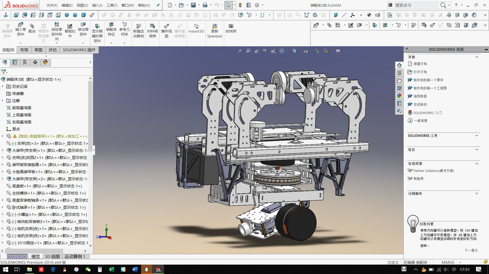
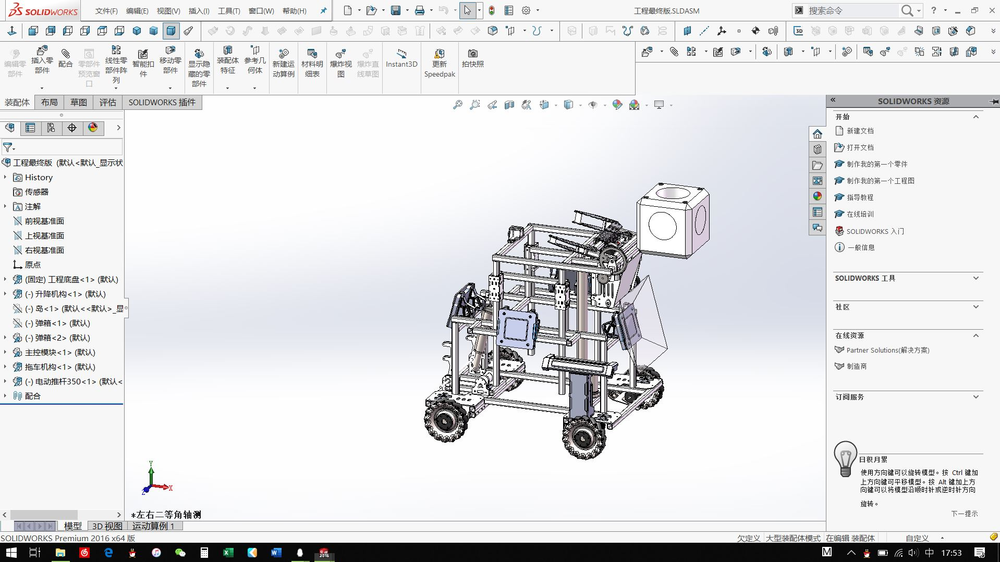

# 基于相机的机器人自动瞄准

<a href="../files/robo/robomaster_coordinate_transform_matrix_tracker_latest_version.html" target="_blank" rel="noopener">打开自动瞄准交互演示 ↗</a> | <a href="../files/robo/robomaster_coordinate_transform_matrix_tracker_latest_version.html" download>下载 HTML ↓</a>

*（可拖动三维空间中的目标，实时观察其在相机成像平面的投影及坐标变换过程。）*

在本科阶段的 **RoboMaster** 机甲大师赛中，我主要负责机械结构设计与部分硬件电路开发。当时最令我满意的设计是一套紧凑型**双轴云台结构**——通过精细调配质量分布并使重心与旋转轴重合，云台在极为有限的体积内兼顾了高机动性与运动稳定性。

然而，要实现对高速移动、旋转目标的自动锁定（自瞄），机械响应只是执行末端，核心问题在于**如何将“相机看到的像素”实时转化为“云台电机的旋转角度”**。为了直观展示这一几何链路，我将自瞄系统中的矩阵变换与目标追踪过程整理成了上方的交互式 HTML 演示。

比赛视频：[视频 1](https://www.bilibili.com/video/BV1nX9kBxEaN/) · [视频 2](https://www.bilibili.com/video/BV1JconBaEkC/)。

我使用 SolidWorks 设计的机器人：

## 机器人视觉原理：从二维像素到三维云台控制

从几何角度看，自动瞄准解决的是一个逆向空间映射问题：**相机捕捉到的只是一张二维平面图像，但云台控制器需要的是机械坐标系下的三维偏航（Yaw）与俯仰（Pitch）指令。** 打通这一链路需要经过以下三步：

### 1. 正向成像投影：三维目标如何变成二维像素

当相机捕捉到敌方机器人的装甲板时，相机坐标系下的三维空间点 $\mathbf{P}_c = [X_c, Y_c, Z_c]^T$ 会通过小孔成像模型（Pinhole Model），投影到二维图像传感器的像素坐标 $(u, v)$ 上：

$$
Z_c \begin{bmatrix} u \\ v \\ 1 \end{bmatrix} = \mathbf{K} \mathbf{P}_c
$$

其中 $\mathbf{K}$ 为**相机内参矩阵**（Intrinsic Matrix），由镜头焦距 $f$ 与感光芯片的光心偏移量决定。

### 2. 深度恢复：从二维像素反推相机坐标系下的三维位置

由于成像过程将三维空间压缩到了二维平面，单个像素点 $(u, v)$ 只能给出目标相对于光心的**方向射线**，而丢失了深度信息 $Z_c$。但由于赛场上装甲板灯条的真实物理尺寸 $L$ 是已知的，在最简小孔近似下，只要测出灯条在图像上占据的像素长度 $l$，就能直接反推出目标深度 $Z_c$：

$$
Z_c \approx \frac{f \cdot L}{l}
$$

*（在实际工程中，结合装甲板四个角点的已知几何尺寸与像素坐标，即可求解经典的 **PnP（Perspective-n-Point）** 问题。）* 获得深度 $Z_c$ 后，对内参投影方程求逆，就能完整还原出目标在**相机坐标系**下的三维坐标 $\mathbf{P}_c$。

### 3. 刚体坐标变换：从相机坐标系到云台控制坐标系

仅仅知道目标相对于相机的位置还无法直接控制枪管，因为相机安装位置与云台旋转中心存在物理偏移，且随云台一起运动。因此，必须将目标坐标从**相机坐标系**（$\mathbf{P}_c$）转换到**云台（或底盘）参考坐标系**（$\mathbf{P}_g$）：

$$
\mathbf{P}_g = \mathbf{R}_{c \to g} \mathbf{P}_c + \mathbf{t}_{c \to g}
$$

其中 $\mathbf{t}_{c \to g}$ 是相机光心相对于云台转轴的平移向量（外参平移），而 $\mathbf{R}_{c \to g}$ 则是描述两者姿态关系的 $3 \times 3$ 旋转矩阵，严格属于三维旋转群 $SO(3)$：

$$
\mathbf{R} \in SO(3), \quad \mathbf{R}^T \mathbf{R} = \mathbf{I}, \quad \det(\mathbf{R}) = 1
$$

得到目标在云台坐标系下的三维坐标 $\mathbf{P}_g = [X_g, Y_g, Z_g]^T$ 后，将其转换为球坐标方向角，即可直接解算出云台锁死目标所需的 **Yaw（偏航）** 和 **Pitch（俯仰）** 旋转量。

## 共同的显式物理背景：跨尺度的坐标变换与 $SO(3)$ 对称性

后来在从事物理化学与机器学习研究时回看这段经历，我意识到：**机器人视觉、[SFG/SHS 非线性光谱中的坐标变换](SFG_QM%20math-cleaned-v2.md)、量子力学中的群论，以及 [$SO(3)$ 等变神经网络](SO(3)-Equivariant%20Graph%20Neural%20Networks_new.md)，背后其实共享着完全一致的显式物理背景。**

这四个领域的底层逻辑高度统一：**先在研究对象最自然的“局域坐标系”中定义物理量，再借助三维旋转群 $SO(3)$ 的群表示，将其变换到观测或控制所用的“全局（实验室）坐标系”中。** 它们唯一的区别仅在于被旋转几何对象的阶数与表示形式：

* **机器人视觉**：在欧氏空间中旋转**一阶向量**（目标位置与视线方向 $\mathbf{P}$），通过基础的 $3 \times 3$ 旋转矩阵 $\mathbf{R} \in SO(3)$ 完成相机系到云台控制系的转换。
* **SFG/SHS 界面光谱**：将分子局域坐标系下的**高阶笛卡尔张量**（如二阶超极化率 $\beta_{ijk}$）通过方向余弦矩阵旋转并取系综平均，映射到实验室坐标系下的宏观极化率张量 $\chi^{(2)}_{IJK} = \sum \langle R_{Ii} R_{Jj} R_{Kk} \rangle \beta_{ijk}$。
* **量子力学群论与 $SO(3)$ 等变神经网络**：将这一几何不变性推广到量子态与原子局域环境的球谐不可约表示中。通过 **Wigner $D$ 矩阵**（$T^{(l)}_{m} = \sum_{m'} D^{(l)}_{mm'}(\Omega) T^{(l)}_{m'}$）与 **Wigner–Eckart 定理**，无论是量子跃迁矩阵元还是神经网络中的几何特征，都在三维旋转变换下严格保持物理上的等变性（Equivariance）。

从这个角度看，宏观世界里直观的机器人自动瞄准，恰好为理解微观尺度下的欧拉角旋转、Wigner $D$ 矩阵以及等变深度学习提供了一个最生动的经典力学切入点。

## 参考链接 {#references}

- [打开自动瞄准交互演示 ↗](../files/robo/robomaster_coordinate_transform_matrix_tracker_latest_version.html)
- [RoboMaster 官方频道](https://www.youtube.com/@RoboMaster/featured)
- [比赛视频 1](https://www.bilibili.com/video/BV1nX9kBxEaN/)
- [比赛视频 2](https://www.bilibili.com/video/BV1JconBaEkC/)

