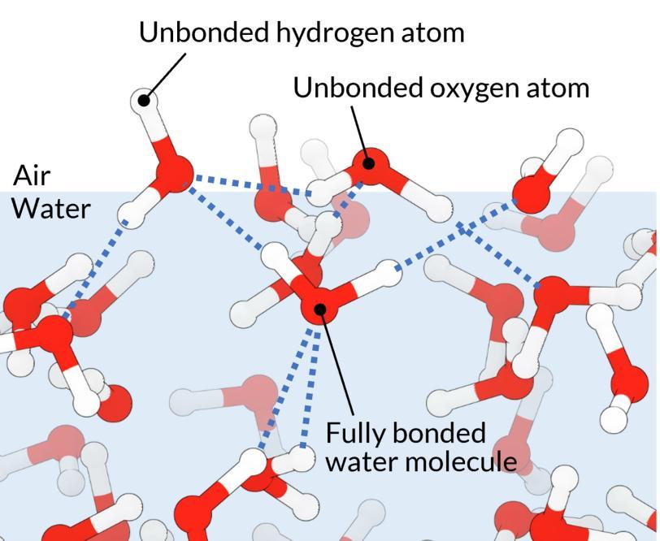
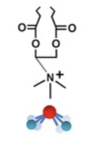
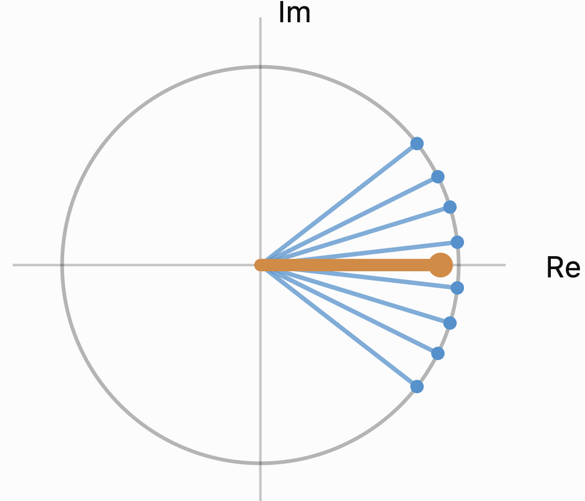
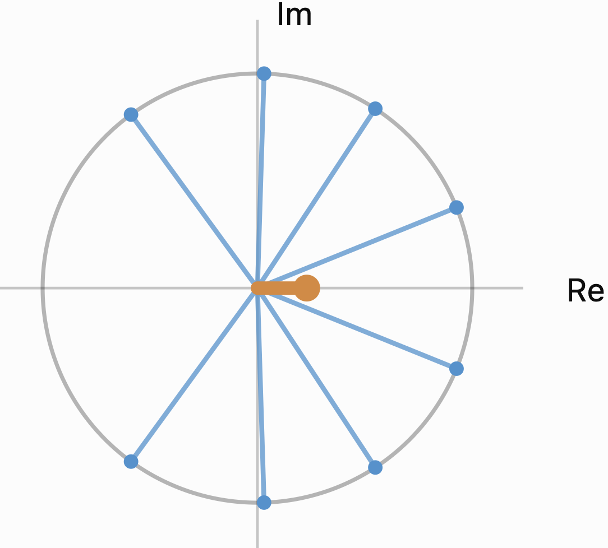
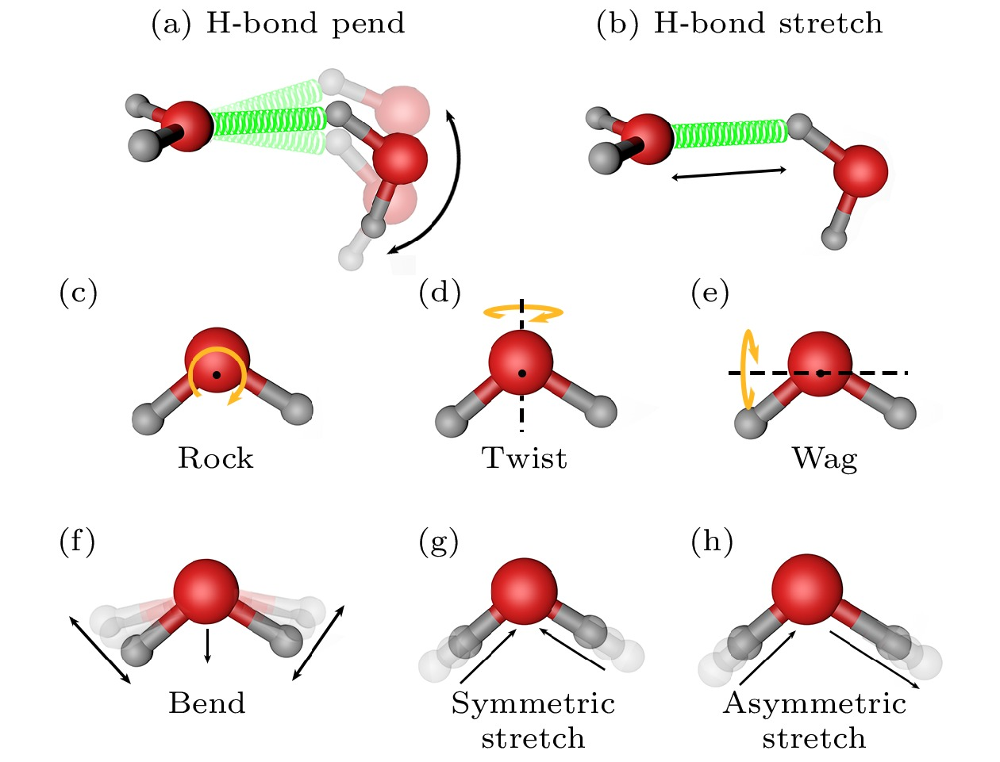
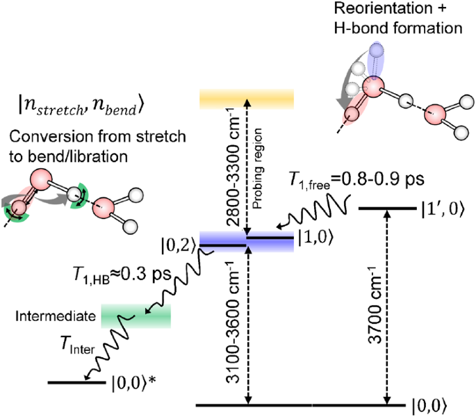

# How Can We Measure and Influence Electron Transfer?

*Figure 1: Cover image. Related report: [SLAC (2025)](https://www6.slac.stanford.edu/news/2025-12-11-slac-researchers-wield-new-tools-study-waters-enigmatic-surface).*

# Introduction

Solvent vibrations play an important role in electron transfer (ET). So can we use light to excite solvent vibrations and make ET faster? This question is especially interesting at the air/water interface. Time-resolved SFG has been used to track ET involving interfacial molecules. Time-resolved SHG can probe excited-state solvation dynamics at interfaces. TR-HD-VSFG can also follow hydrated electrons and changes in their local water environment through the OH vibrational response of nearby water molecules. [\[1\]](https://doi.org/10.1016/j.cplett.2012.05.054), [\[2\]](https://doi.org/10.1016/S0009-2614%2899%2900017-2), [\[3\]](https://doi.org/10.1021/jacs.6b02171)

I would like to know whether an IR pump can excite the HOH bending mode or the high-frequency OH stretch at the air/water interface and thereby speed up ET. In other words, can a light pulse directed at the water trigger or accelerate ET in a molecule sitting at the interface? And what role might the many free OH groups at this interface play?

When we model SFG, IR, and Raman spectra, we often work with time correlation functions of vibrational coordinates, dipole moments, or polarizabilities. For SFG at the water interface, a dipole–polarizability correlation function can be used. So I also want to start from correlation functions to study ET. The key difference is that the ET rate depends directly on the **energy-gap fluctuation correlation function** between the initial and final electronic states. In simple terms, it describes how the surrounding solvent motion keeps changing the relative energies of the donor and acceptor. [\[4\]](https://doi.org/10.1021/jp0133438), [\[5\]](https://doi.org/10.1063/1.473037)

Because the OH stretch is a high-frequency vibration, we need to treat it quantum mechanically. Slower collective motions of the solvent can, under certain conditions, be treated classically. This is also a common way to model ET in solution using Marcus–Levich–Jortner (MLJ) theory, as well as ET at metal/solution interfaces. [\[6\]](https://doi.org/10.1063/1.1742723), [\[7\]](https://doi.org/10.1063/1.432142), [\[8\]](https://doi.org/10.1007/978-3-642-04937-8)

Here I will work through the derivation in simple steps, without skipping too much. I will also use figures and physical pictures wherever possible, with experimental researchers in mind.

In this article, I do not want to spend too much time debating which assumptions or models are best, or trying to describe every detail of the interface. I mainly want a rough answer to one question: can light-excited solvent vibrations speed up ET?

One related experimental example comes from Delor and co-workers, who used selective infrared excitation to change vibrations of a molecular bridge and thereby control intramolecular ET. [\[9\]](https://doi.org/10.1126/science.1259995)

| Figure A | Figure B |
|:----------------------------------:|:----------------------------------:|
|  |  |

*Figure 2: Reference images related to ultrafast interfacial spectroscopy. The original link for the image on the right points to a review of interfacial spectroscopy by Tahara.* [\[10\]](https://doi.org/10.1093/bulcsj/uoae012)

# Summary

This article asks whether light can change the ET rate by exciting high-frequency OH stretching or HOH bending vibrations at the air/water interface.

We build a **quantitative link between the SFG vibrational response, the ET energy-gap fluctuation correlation function, and vibrational reorganization energy**. However, the coupling between the vibration and the ET energy gap still needs to be determined independently, for example using AIMD or additional spectroscopic measurements.

Our rough model shows that **exciting high-frequency OH vibrations could speed up ET significantly for some reaction free energies and coupling strengths**. But whether we can observe this effect depends on the very fast relaxation of water vibrations and the small number of additional ET events.

**The instantaneous ET rate could increase by several times in theory, while the extra ET product signal might be extremely hard to detect experimentally.**

# Theory and Derivations

## **Transition Amplitude**

**Since we are discussing ET, we will start by deriving the transition amplitude and transition probability.**

For the interaction-picture evolution operator, we have:

$$
i\hbar\frac{d}{dt}\hat{U}_I(t) =
\hat{V}_I(t)\hat{U}_I(t)
$$

where:

$$
\hat{V}_I(t) =
e^{i\hat{H}_0t/\hbar}
\hat{V}
e^{-i\hat{H}_0t/\hbar}
$$

Integrating this differential equation and iterating once gives the Dyson expansion:

$$
\boxed{
\hat{U}_I(t) =
\hat{I}
-\frac{i}{\hbar}
\int_0^t dt_1\,\hat{V}_I(t_1)
+O(V^2)
}
$$

In the interaction picture, the transition amplitude from $i$ to $f$ is defined as:

$$
A_{fi}^{(I)}(t) =
\langle f|\hat{U}_I(t)|i\rangle
$$

It tells us the amplitude for a system that started in $i$ to end up in $f$ after evolving under the perturbation for some time.

Substituting the Dyson expansion:

$$
A_{fi}^{(I)}(t) =
\underbrace{\langle f|\hat{I}|i\rangle}_{\delta_{fi}}
-\frac{i}{\hbar}
\int_0^t dt_1\,
\langle f|\hat{V}_I(t_1)|i\rangle
+O(V^2)
$$

When $f\neq i$ and the two states are orthogonal:

$$
\langle f|i\rangle=0
$$

Therefore:

$$
\boxed{
A_{fi}^{(I,1)}(t) =
-\frac{i}{\hbar}
\int_0^t dt_1\,
\langle f|\hat{V}_I(t_1)|i\rangle
}
$$

The first-order transition-amplitude operator for an electron moving from $i$ to $f$ is:

$$
\boxed{
\hat{A}_{fi}^{(1)}(t) =
-\frac{iV_{fi}}{\hbar}
\int_0^t dt_1\,
e^{+i\hat{H}_ft_1/\hbar}
e^{-i\hat{H}_it_1/\hbar}
}
$$

Now we have the transition amplitude.

### From Transition Amplitude to Transition Probability

In quantum mechanics, the probability is the amplitude times its complex conjugate.

The nuclear degrees of freedom may not be in a single pure state. So we use the initial nuclear density matrix $\hat{\rho}_i$:

$$
P_{i\to f}(t) =
\operatorname{Tr}_n
\left[
\hat{A}_{fi}^{(1)}(t)
\hat{\rho}_i
\hat{A}_{fi}^{(1)\dagger}(t)
\right]
$$

Ultimately, we want to know whether the electron has moved from $i$ to $f$. But whether this happens depends on the nuclear motion of the molecule and the surrounding solvent. We therefore need to separate the electronic and nuclear degrees of freedom.

### From Basic Quantum Mechanics to Electron Transfer

In the usual two-level problem described in Sakurai and Napolitano’s *Modern Quantum Mechanics*, with no additional degrees of freedom: [\[11\]](https://www.cambridge.org/highereducation/books/modern-quantum-mechanics/DF43277E8AEDF83CC12EA62887C277DC)

$$
A_{fi}(t) =
\langle f|\hat{U}(t)|i\rangle
$$

The transition probability is simply:

$$
\boxed{
P_{i\to f}(t) =
|A_{fi}(t)|^2
}
$$

In solution, however, the orientation, hydrogen-bond structure, and vibrational states of nearby water molecules may also change when an electron moves from $i$ to $f$.

The Hilbert space of the full system is therefore:

$$
\mathcal{H} =
\mathcal{H}_{\mathrm{electron}}
\otimes
\mathcal{H}_{\mathrm{nuclear}}
$$

The electronic states are described by $|i\rangle$ and $|f\rangle$, while the nuclear degrees of freedom are described by $|\nu\rangle$.

When we calculate:

$$
\hat{A}_{fi}(t) =
\langle f|\hat{U}(t)|i\rangle
$$

we have taken a matrix element only over the electronic degrees of freedom. We have not removed the nuclear degrees of freedom.

So $\hat{A}_{fi}$ is still an operator in the nuclear Hilbert space.

If the initial nuclear state is $|\nu\rangle$, the ET probability becomes:

$$
P_{i\nu\to f}(t) =
\langle\nu|
\hat{A}_{fi}^{\dagger}(t)
\hat{A}_{fi}(t)
|\nu\rangle
$$

In other words, we have included the nuclear coordinates as well.

If the initial solvent is in a mixed state described by the density operator $\hat{\rho}_i$, we can expand the expression and use the cyclic property of the trace to obtain:

$$
\boxed{
P_{i\to f}(t) =
\operatorname{Tr}_n
\left[
\hat{A}_{fi}(t)
\hat{\rho}_i
\hat{A}_{fi}^{\dagger}(t)
\right]
}
$$

Now substitute the first-order Dyson amplitude derived above:

$$
\begin{aligned}
P_{i\to f}(t)
=&
\frac{|V_{fi}|^2}{\hbar^2}
\int_0^t dt_1
\int_0^t dt_2 \\
&\times
\operatorname{Tr}_n
\left[
e^{+i\hat{H}_ft_1/\hbar}
e^{-i\hat{H}_it_1/\hbar}
\hat{\rho}_i
e^{+i\hat{H}_it_2/\hbar}
e^{-i\hat{H}_ft_2/\hbar}
\right].
\end{aligned}
$$

Combining the exponential factors gives:

$$
\boxed{
\begin{aligned}
P_{i\to f}(t)
=&
\frac{|V_{fi}|^2}{\hbar^2}
\int_0^t dt_1
\int_0^t dt_2 \\
&\times
\operatorname{Tr}_n
\left[
\hat{\rho}_i
e^{-i\hat{H}_i(t_1-t_2)/\hbar}
e^{+i\hat{H}_f(t_1-t_2)/\hbar}
\right].
\end{aligned}
}
$$

Notice something useful: the nuclear trace now depends only on the difference between the two times.

For convenience, let us define:

$$
\tau=t_1-t_2
$$

This naturally leads us to a correlation function.

### Ando Correlation Function

This is where the Ando correlation function comes in.

Define:

$$
\boxed{
\begin{aligned}
C_{if}(\tau)
&=
\operatorname{Tr}_n
\left[
\hat{\rho}_i
e^{-i\hat{H}_i\tau/\hbar}
e^{+i\hat{H}_f\tau/\hbar}
\right] \\
&=
\left\langle
e^{-i\hat{H}_i\tau/\hbar}
e^{+i\hat{H}_f\tau/\hbar}
\right\rangle_i.
\end{aligned}
}
$$

The transition probability can now be written as:

$$
\boxed{
P_{i\to f}(t) =
\frac{|V_{fi}|^2}{\hbar^2}
\int_0^t dt_1
\int_0^t dt_2\,
C_{if}(t_1-t_2)
}
$$

For an equilibrium initial state:

$$
C_{if}(-\tau) =
C_{if}(\tau)^*
$$

Taking the time derivative of the probability then gives:

$$
\boxed{
k(t) =
\frac{2|V_{fi}|^2}{\hbar^2}
\operatorname{Re}
\int_0^t d\tau\,C_{if}(\tau)
}
$$

If the correlation function decays fast enough for the integral to converge, and the system reaches a regime where a constant rate can be defined, we get:

$$
\boxed{
k_{\mathrm{FGR}} =
\frac{|V_{fi}|^2}{\hbar^2}
\int_{-\infty}^{+\infty}
d\tau\,C_{if}(\tau)
}
$$

This is the Fermi Golden Rule expression for the ET rate in terms of a time correlation function.

This time-correlation approach appears in Ando’s work on outer-sphere ET in aqueous solution and in Tokmakoff’s teaching materials. Different conventions for operator ordering and phases can lead to equivalent expressions that are complex conjugates of the one used here. [\[5\]](https://doi.org/10.1063/1.473037), [\[12\]](https://chem.libretexts.org/Bookshelves/Physical_and_Theoretical_Chemistry_Textbook_Maps/Time-Dependent_Quantum_Mechanics_and_Spectroscopy_2025e_%28Tokmakoff%29/19%3A_Energy_and_Charge_Transfer/19.04%3A_Marcus_Theory_for_Electron_Transfer)

Let us look more closely at this clean equation, which requires very few assumptions:

$$
C_{if}(t) =
\operatorname{Tr}_n
\left[
\hat{\rho}_i
e^{-i\hat{H}_it/\hbar}
e^{i\hat{H}_ft/\hbar}
\right]
$$

We can think of it as comparing two kinds of nuclear time evolution, driven by the initial- and final-state Hamiltonians. In this picture, if the two Hamiltonians (molecule plus solvent) behave more similarly, their contributions can stay in phase for longer, which can favor ET.

To understand the equation better, let us rewrite it in another form.

Suppose the nuclear Hamiltonians for the two electronic states have the following eigenstates:

$$
\hat{H}_i|n_i\rangle =
E_n^i|n_i\rangle
$$

$$
\hat{H}_f|m_f\rangle =
E_m^f|m_f\rangle
$$

Here, $n$ and $m$ label nuclear vibrational states. In a solvent, they can also include collective motions and other nuclear degrees of freedom.

We then obtain:

$$
\boxed{
C_{if}(t) =
\sum_{n,m}p_n
|\langle m_f|n_i\rangle|^2
e^{i(E_m^f-E_n^i)t/\hbar}
}
$$

Under the stationary-initial-state condition used above, this is an exact quantum-mechanical result. No classical approximation is needed.

A larger Franck–Condon factor $|\langle m_f|n_i\rangle|^2$ means a stronger overlap between the initial and final nuclear vibrational wavefunctions. That vibrational transition channel therefore carries more weight.

When the initial and final energies are closer, their phase contributions cancel less strongly, which can favor ET. As a simple limiting case, if the initial and final Hamiltonians are identical and we are comparing the same state with itself, the correlation function is 1.

| Figure A | Figure B |
|:----------------------------------:|:----------------------------------:|
|  |  |

*Figure 3: Sketches of phase addition and ensemble averaging (two panels shown side by side).*

The blue lines are unit-length complex amplitudes from different nuclear configurations; the orange line is their average. Each blue line always has length 1, but as their phases spread out, the average orange vector usually becomes shorter.

The phases from different solvent contributions add together, much like amplitudes in a Feynman path integral.

A few more points about this correlation function.

## How Are SFG and Electron Transfer Connected Through Correlation Functions?

### Suppose SFG and ET Are Both Influenced by the Same Vibrational Coordinate $q(t)$

Let us model an interfacial water OH stretch as a harmonic oscillator:

$$
H_i =
\frac{p^2}{2m} +
\frac12m\omega_0^2q^2
$$

Here, $q(t)$ **is** the displacement coordinate of a particular water vibrational degree of freedom at time $t$.

After ET, the potential energy surface becomes:

$$
H_f =
\Delta G^0 +
\frac{p^2}{2m} +
\frac12m\omega_0^2(q-d)^2
$$

We introduce three coupling constants in this model:

$$
\boxed{
\begin{aligned}
M(q)&=M_0+bq\\
A(q)&=A_0+aq\\
X(q)&=\Delta G^0+\lambda-gq
\end{aligned}
}
$$

where:

- $b=\partial M/\partial q$: how strongly the vibration changes the dipole moment, or its **IR activity**.
- $a=\partial A/\partial q$: how strongly the vibration changes the polarizability, or its **Raman activity**.
- $g=-\partial X/\partial q$: how strongly the vibration changes the ET energy gap. This is the **ET coupling** we really care about.

For a displaced harmonic oscillator:

$$
g=m\omega_0^2d
$$

$$
\boxed{
\lambda_{\mathrm{OH}} =
\frac{g^2}{2m\omega_0^2},
\qquad
S_{\mathrm{OH}} =
\frac{g^2}{2m\hbar\omega_0^3}
}
$$

This gives us an important result: **if SFG can tell us how** $q(t)$ behaves, and we can also determine $g$, we can calculate the contribution of the OH vibration to the ET reorganization energy and the Huang–Rhys factor.

### Starting from the SFG Response Function

For a simple illustration, we use a single-mode, scalar classical oscillator response. A full description of interfacial SFG also needs tensor components, orientation averaging, and local optical-field corrections. For the microscopic theory, see Morita–Hynes and the review of phase-sensitive SFG. [\[13\]](https://doi.org/10.1016/S0301-0104%2800%2900127-0), [\[14\]](https://doi.org/10.1146/annurev-physchem-040412-110110)

Let us consider the classical vibrational response. The IR electric field couples to the vibrational dipole and applies a driving force to $q$:

$$
m\ddot q +
m\gamma\dot q +
m\omega_0^2q =
bE_{\mathrm{IR}}(t)
$$

Here $\gamma$ is the effective damping constant.

Transforming into frequency space:

$$
q(\omega) =
\frac{bE_{\mathrm{IR}}(\omega)}
{m(\omega_0^2-\omega^2-i\gamma\omega)}
$$

Meanwhile, the visible light produces an SFG response through the vibrationally dependent polarizability $A(q)$:

$$
P_{\mathrm{SFG}}
\propto
A(q)E_{\mathrm{vis}}
$$

Keeping only the vibration-induced part:

$$
P_{\mathrm{SFG}}^{\mathrm{res}}
\propto
aqE_{\mathrm{vis}}
$$

Substituting $q(\omega)$ gives the simplified resonant SFG response:

$$
\boxed{
\chi_{\mathrm{SFG}}^{(2),\mathrm{res}}(\omega) =
\frac{\mathcal N ab}
{m(\omega_0^2-\omega^2-i\gamma\omega)}
}
$$

$\mathcal N$ includes the surface number density, orientation projections, and relevant optical geometry factors. Real experiments also require Fresnel-factor corrections.

So the SFG spectrum contains information about:

$$
\underbrace{\omega_0,\gamma}_{\text{vibrational frequency and response time}}
\qquad
\underbrace{\mathcal Nab}_{\text{optical response strength}}
$$

Now let us turn to ET.

### How Does the Same Vibration Change the ET Energy Gap?

From our definition:

$$
X(q)=X_0-gq
$$

The energy-gap fluctuation is:

$$
\delta X(t)=-g\delta q(t)
$$

In other words, the energy-gap fluctuation is the coordinate fluctuation multiplied by the energy-coupling constant $g$:

$$
\boxed{
K_{XX}(t) =
g^2\langle\delta q(t)\delta q(0)\rangle
}
$$

For SFG, the corresponding dipole and polarizability fluctuations are:

$$
\delta M(t)=b\delta q(t)
$$

$$
\delta A(t)=a\delta q(t)
$$

Therefore:

$$
\langle\delta A(t)\delta M(0)\rangle =
ab\langle\delta q(t)\delta q(0)\rangle
$$

Comparing the two expressions:

$$
\boxed{
K_{XX}(t) =
\frac{g^2}{ab}
\langle\delta A(t)\delta M(0)\rangle
}
$$

This is the first bridge equation we were looking for.

In this model, both correlation functions share the same underlying quantity:

$$
\boxed{
K_{qq}(t) =
\langle\delta q(t)\delta q(0)\rangle
}
$$

### Connecting Experimental SFG and ET with the Fluctuation–Dissipation Theorem

For now, we consider only equilibrium conditions, so we can use the fluctuation–dissipation theorem (FDT). This transformation is **derived within the specific linear model chosen here**. It does not mean that the literature has shown that an arbitrary measured SFG spectrum uniquely determines ET coupling.

Define the linear response of the vibrational coordinate to an external force:

$$
\chi_{qq}(\omega) =
\frac{1}
{m(\omega_0^2-\omega^2-i\gamma\omega)}
$$

We have already shown that:

$$
\chi_{\mathrm{SFG}}^{(2),\mathrm{res}}(\omega) =
\mathcal Nab\,\chi_{qq}(\omega)
$$

If phase-sensitive HD-SFG gives us the complex $\chi^{(2)}$, and we can calibrate the optical factors, then:

$$
\boxed{
\chi_{qq}(\omega) =
\frac{\chi_{\mathrm{SFG}}^{(2),\mathrm{res}}(\omega)}
{\mathcal Nab}
}
$$

The quantum fluctuation–dissipation theorem gives the full equilibrium coordinate correlation function (we skip the lengthy derivation here):

$$
\begin{aligned}
K_{qq}(t)
&=\langle\delta q(t)\delta q(0)\rangle\\
&=\frac{\hbar}{\pi}\int_0^\infty d\omega\,
\operatorname{Im}\chi_{qq}(\omega)\\
&\quad\times\left[
\coth\left(\frac{\beta\hbar\omega}{2}\right)\cos(\omega t)
-i\sin(\omega t)
\right]
\end{aligned}
$$

where $\beta=1/(k_BT)$.

Since $X=X_0-gq$, we have:

$$
\boxed{
\begin{aligned}
K_{XX}(t)
={}&
\frac{\hbar g^2}{\pi}
\int_0^\infty d\omega\\
&\times
\operatorname{Im}
\left[
\frac{\chi_{\mathrm{SFG}}^{(2),\mathrm{res}}(\omega)}
{\mathcal Nab}
\right]\\
&\times\left[
\coth\left(\frac{\beta\hbar\omega}{2}\right)\cos(\omega t)
-i\sin(\omega t)
\right]
\end{aligned}
}
$$

This is an explicit, model-dependent transformation from **SFG to the ET energy-gap fluctuation correlation function**.

We can use the measured SFG spectrum as input and obtain the energy-gap fluctuation dynamics needed for ET. For high-frequency OH vibrations, this expression keeps both the quantum thermal-population correction and the imaginary phase that comes from the noncommutativity of the operators, rather than immediately using the classical equipartition approximation.

However, we still need $g$ and the optical normalization factors. More importantly, this derivation works only when the shared vibrational mode can be described with linear harmonic coupling, in equilibrium, and within linear response.

### Calculating Reorganization Energy from SFG

We can derive an even simpler expression.

For the single harmonic oscillator above:

$$
\lambda_{\mathrm{OH}} =
\frac12g^2\chi_{qq}(0)
$$

Using the Kramers–Kronig relation for the response function:

$$
\chi_{qq}(0) =
\frac{2}{\pi}
\int_0^\infty
\frac{\operatorname{Im}\chi_{qq}(\omega)}
{\omega}\,d\omega
$$

Therefore:

$$
\boxed{
\lambda_{\mathrm{OH}} =
\frac{g^2}{\pi\mathcal Nab}
\int_0^\infty
\frac{
\operatorname{Im}\chi_{\mathrm{SFG}}^{(2),\mathrm{res}}(\omega)
}{\omega}\,d\omega
}
$$

This connects the reorganization energy to the SFG response.

However, it gives only the contribution from modes that are visible to SFG and coupled to the ET energy gap. It is not the full solvent reorganization energy $\lambda_s$. Also, $g$ cannot be derived from $a$ and $b$ alone. SFG measures how a vibration changes the optical properties of water, whereas $g$ tells us how the same vibration changes the relative energies of a particular donor and acceptor. These are different derivatives of the electronic structure. For example, two ET systems might give exactly the same interfacial water SFG spectrum, but the value of $g$ in one system could be twice that in the other. Their vibrational reorganization energies would differ by a factor of four, even though SFG alone might not distinguish them.

So the most important parameter to determine experimentally is not the vibrational frequency, but the **ET energy-gap coupling** $g$. We may need 2D-SFG or AIMD to help determine this parameter.

So far, we have connected SFG to the energy-gap fluctuation correlation function $K_{XX}(t)$. But the ET rate actually uses the $C_{if}(t)$ that we defined at the start.

For the harmonic oscillator with linear coupling used here, the two can be related through a second-order cumulant expansion:

$$
C_{if}(t)
=
\exp\left[
\cdots
\right]
$$

Now let us return to our original correlation function.

We now have the correlation function. Next, let us see how to handle the low-frequency rotations and the high-frequency OH vibrations separately.

## Low-Frequency Solvent Motions

Separating a classical low-frequency bath from high-frequency quantum modes is the basic idea behind MLJ-type ET models. [\[7\]](https://doi.org/10.1063/1.432142), [\[5\]](https://doi.org/10.1063/1.473037)

*Figure 4: Sketch of low-frequency collective motions of water. Source linked in the original draft: [supplementary material from Acta Physica Sinica](https://wulixb.iphy.ac.cn/supplement/e5e04400-2592-41e2-b975-2a0dd58945ae) (the exact figure number and copyright status still need checking).*

- **(a) H-bond pend (hydrogen-bond pendular motion)**: usually below $100\ \mathrm{cm}^{-1}$.

- **(b) H-bond stretch**: around $150\text{–}250\ \mathrm{cm}^{-1}$.

- **(c) Rock (rocking motion)**

- **(d) Twist (twisting motion)**

- **(e) Wag (wagging motion)**: an intermolecular motion described here as slow; the others are described as faster motions.

We separate the nuclear Hamiltonian into a classical low-frequency bath and high-frequency modes:

Note that these vibrations describe collective motion in the solution, not just the vibration of a single molecule.

$$
H_i=H_{s,i}+\sum_\alpha H_{\alpha,i}
$$

$$
H_f=\Delta G^0+H_{s,f}
+\sum_\alpha H_{\alpha,f}
$$

If these parts can be treated separately, and the initial nuclear density matrix approximately factorizes, we obtain:

$$
\boxed{
C_{if}(t)=
C_s(t)\prod_\alpha C_\alpha(t)
}
$$

Let us look at each term in turn.

#### Correlation Function of the Low-Frequency Solvent Bath

We treat the low-frequency bath as a classical Gaussian solvent with reorganization energy $\lambda_s$ and use a short-time, static energy-gap approximation.

#### Classical Common-Trajectory Approximation

Suppose the solvent motion is slow enough to be represented by a classical trajectory $q(\tau)$.

Under this approximation, the nuclear contribution to the relative phase between the two electronic states can be written as follows.

**Step 1: Start from the correlation function we derived earlier.**

$$
C_{if}(t)=
\operatorname{Tr}_n
\left[
\rho_i e^{-iH_it/\hbar}e^{iH_ft/\hbar}
\right]
$$

Define the energy-gap operator between the two nuclear Hamiltonians:

$$
\hat X=H_f-H_i=U_f(\hat q)-U_i(\hat q)
$$

Here we assume that both electronic states have the same nuclear kinetic-energy operator.

**Step 2: Express the difference between the two propagators as phase accumulation.**

Using the cyclic property of the trace and $[\rho_i,H_i]=0$, we can rewrite the correlation function as:

$$
C_{if}(t)=
\left\langle
\widetilde{\mathcal T}
\exp\left[
\frac{i}{\hbar}\int_0^t\hat X_I(\tau)d\tau
\right]
\right\rangle_i
$$

where:

$$
\hat X_I(\tau)=
e^{iH_i\tau/\hbar}\hat X e^{-iH_i\tau/\hbar}
$$

$\widetilde{\mathcal T}$ denotes anti-time ordering. Up to this point, the transformation is still exact.

**Step 3: Introduce the classical common-trajectory approximation.**

We replace the quantum evolution of the nuclear operators by a classical trajectory $q(\tau)$ on the initial-state potential-energy surface:

$$
\hat X_I(\tau)\longrightarrow X(q(\tau))
$$

We also neglect the noncommutativity of energy-gap operators at different times, so time ordering is no longer needed.

Over each short time interval $d\tau$, the two electronic states build up a relative phase:

$$
d\phi=\frac{X(q(\tau))}{\hbar}d\tau
$$

Adding up these phase contributions gives:

$$
\phi(t)=\frac{1}{\hbar}\int_0^tX(q(\tau))d\tau
$$

Finally, we average over a statistical ensemble of initial-state solvent trajectories:

$$
\boxed{
C_s(t)\approx
\left\langle
\exp\left[
\frac{i}{\hbar}\int_0^tX(q(\tau))d\tau
\right]
\right\rangle_i
}
$$

The corresponding correlation function is:

$$
\boxed{
C_s(t)=
\exp\left[
\frac{i(\Delta G^0+\lambda_s)t}{\hbar}
-\frac{\lambda_s k_BT}{\hbar^2}t^2
\right]
}
$$

#### Short-Time Static Approximation

Suppose the solvent moves very little during the time interval that matters for the correlation function. In a bath model, where solvent motions are represented by a set of harmonic oscillators, translational and rotational motions are often much slower than the OH stretch:

$$
q(\tau)\approx q(0)
\qquad
0\leq\tau\leq t
$$

Then:

$$
X(q(\tau))\approx X(q(0))
$$

Therefore:

$$
\int_0^tX(q(\tau))\,d\tau
\approx X(q(0))t
$$

The correlation function becomes:

$$
\boxed{
C_s(t)\approx
\left\langle e^{iXt/\hbar}\right\rangle_i
}
$$

For a classical solvent, we can write the ensemble average as an integral:

$$
\boxed{
C_s(t)=
\int_{-\infty}^{+\infty}
P_i(X)e^{iXt/\hbar}\,dX
}
$$

In the classical Marcus model, the initial-state energy-gap distribution is approximately Gaussian: [\[6\]](https://doi.org/10.1063/1.1742723)

$$
\boxed{
P_i(X)=
\frac{1}{\sqrt{4\pi\lambda_s k_BT}}
\exp\left[
-\frac{(X-\Delta G^0-\lambda_s)^2}
{4\lambda_s k_BT}
\right]
}
$$

Substituting this expression gives:

$$
C_s(t)=
\frac{1}{\sqrt{2\pi\sigma_X^2}}
\int_{-\infty}^{+\infty}
\exp\left[
-\frac{(X-\mu_X)^2}{2\sigma_X^2}
+\frac{iXt}{\hbar}
\right]dX
$$

Let:

$$
Y=X-\mu_X
$$

Since $X=Y+\mu_X$, we get:

$$
C_s(t)=
e^{i\mu_Xt/\hbar}
\frac{1}{\sqrt{2\pi\sigma_X^2}}
\int_{-\infty}^{+\infty}
\exp\left[
-\frac{Y^2}{2\sigma_X^2}
+\frac{iYt}{\hbar}
\right]dY
$$

Use the standard Gaussian integral:

$$
\int_{-\infty}^{+\infty}
e^{-aY^2+bY}\,dY =
\sqrt{\frac{\pi}{a}}
e^{b^2/(4a)}
$$

Set:

$$
a=\frac{1}{2\sigma_X^2},
\qquad
b=\frac{it}{\hbar}
$$

Since $i^2=-1$, the integral becomes:

$$
\frac{1}{\sqrt{2\pi\sigma_X^2}}
\int_{-\infty}^{+\infty}
\exp\left[
-\frac{Y^2}{2\sigma_X^2}
+\frac{iYt}{\hbar}
\right]dY =
\exp\left[
-\frac{\sigma_X^2t^2}{2\hbar^2}
\right]
$$

Therefore:

$$
\boxed{
C_s(t)=
\exp\left[
\frac{i\mu_Xt}{\hbar} -
\frac{\sigma_X^2t^2}{2\hbar^2}
\right]
}
$$

Finally, substitute:

$$
\mu_X=\Delta G^0+\lambda_s
$$

and:

$$
\sigma_X^2=2\lambda_sk_BT
$$

We obtain:

$$
\boxed{
C_s(t)=
\exp\left[
\frac{i(\Delta G^0+\lambda_s)t}{\hbar} -
\frac{\lambda_sk_BT}{\hbar^2}t^2
\right]
}
$$

Next, let us deal with the high-frequency modes.

## Correlation Function for High-Frequency OH or HOH Vibrations

Again, we start with two displaced harmonic oscillators.

Suppose the nuclear Hamiltonians before and after ET are:

$$
H_i=\frac{p^2}{2m}+\frac12m\omega^2q^2
$$

$$
H_f=\frac{p^2}{2m}+\frac12m\omega^2(q-d)^2+\Delta G^0
$$

Here $d$ is the difference between the equilibrium positions of the two potential-energy surfaces.

The reorganization energy is:

$$
\lambda=\frac12m\omega^2d^2
$$

Define the Huang–Rhys factor:

$$
\boxed{
S=\frac{\lambda}{\hbar\omega}
=\frac{m\omega d^2}{2\hbar}
}
$$

It measures the displacement between the two vibrational potential-energy surfaces relative to the quantum zero-point fluctuations.

### Starting from the Exact Nuclear Correlation Function

For more on displaced harmonic oscillators and the Franck–Condon expansion, see Jortner and Tokmakoff’s discussions of vibronic coupling. [\[7\]](https://doi.org/10.1063/1.432142), [\[12\]](https://chem.libretexts.org/Bookshelves/Physical_and_Theoretical_Chemistry_Textbook_Maps/Time-Dependent_Quantum_Mechanics_and_Spectroscopy_2025e_%28Tokmakoff%29/19%3A_Energy_and_Charge_Transfer/19.04%3A_Marcus_Theory_for_Electron_Transfer)

Earlier, we obtained:

$$
C_{if}(t)=
\operatorname{Tr}_n
\left[
\rho_i e^{-iH_it/\hbar}e^{iH_ft/\hbar}
\right]
$$

At zero temperature, the initial nuclear density matrix is:

$$
\rho_i=|0_i\rangle\langle0_i|
$$

Therefore:

$$
\boxed{
C^{(0)}(t)=
\langle0_i|
e^{-iH_it/\hbar}
e^{iH_ft/\hbar}
|0_i\rangle
}
$$

Notice that we have not used a classical approximation here.

We can expand the expression in the final-state vibrational eigenbasis, where:

$$
H_f|n_f\rangle=E_n^f|n_f\rangle
$$

with:

$$
E_n^f=\Delta G^0+\hbar\omega(n+1/2)
$$

Insert the completeness relation:

$$
I=\sum_{n=0}^{\infty}|n_f\rangle\langle n_f|
$$

This gives:

$$
C^{(0)}(t)=
\sum_n
\langle0_i|e^{-iH_it/\hbar}|n_f\rangle
\langle n_f|e^{iH_ft/\hbar}|0_i\rangle
$$

Since:

$$
H_i|0_i\rangle=\frac12\hbar\omega|0_i\rangle
$$

we have:

$$
C^{(0)}(t)=
\sum_n
|\langle n_f|0_i\rangle|^2
e^{i(E_n^f-E_0^i)t/\hbar}
$$

Using:

$$
E_n^f-E_0^i=\Delta G^0+n\hbar\omega
$$

we obtain:

$$
\boxed{
C^{(0)}(t)=
e^{i\Delta G^0t/\hbar}
\sum_{n=0}^{\infty}
|\langle n_f|0_i\rangle|^2
e^{in\omega t}
}
$$

The key quantity here is:

$$
|\langle n_f|0_i\rangle|^2
$$

It gives the probability of projecting the initial vibrational ground state onto the $n$th vibrational state of the final potential.

$$
|\langle n_f|0_i\rangle|^2
$$

Let us briefly derive this projection probability.

### Introducing the Quantum Displacement Operator

Consider two harmonic oscillators:

$$
U_i(q)=\frac12m\omega^2q^2
$$

$$
U_f(q)=\frac12m\omega^2(q-d)^2
$$

The final-state oscillator is simply shifted to the right by a distance $d$.

In quantum mechanics, the spatial translation operator is:

$$
\boxed{
D(d)=e^{-id\hat p/\hbar}
}
$$

It shifts a wavefunction to the right by $d$:

$$
D(d)\psi(q)=\psi(q-d)
$$

Therefore:

$$
|n_f\rangle=D(d)|n_i\rangle
$$

Using the harmonic-oscillator creation and annihilation operators:

$$
\hat p=i\sqrt{\frac{m\hbar\omega}{2}}
(a^\dagger-a)
$$

Substitute into the displacement operator:

$$
D(d)=
\exp\left[
d\sqrt{\frac{m\omega}{2\hbar}}
(a^\dagger-a)
\right]
$$

Define:

$$
\alpha=d\sqrt{\frac{m\omega}{2\hbar}}
$$

Then:

$$
\boxed{
D(\alpha)=e^{\alpha(a^\dagger-a)}
}
$$

And the Huang–Rhys factor is:

$$
S=\frac{m\omega d^2}{2\hbar}=\alpha^2
$$

So $\alpha=\sqrt S$ (taking $d>0$).

We want to calculate:

$$
\langle n_f|0_i\rangle
$$

Since:

$$
|n_f\rangle=D(\alpha)|n_i\rangle
$$

we get:

$$
\langle n_f|0_i\rangle =
\langle n_i|D(-\alpha)|0_i\rangle
$$

Let:

$$
|\psi\rangle=D(-\alpha)|0_i\rangle
$$

Our task is now to expand $|\psi\rangle$ in the number-state basis of the initial oscillator.

**Step 1: Show that it is an eigenstate of the annihilation operator.**

Using the property of the displacement operator:

$$
aD(-\alpha)=D(-\alpha)(a-\alpha)
$$

And because:

$$
a|0_i\rangle=0
$$

we find:

$$
\begin{aligned}
a|\psi\rangle
&=aD(-\alpha)|0_i\rangle\\
&=D(-\alpha)(a-\alpha)|0_i\rangle\\
&=-\alpha|\psi\rangle
\end{aligned}
$$

So we obtain:

$$
\boxed{a|\psi\rangle=-\alpha|\psi\rangle}
$$

**Step 2: Expand in the number-state basis.**

Any harmonic-oscillator state can be written as:

$$
|\psi\rangle=\sum_{n=0}^{\infty}c_n|n_i\rangle
$$

Here $c_n$ is the projection amplitude we want to find.

Using:

$$
a|n\rangle=\sqrt n|n-1\rangle
$$

and:

$$
a|\psi\rangle=-\alpha|\psi\rangle
$$

Compare the coefficients of each $|n\rangle$:

$$
\sqrt{n+1}\,c_{n+1}=-\alpha c_n
$$

Then:

$$
c_1=-\alpha c_0
$$

$$
c_2=\frac{(-\alpha)^2}{\sqrt{2!}}c_0
$$

$$
c_3=\frac{(-\alpha)^3}{\sqrt{3!}}c_0
$$

In general:

$$
\boxed{
c_n=\frac{(-\alpha)^n}{\sqrt{n!}}c_0
}
$$

**Step 3: Use normalization to find** $c_0$.

Since:

$$
\sum_{n=0}^{\infty}|c_n|^2=1
$$

we have:

$$
|c_0|^2
\sum_{n=0}^{\infty}\frac{\alpha^{2n}}{n!}=1
$$

Using the exponential series:

$$
\sum_{n=0}^{\infty}\frac{\alpha^{2n}}{n!}
=e^{\alpha^2}
$$

we get:

$$
c_0=e^{-\alpha^2/2}
$$

Here we choose the overall phase so that $c_0$ is real and positive.

Finally:

$$
\boxed{
c_n=e^{-\alpha^2/2}
\frac{(-\alpha)^n}{\sqrt{n!}}
}
$$

Since $\alpha^2=S$, we obtain:

$$
\boxed{
|\langle n_f|0_i\rangle|^2
=|c_n|^2
=e^{-S}\frac{S^n}{n!}
}
$$

This is the Poisson distribution of Franck–Condon factors.

### Substitute Back into the Correlation Function and Sum

Insert the Franck–Condon factors into the nuclear correlation function:

$$
C^{(0)}(t) =
e^{i\Delta G^0t/\hbar}
\sum_{n=0}^{\infty}
e^{-S}\frac{S^n}{n!}e^{in\omega t}
$$

Rearranging:

$$
C^{(0)}(t) =
e^{i\Delta G^0t/\hbar}
e^{-S}
\sum_{n=0}^{\infty}
\frac{(Se^{i\omega t})^n}{n!}
$$

Using the Taylor expansion of the exponential:

$$
e^x=\sum_{n=0}^{\infty}\frac{x^n}{n!}
$$

we have:

$$
\sum_{n=0}^{\infty}
\frac{(Se^{i\omega t})^n}{n!} =
e^{Se^{i\omega t}}
$$

Finally:

$$
\boxed{
C^{(0)}(t) =
e^{i\Delta G^0t/\hbar}
\exp\left[S(e^{i\omega t}-1)\right]
}
$$

If we only want the vibrational bath correlation function, we factor out the separate electronic free-energy difference $\Delta G^0$ to obtain:

$$
\boxed{
C_\alpha^{(0)}(t) =
\exp\left[
S_\alpha(e^{i\omega_\alpha t}-1)
\right]
}
$$

**We now have both the low- and high-frequency correlation functions.**

## How the IR Pump Changes Vibrational Populations

Now let us ask how the correlation function changes after the pump pulse.

Suppose the IR pump excites some of the water vibrational modes that directly participate in ET. The density matrix of each excited mode can then be approximated as:

$$
\boxed{
\rho_\alpha^{\mathrm{pump}} =
(1-f_\alpha)|0\rangle\langle0| +
f_\alpha|1\rangle\langle1|
}
$$

where:

$$
f_\alpha
$$

is the population in the first vibrational excited state.

For example:

$$
f_\alpha=0.05
$$

means that, in this model, 5% of the relevant vibrational modes are in $v=1$, while the other 95% remain in $v=0$.

Because the correlation function is linear in the density matrix:

$$
C_\alpha^{\mathrm{pump}}(t) =
(1-f_\alpha)C_\alpha^{(0)}(t) +
f_\alpha C_\alpha^{(1)}(t)
$$

For a displaced harmonic oscillator, we can derive exactly:

$$
C_\alpha^{(1)}(t) =
C_\alpha^{(0)}(t)
\left[
1-2S_\alpha(1-\cos\omega_\alpha t)
\right]
$$

Therefore:

$$
\boxed{
\begin{aligned}
C_\alpha^{\mathrm{pump}}(t)
={}&
e^{S_\alpha(e^{i\omega_\alpha t}-1)}\\
&\times
\left[
1-2f_\alpha S_\alpha
(1-\cos\omega_\alpha t)
\right]
\end{aligned}
}
$$

This is the simplest analytical expression we need for the OH/HOH vibrational correlation function after optical excitation.

It contains three key factors:

$$
\boxed{
f_\alpha,\quad S_\alpha,\quad\omega_\alpha
}
$$

They tell us how many vibrations are excited, how strongly those vibrations couple to the ET energy gap, and their vibrational frequencies.

## OH/HOH Vibrational Correlation Functions and the ET Rate

Now include both OH and HOH modes:

In full:

$$
\boxed{
\begin{aligned}
C_{\mathrm{pump}}(t)
={}&
\exp\left[
\frac{i(\Delta G^0+\lambda_s)t}{\hbar}
-\frac{\lambda_s k_BT}{\hbar^2}t^2
\right] \\
&\times
\exp\left[
S_{\mathrm{OH}}(e^{i\omega_{\mathrm{OH}}t}-1)
\right] \\
&\times
\left[
1-2f_{\mathrm{OH}}S_{\mathrm{OH}}
(1-\cos\omega_{\mathrm{OH}}t)
\right] \\
&\times
\exp\left[
S_{\mathrm{HOH}}(e^{i\omega_{\mathrm{HOH}}t}-1)
\right] \\
&\times
\left[
1-2f_{\mathrm{HOH}}S_{\mathrm{HOH}}
(1-\cos\omega_{\mathrm{HOH}}t)
\right]
\end{aligned}
}
$$

$$
\boxed{
\begin{aligned}
C_{\mathrm{pump}}(t)
={}&
e^{i(\Delta G^0+\lambda_s)t/\hbar}
e^{-\lambda_s k_BTt^2/\hbar^2}\\
&\times C_{\mathrm{OH}}^{\mathrm{pump}}(t)
C_{\mathrm{HOH}}^{\mathrm{pump}}(t)
\end{aligned}
}
$$

This model assumes independent vibrational modes, a diagonal population density matrix, and a short-time static Gaussian solvent bath.

If the pump excites only OH, set $f_{\mathrm{HOH}}=0$. If it excites only HOH, set $f_{\mathrm{OH}}=0$.

We can now substitute the result back into our original relation between the ET rate and the correlation function:

$$
\boxed{
k_{\mathrm{ET}}^{\mathrm{pump}} =
\frac{2|V_{if}|^2}{\hbar^2}
\operatorname{Re}
\int_0^\infty C_{\mathrm{pump}}(t)\,dt
}
$$

This lets us compare the ET rates before and after pumping.

# Model Summary

## 1. Start from the Quantum Correlation Function for ET

The ET rate is:

$$
\boxed{
k_{\mathrm{ET}}
=
\frac{2|V_{if}|^2}{\hbar^2}
\operatorname{Re}
\int_0^\infty C_{if}(t)\,dt
}
$$

where:

$$
\boxed{
C_{if}(t)
=
\operatorname{Tr}_n
\left[
\rho_i
e^{-iH_it/\hbar}
e^{iH_ft/\hbar}
\right]
}
$$

This is the starting point for everything that follows.

## 2. Connect SFG to the ET Energy-Gap Correlation Function

Suppose a particular OH or HOH vibrational coordinate $q$ of interfacial water affects both the SFG response and the ET energy gap.

Using the harmonic-oscillator and linear-coupling approximations:

$$
M(q)=M_0+bq
$$

$$
A(q)=A_0+aq
$$

$$
X(q)=X_0-gq
$$

Here $a$ and $b$ describe the Raman and IR couplings, respectively, while $g$ describes the coupling between the vibrational coordinate and the ET energy gap.

The energy-gap correlation function is then:

$$
\boxed{
K_{XX}(t)
=
g^2\langle\delta q(t)\delta q(0)\rangle
}
$$

For a single harmonic mode, the resonant SFG response is:

$$
\chi_{\mathrm{SFG}}^{(2),\mathrm{res}}(\omega)
=
\mathcal Nab\,\chi_{qq}(\omega)
$$

Using the equilibrium fluctuation–dissipation theorem, we obtain the central **SFG–ET bridge equation** of this article:

$$
\boxed{
\begin{aligned}
K_{XX}(t)
={}&
\frac{\hbar g^2}{\pi}
\int_0^\infty d\omega\\
&\times
\operatorname{Im}
\left[
\frac{
\chi_{\mathrm{SFG}}^{(2),\mathrm{res}}(\omega)
}{
\mathcal Nab
}
\right]\\
&\times\left[
\coth\left(
\frac{\beta\hbar\omega}{2}
\right)\cos(\omega t)
-i\sin(\omega t)
\right]
\end{aligned}
}
$$

In this model, the complex vibrational response measured by HD-SFG can help us infer the full quantum correlation function of the ET energy-gap fluctuations.

We can also find the contribution of an individual vibrational mode to the ET reorganization energy:

$$
\boxed{
\lambda_\alpha
=
\frac{g_\alpha^2}{\pi}
\int_0^\infty
\frac{d\omega}{\omega}
\operatorname{Im}
\left[
\frac{
\chi_{\mathrm{SFG},\alpha}^{(2),\mathrm{res}}(\omega)
}{
\mathcal N_\alpha a_\alpha b_\alpha
}
\right]
}
$$

## 3. Build the Low- and High-Frequency Solvent Correlation Functions

For a high-frequency quantum mode:

$$
\boxed{
C_\alpha^{(0)}(t)
=
\exp\left[
S_\alpha(e^{i\omega_\alpha t}-1)
\right]
}
$$

The classical low-frequency Gaussian bath contributes:

$$
C_s(t)
=
\exp\left[
\frac{i(\Delta G^0+\lambda_s)t}{\hbar}
-
\frac{\lambda_s k_BTt^2}{\hbar^2}
\right]
$$

So the full ET correlation function can be approximately factorized as:

$$
\boxed{
C_{if}^{(0)}(t)
=
C_s(t)
\prod_\alpha C_\alpha^{(0)}(t)
}
$$

## 4. Include the Nonequilibrium Vibrational Population Created by the Pump

Suppose the pump excites some OH or HOH vibrations from $v=0$ to $v=1$, with excited-state population $f_\alpha$.

Keeping only two vibrational levels and neglecting coherence between them:

$$
\rho_\alpha^{\mathrm{pump}}
=
(1-f_\alpha)|0\rangle\langle0|
+
f_\alpha|1\rangle\langle1|
$$

The corresponding nonequilibrium vibrational correlation function is:

$$
\boxed{
\begin{aligned}
C_\alpha^{\mathrm{pump}}(t)
={}&
e^{S_\alpha(e^{i\omega_\alpha t}-1)}\\
&\times
\left[
1-2f_\alpha S_\alpha
(1-\cos\omega_\alpha t)
\right]
\end{aligned}
}
$$

Therefore:

$$
\boxed{
C_{if}^{\mathrm{pump}}(t)
=
C_s(t)
\prod_{\alpha=\mathrm{OH,HOH}}
C_\alpha^{\mathrm{pump}}(t)
}
$$

Substituting this correlation function into Fermi’s Golden Rule gives the ET rate for different OH/HOH excitation populations:

$$
\boxed{
k_{\mathrm{ET}}^{\mathrm{pump}}
=
\frac{2|V_{if}|^2}{\hbar^2}
\operatorname{Re}
\int_0^\infty
C_{if}^{\mathrm{pump}}(t)\,dt
}
$$

So the influence of the pump on ET mainly depends on three parameters: the vibrational frequency $\omega_\alpha$, the vibronic coupling strength $S_\alpha$, and the nonequilibrium excited-state population $f_\alpha$.

# Parameter Analysis

To interpret $k$ as an effective ET rate, the timescales of the changing vibrational populations, solvent relaxation, and the reaction must allow this approximation. Otherwise, we need a nonequilibrium, time-resolved transition probability instead of a single constant rate.

Let us choose a set of model parameters:

| Parameter | Assumed value | Notes |
|------------------------|------------------------|------------------------|
| Temperature $T$ | 300 K | Room temperature |
| Low-frequency bath reorganization energy $\lambda_s$ | 0.40 eV | Illustrative value |
| Electronic coupling $\lvert V_{if}\rvert$ | 1 meV | Example value used to calculate the absolute ET rate and transition probability |
| OH frequency | 3700 cm⁻¹ | Free OH |
| HOH frequency | 1650 cm⁻¹ | Bending mode |
| OH Huang–Rhys factor $S_{\mathrm{OH}}$ | 0.03 | Example of weak vibrational coupling |
| HOH Huang–Rhys factor $S_{\mathrm{HOH}}$ | 0.10 | Example of stronger vibrational coupling |
| Pumped population $f$ | 5% | 5% of the local vibrational modes involved in ET are in $v=1$ |

The corresponding mode-specific reorganization energies are:

$$
\lambda_{\mathrm{OH}}
=S_{\mathrm{OH}}\hbar\omega_{\mathrm{OH}}
\approx0.0138\ \mathrm{eV}
$$

$$
\lambda_{\mathrm{HOH}}
=S_{\mathrm{HOH}}\hbar\omega_{\mathrm{HOH}}
\approx0.0205\ \mathrm{eV}
$$

### How Do We Calculate the Rate?

Substitute into Fermi’s Golden Rule and sum over the vibrational states:

$$
\boxed{
\begin{aligned}
k_{\mathrm{ET}}
={}&
\frac{2\pi|V_{if}|^2}
{\hbar\sqrt{4\pi\lambda_s k_BT}}\\
&\times
\sum_{n,m}p_n F_{mn}
\exp\left[
-\frac{(\Delta G^0+\lambda_s+(m-n)\hbar\omega)^2}
{4\lambda_s k_BT}
\right]
\end{aligned}
}
$$

For simplicity, the expression above shows one high-frequency mode, where $F_{mn}$ is the Franck–Condon factor:

$$
F_{mn}=|\langle m_f|n_i\rangle|^2
$$

Before pumping:

$$
p_0\approx1,\qquad p_1\approx0
$$

After pumping:

$$
p_0=1-f,\qquad p_1=f
$$

So the rate can be written as:

$$
\boxed{
k_{\mathrm{pump}}=(1-f)k_0+fk_1
}
$$

Here $k_0$ is the rate for the initial vibrational level $n=0$, and $k_1$ is the rate for $n=1$. Both rates include all allowed final-state vibrational channels.

### Results

Consider three different ET reaction free energies:

$$
\Delta G^0=-0.4,\quad0,\quad+0.2\ \mathrm{eV}
$$

For different vibrational frequencies, the **ET rate after pumping / ET rate before pumping** is:

| $\Delta G^0$ | 3400 cm⁻¹, 5% OH | 3700 cm⁻¹, 5% free OH | 3700 cm⁻¹, 1.5% free OH |
|------------------|------------------|------------------|------------------|
| −0.4 eV      | 0.997            | 0.997                 | 0.999                   |
| 0 eV         | 1.071            | 1.067                 | 1.020                   |
| +0.1 eV      | 1.551            | 1.618                 | 1.186                   |
| +0.2 eV      | 5.206            | 6.624                 | 2.687                   |

**ET rate after pumping / before pumping for different OH and HOH excitations**

| $\Delta G^0$ | OH only, 5% | HOH only, 5% | Both excited, 5% each |
|--------------|------------:|-------------:|----------------------:|
| −0.4 eV      |       0.997 |        0.994 |                 0.991 |
| 0 eV         |       1.067 |        1.086 |                 1.152 |
| +0.2 eV      |       6.624 |        1.678 |                 7.290 |

These values come from the two-high-frequency-mode model with a classical Gaussian solvent bath described above. Vibrational channels were included until numerical convergence, with $S_{\mathrm{OH}}=0.03$, $S_{\mathrm{HOH}}=0.10$, $\lambda_s=0.4$ eV, and $T=300$ K. When only OH or only HOH is pumped, the other mode is still included in its ground state.

## Including the Lifetime of the Vibrational Excited State

The excited-state lifetime of OH vibrations is often on the sub-picosecond scale. In experiments, it is especially important to distinguish the relaxation pathways of free OH and hydrogen-bonded OH. [\[15\]](https://doi.org/10.1038/s41467-024-45388-8), [\[16\]](https://doi.org/10.1038/s41467-020-19143-8)

{width="481"}

*Figure 5: Reference figure on interfacial OH vibrational relaxation.* [\[15\]](https://doi.org/10.1038/s41467-024-45388-8)

In their 2024 paper *Unified picture of vibrational relaxation of OH stretch at the air/water interface*, Sung, Inoue, Nihonyanagi, and Tahara used time-resolved HD-VSFG to measure the following dynamics: [\[15\]](https://doi.org/10.1038/s41467-024-45388-8)

The population relaxation time of hydrogen-bonded OH stretching vibrations is about 0.2–0.4 ps.

Excitation of free OH converts to hydrogen-bonded OH excitation on a timescale of about 0.9 ps, before the energy relaxes further into lower-frequency vibrations.

A more experimentally realistic model should therefore make the excited-state population depend on the pump–probe delay $t_d$:

$$
\boxed{
f_{\mathrm{OH}}(t_d) =
f_0e^{-t_d/T_1}
}
$$

where $T_1$ is the vibrational population relaxation time.

If all other parameters stay the same, the mixed-population model gives:

$$
\boxed{
k_{\mathrm{ET}}(t_d) =
k_0+
f_0e^{-t_d/T_1}(k_1-k_0)
}
$$

For example, suppose:

$$
f_0=0.05,\qquad T_1=0.84\ \mathrm{ps}
$$

### How the Instantaneous Rate Changes after Pumping

Suppose the pump excites 1.5% of the free OH modes.

| Delay after pump | Remaining excited free OH population | Rate ratio at +0.1 eV | Rate ratio at +0.2 eV |
|----------------|------------------------|----------------|----------------|
| 0 ps | 1.50% | 1.186 | 2.687 |
| 0.3 ps | 1.05% | 1.130 | 2.180 |
| 0.84 ps | 0.55% | 1.068 | 1.621 |
| 1 ps | 0.46% | 1.056 | 1.513 |
| 2 ps | 0.14% | 1.017 | 1.156 |
| 3 ps | 0.04% | 1.005 | 1.047 |

If we observe ET over the first 1 ps, we should use an average rate.

For an experiment, comparing the value of $k(t)$ at one particular moment is not enough. We need the average over the observation window:

$$
\overline{k}(t) =
\frac{1}{t}\int_0^t k(t')\,dt'
$$

Substituting the instantaneous-rate model:

$$
\boxed{
\frac{\overline{k}(t)}{k_0} =
1+(R_0-1)\frac{T_1}{t}
\left(1-e^{-t/T_1}\right)
}
$$

Here $R_0=k_{\mathrm{ET}}(0)/k_0$ is the instantaneous rate ratio right after the pump. For an initial free OH excitation population $f_0=1.5\%$:

| Observation window | Average rate ratio at +0.1 eV | Average rate ratio at +0.2 eV |
|------------------|--------------------------:|--------------------------:|
| 0–0.84 ps | 1.117 | 2.066 |
| 0–1 ps | 1.108 | 1.986 |
| 0–2 ps | 1.071 | 1.643 |
| 0–5 ps | 1.031 | 1.283 |

With these particular model parameters, exciting free OH at 3700 cm⁻¹ can make the average effective rate for the +0.2 eV reaction about twice the unpumped rate during the first picosecond.

We should emphasize again that this factor-of-two increase is not an experimental result from the literature. It depends on the unverified assumptions $S_{\mathrm{free}}=0.03$, $\lambda_s=0.4$ eV, and $f_0=1.5\%$.

### Electron Transfer Probability

For a population of reactants that begins reacting at $t=0$, if ET is irreversible and is the only reaction pathway, the ET probability is:

$$
P_{\mathrm{ET}}(t) =
1-\exp\left[
-\int_0^t k(s)\,ds
\right]
$$

Substituting the instantaneous-rate model gives:

$$
\boxed{
P_{\mathrm{ET}}(t) =
1-\exp\left[
-k_0t
-k_0(R_0-1)T_1
\left(1-e^{-t/T_1}\right)
\right]
}
$$

For our example with $f_0=1.5\%$, over the first 1 ps:

| Quantity                    |             +0.1 eV |             +0.2 eV |
|-----------------------------|--------------------:|--------------------:|
| ET probability without pump | $5.52\times10^{-5}$ | $3.86\times10^{-6}$ |
| ET probability with pump    | $6.12\times10^{-5}$ | $7.67\times10^{-6}$ |
| Additional ET probability   | $5.98\times10^{-6}$ | $3.81\times10^{-6}$ |

This means that for every million reactant molecules initially present, we would get only about 6 or 4 additional ET events during that first picosecond.

**In other words, because so little extra product is formed, the pump-induced water vibrational signal may be much stronger than the SFG signal caused by ET products.**

So trying to speed up ET by exciting free OH may not be practical in this example. But it also points to a possible solution: if a molecule’s ET center couples very strongly to OH vibrations, the acceleration might be large enough to observe.

# Conclusion

**Speeding up ET by optically exciting high-frequency vibrations may be difficult, or the effect may be too small to observe. A better chance would be a system where those vibrations strongly change the energy of the molecular ET center. This gives us a useful direction for choosing a reaction system.**

However, I have only chosen a rough set of example parameters here. Realistic values will need to come from AIMD, SFG measurements of solvent dynamics, and experiments on the actual reaction system.

$$
C_{if}(t) =
\operatorname{Tr}_n
\left[
\hat{\rho}_i
e^{-i\hat{H}_it/\hbar}
e^{i\hat{H}_ft/\hbar}
\right]
$$

The equation above is exact. We then made a series of assumptions to arrive at a Marcus–Levich–Jortner (MLJ)-type model, which could be adjusted to better describe the real air/water interface.

Several experimental questions remain. How large should the laser spot be? How many OH groups can we excite? How should we choose the pump duration? How much heating would a 10–20 μJ pulse cause, and could it affect the measurement? Water dynamics vary with depth at the air/water interface, so the correlation functions should also change. Is the molecular ET center surrounded by free OH groups, or is it located deeper in the water? How much could the interfacial electric double layer change the ET rate? Could energy transfer through hydrogen bonds make ET faster? TR-HD-VSFG work from Tahara’s group suggests that free OH excitation does not turn directly into heat. Its energy can first move into hydrogen-bonded OH through reorientation, then relax further into bending overtones and low-frequency modes. [\[15\]](https://doi.org/10.1038/s41467-024-45388-8), [\[16\]](https://doi.org/10.1038/s41467-020-19143-8)

$$
\begin{aligned}
\mathrm{free\ OH}(v=1)
&\xrightarrow{\ \tau_f\approx0.84\ \mathrm{ps}\ }
\mathrm{HB\ OH}(v=1)\\
&\xrightarrow{\ \tau_H\approx0.34\ \mathrm{ps}\ }
\text{bending overtones, low-frequency modes, etc.}
\end{aligned}
$$

------------------------------------------------------------------------

## References

**\[1\]** Rao, Y.; Xu, M.; Jockusch, S.; Turro, N. J.; Eisenthal, K. B. Dynamics of excited state electron transfer at a liquid interface using time-resolved sum frequency generation. *Chemical Physics Letters* **2012**, *544*, 1–6. [DOI / Full text](https://doi.org/10.1016/j.cplett.2012.05.054)

**\[2\]** Zimdars, D.; Dadap, J. I.; Eisenthal, K. B.; Heinz, T. F. Femtosecond dynamics of solvation at the air/water interface. *Chemical Physics Letters* **1999**, *301*(1–2), 112–120. [DOI / Full text](https://doi.org/10.1016/S0009-2614%2899%2900017-2)

**\[3\]** Matsuzaki, K.; Kusaka, R.; Nihonyanagi, S.; Yamaguchi, S.; Nagata, T.; Tahara, T. Partially hydrated electrons at the air/water interface observed by UV-excited time-resolved heterodyne-detected vibrational sum frequency generation spectroscopy. *Journal of the American Chemical Society* **2016**, *138*(24), 7551–7557. [DOI / Full text](https://doi.org/10.1021/jacs.6b02171)

**\[4\]** Morita, A.; Hynes, J. T. A theoretical analysis of the sum frequency generation spectrum of the water surface. II. Time-dependent approach. *The Journal of Physical Chemistry B* **2002**, *106*(3), 673–685. [DOI / Full text](https://doi.org/10.1021/jp0133438)

**\[5\]** Ando, K. Quantum energy gap law of outer-sphere electron transfer reactions: A molecular dynamics study on aqueous solution. *The Journal of Chemical Physics* **1997**, *106*(1), 116–126. [DOI / Full text](https://doi.org/10.1063/1.473037)

**\[6\]** Marcus, R. A. On the theory of oxidation-reduction reactions involving electron transfer. I. *The Journal of Chemical Physics* **1956**, *24*(5), 966–978. [DOI / Full text](https://doi.org/10.1063/1.1742723)

**\[7\]** Jortner, J. Temperature dependent activation energy for electron transfer between biological molecules. *The Journal of Chemical Physics* **1976**, *64*(12), 4860–4867. [DOI / Full text](https://doi.org/10.1063/1.432142)

**\[8\]** Schmickler, W.; Santos, E. *Interfacial Electrochemistry*, 2nd ed. Springer: Berlin/Heidelberg, **2010**. [Publisher page](https://doi.org/10.1007/978-3-642-04937-8)

**\[9\]** Delor, M.; Scattergood, P. A.; Sazanovich, I. V.; Parker, A. W.; Greetham, G. M.; Meijer, A. J. H. M.; Towrie, M.; Weinstein, J. A. Toward control of electron transfer in donor-acceptor molecules by bond-specific infrared excitation. *Science* **2014**, *346*(6216), 1492–1495. [DOI / Full text](https://doi.org/10.1126/science.1259995)

**\[10\]** Tahara, T. Working on a dream: Bringing up the level of interface spectroscopy to the bulk level. *Bulletin of the Chemical Society of Japan* **2024**, *97*(4), uoae012. [DOI / Full text](https://doi.org/10.1093/bulcsj/uoae012)

**\[11\]** Sakurai, J. J.; Napolitano, J. *Modern Quantum Mechanics*, 3rd ed. Cambridge University Press: Cambridge, **2020**. [Publisher page](https://www.cambridge.org/highereducation/books/modern-quantum-mechanics/DF43277E8AEDF83CC12EA62887C277DC)

**\[12\]** Tokmakoff, A. Time-Dependent Quantum Mechanics and Spectroscopy (2025e), Section 19.4: Marcus Theory for Electron Transfer. *Chemistry LibreTexts*, online textbook (accessed **2026-10-14**). [Textbook page](https://chem.libretexts.org/Bookshelves/Physical_and_Theoretical_Chemistry_Textbook_Maps/Time-Dependent_Quantum_Mechanics_and_Spectroscopy_2025e_%28Tokmakoff%29/19%3A_Energy_and_Charge_Transfer/19.04%3A_Marcus_Theory_for_Electron_Transfer)

**\[13\]** Morita, A.; Hynes, J. T. A theoretical analysis of the sum frequency generation spectrum of the water surface. *Chemical Physics* **2000**, *258*(2–3), 371–390. [DOI / Full text](https://doi.org/10.1016/S0301-0104%2800%2900127-0)

**\[14\]** Shen, Y. R. Phase-sensitive sum-frequency spectroscopy. *Annual Review of Physical Chemistry* **2013**, *64*, 129–150. [DOI / Full text](https://doi.org/10.1146/annurev-physchem-040412-110110)

**\[15\]** Sung, W.; Inoue, K.; Nihonyanagi, S.; Tahara, T. Unified picture of vibrational relaxation of OH stretch at the air/water interface. *Nature Communications* **2024**, *15*, 1258. [DOI / Full text](https://doi.org/10.1038/s41467-024-45388-8)

**\[16\]** Inoue, K.; Ahmed, M.; Nihonyanagi, S.; Tahara, T. Reorientation-induced relaxation of free OH at the air/water interface revealed by ultrafast heterodyne-detected nonlinear spectroscopy. *Nature Communications* **2020**, *11*, 5344. [DOI / Full text](https://doi.org/10.1038/s41467-020-19143-8)