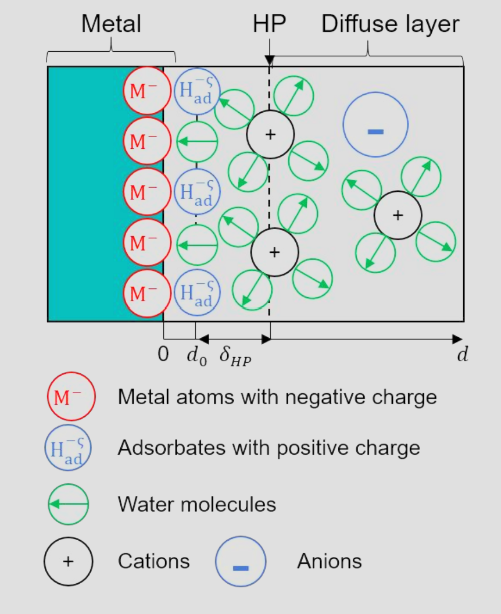
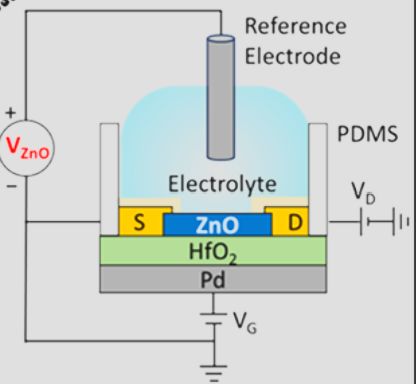

# What Are We Changing When We Change the Electrode Potential?

While studying electron transfer theory at metal/solution interfaces and computational electrochemistry, I spent a long time investigating a fundamental question: what are we actually changing at the microscopic level when we change the electrode potential? Following my questions and step-by-step understanding, this note brings together the theories of Trasatti, Jun Cheng, Schmickler, and Jun Huang, along with recent work on four-electrode semiconductor systems (Can Li [9]; Frisbie [10]) and the modulation of reorganization energy by electronic structure (Bediako & Limmer [11]).

## 1. Trasatti’s Definition of Electrode Potential {#trasatti-definition}

Tracing the literature back to Trasatti’s work in the 1970s and 1980s (e.g., [1]), the electrochemical potential of electrons $\tilde{\mu}_e$ in an electrode (i.e., the Fermi level $E_F$) is defined as the sum of two parts:

$$
\boxed{\tilde{\mu}_e = \mu_e - e\phi}
$$

- $\tilde{\mu}_e$ (electrochemical potential of electrons): The thermodynamic quantity controlled and measured by a potentiostat, corresponding to the change in applied electrode potential E ($\Delta \tilde{\mu}_e = -e\Delta E$).

- $\mu_e$ (chemical potential of electrons): Reflects the internal electronic structure and band filling of the electrode (i.e., the position of the Fermi level relative to the band edge).

- $\phi$ (inner potential): The local electrostatic potential experienced by electrons at a given spatial position.

When we change the applied electrode potential $\Delta E$, does the change go into the chemical potential $\Delta \mu_e$, or into the interfacial electrostatic potential difference $\Delta(\phi^M - \phi^S)$?

## 2. Metal Electrodes: Invariant Density of States (DOS) {#metal-electrodes}

For traditional metal electrodes (such as Pt and Au), the electronic density of states (DOS) near the Fermi level is very large. The surface charge added or removed during double-layer charging barely changes the internal band filling of the metal, so $\Delta \mu_e^M \approx 0$. Consequently:

$$
\Delta \tilde{\mu}_e^M = \Delta \mu_e^M - e\Delta(\phi^M - \phi^S) \approx -e\Delta(\phi^M - \phi^S)
$$

Applying an electrode potential to a metal electrode essentially changes only the inner potential difference across the metal/solution interface (the double-layer electrostatic potential distribution $\phi(z)$).

### 2.1 Choice of Reference Frame and Energy Level Shifts {#reference-frame}

{width="431"}

When reading Jun Cheng [2], Schmickler [3, 4], as well as Jun Huang’s papers on the Newns–Anderson model [5–7], it is important to note the choice of the energy zero reference frame:

- Using the bulk solution as the energy zero (fixing $\phi^S = 0$, as in the ab initio molecular dynamics cSHE method described by Jun Cheng in Chapter 5): When the electrode potential changes, the inner potential of the metal $\phi^M$ changes, so the metal’s Fermi level and the entire metal DOS shift together by $-e\Delta\phi^M$.

- Using the metal Fermi level as the energy zero (fixing $\epsilon_F \equiv \tilde{\mu}_e^M = 0$, which fixes $\phi^M = 0$): This is the perspective adopted in the Newns–Anderson Hamiltonians of Schmickler and Jun Huang. In this reference frame, because $\Delta \mu_e^M = 0$ and $\epsilon_F = 0$ is fixed by definition, neither the Fermi level nor the electronic density of states (DOS) of the metal moves. Changing the electrode potential (overpotential $\eta$) only changes the double-layer electrostatic potential distribution $\phi(z)$ on the solution side.

### 2.2 Effects of Electrode Potential on Molecules and the Metal Surface {#molecules-and-surface}

In the reference frame where $\epsilon_F = 0$ ($\phi^M = 0$), the effect of the electrode potential is manifested through changes in the solution-side electrostatic potential $\phi(z)$:

- Effect on reactant molecules: A molecule at the reaction plane $z_r$ within the double layer directly feels the change in the local electrostatic potential $\phi(z_r)$. In Schmickler’s model, the applied potential shifts the effective molecular orbital energy $\tilde{\epsilon}_a$ relative to the fixed metal Fermi level:

  $$
  \tilde{\epsilon}_a(q, \eta) = \epsilon_{a0} + e\eta - 2\lambda q
  $$

  A molecule located within the double layer experiences only a partial potential drop. In Jun Huang's model [5], this changing $\phi(z)$ also changes the partial charge occupation of hybridized molecular orbitals, the electrostatic work on reactant ions, and the reorganization energy caused by the orientation saturation of interfacial water dipoles.

- Effect on surface electron spillover: A natural question arises: if the bulk chemical potential $\mu_e^{\text{bulk}}$ and inner potential $\phi^M=0$ are invariant, what drives the potential-dependent surface electron spillover described in Schmickler’s Jellium model [3] and Jun Huang’s density-potential functional theory (DPFT) [8]? This stems from the bulk–surface distinction: the positive ion background of the metal stops at the surface $z=0$, but electrons are waves; to avoid the kinetic energy penalty from an infinite density gradient, the surface electron cloud spills over into the solution side by $1\text{–}2\text{ \AA}$. Deep in the metal bulk, electrostatic screening keeps the bulk neutral, so $\mu_e^{\text{bulk}}$ and $\phi^M=0$ do not change; however, at the surface boundary ($z \approx 0$), the changed electrostatic potential $\phi(z)$ on the solvent side must continuously align with the zero potential inside the metal. It is the interfacial electric field $-\nabla\phi(z)$ from this potential alignment that pulls the spilling electron cloud out toward the solution or pushes it back into the lattice. So in Jun Huang's metal picture, the charge on the metal surface is contributed by the electrostatic potential on the solvent side.

## 3. Semiconductor Electrodes and the Four-Electrode System {#semiconductors}

### 3.1 The Reference Zero Point in Three-Electrode Systems and How Semiconductors Differ {#three-electrode-reference}

Conventional electrochemical measurements use a three-electrode system (working electrode WE, counter electrode CE, and reference electrode RE). The extra reference electrode carries no current; its purpose is to provide a fixed potential zero point in the solution, allowing us to accurately measure and control the electrochemical potential change $\Delta V_W = -\Delta\tilde{\mu}_e / e$ of the working electrode relative to the solution.

However, semiconductors behave differently from metals. For low-DOS semiconductors such as graphene, $\text{MoS}_2$ (Can Li & Fengtao Fan [9]), or ultrathin $\text{ZnO}$ (Frisbie [10]), the quantum capacitance $C_Q = e^2\cdot\text{DOS}$ is small and comparable to the double-layer capacitance $C_{\text{EDL}}$. When a working electrode potential $V_W$ is applied, the energy is split between the internal chemical potential change ($\Delta\mu_e$, denoted as $\Delta\delta$ in Frisbie’s paper) and the interfacial double-layer electrostatic potential change ($e\Delta\phi_{\text{EDL}}$):

$$
-e\Delta V_W = \Delta\mu_e + e\Delta\phi_{\text{EDL}} \quad (\text{or } eV_W = \Delta\delta + e\Delta\phi_{\text{EDL}})
$$

In a three-electrode system, the change in the chemical potential part is large when tuning the electrode potential and cannot be ignored; moreover, it changes simultaneously with the double-layer electrostatic potential and cannot be controlled independently.

### 3.2 How the Four-Electrode Setup Changes $\Delta\mu_e$ and $\Delta\phi_{\text{EDL}}$ {#four-electrode-control}

{width="415"}

In Frisbie’s four-electrode setup [10], a fourth electrode—a back-gate (applying voltage $V_G$)—is placed behind a $5\text{ nm}$ ultrathin $\text{ZnO}$ working electrode (whose thickness is smaller than the electrostatic screening length, so the entire film shares the surface charge) across an $\text{HfO}_2$ dielectric layer.

Here, the total electronic charge $Q$ in $\text{ZnO}$ (which determines the internal chemical potential of the semiconductor, $\Delta\mu_e \equiv \Delta\delta = eQ/C_Q$) is controlled by both $V_W$ and $V_G$:

$$
Q = -C_{\text{EDL}} V_W + C_G V_G
$$

- Working electrode ($V_W$): Injects electrons from the frontside with counter-ions in the solution double layer, thus changing both the internal chemical potential $\Delta\mu_e$ and the solid–liquid interfacial electrostatic potential $\Delta\phi_{\text{EDL}}$.

- Back-gate ($V_G$): Acts as an electrostatic field applied across the backside insulator. It pulls electrons into $\text{ZnO}$ and changes the internal chemical potential $\Delta\mu_e$, while the positive counter-charges remain on the backside metal gate without charging the frontside solution double layer.

By jointly controlling $V_W$ and $V_G$, we can tune these two parts independently:

1. Changing only the internal chemical potential ($\Delta\mu_e \neq 0, \Delta\phi_{\text{EDL}} = 0$): While adjusting $V_W$, we use the electrostatic field of the back-gate $V_G$ to cancel out the change in the $\text{ZnO}$ surface double-layer potential caused by $V_W$ (or simply sweep $V_G$ under frontside open-circuit conditions). This adjusts only the internal chemical potential of $\text{ZnO}$ without changing the double-layer potential at the solid–liquid interface.

2. Changing only the interfacial electrostatic potential ($\Delta\phi_{\text{EDL}} \neq 0, \Delta\mu_e = 0$): By tuning $V_G$ and $V_W$ simultaneously in inverse proportion to their capacitances ($\Delta V_G / \Delta V_W = C_{\text{EDL}} / C_G$), the electrons pulled in by $V_G$ from the back exactly cancel the electrons removed by $V_W$ from the front ($\Delta Q = 0$). In this case, the electron concentration and chemical potential $\Delta\mu_e$ inside $\text{ZnO}$ remain unchanged, and only the double-layer electrostatic potential $\Delta\phi_{\text{EDL}}$ at the solid–liquid interface changes.

## 4. Changing Local Charge vs. Changing the Mean Electric Field {#local-charge-and-mean-field}

When we use the four-electrode setup to decouple and independently control the chemical potential ($\Delta\mu_e$) and the interfacial electrostatic potential ($\Delta\phi_{\text{EDL}}$), their effects on adiabatic inner-sphere reactions and non-adiabatic outer-sphere reactions can be viewed as a single unified problem.

### 4.1 Adiabatic Inner-Sphere Electron Transfer Reactions {#inner-sphere}

- In the tight-binding Newns–Anderson framework, molecular adsorption on oxide or metal sites depends on attraction to the narrow metal d-band and repulsion from the broad sp-band.

- When the interfacial electrostatic potential is fixed ($\Delta\phi_{\text{EDL}}=0$) and only the chemical potential $\Delta\mu_e$ of the semiconductor is tuned, shifting the Fermi level changes the electron occupation $\langle n_a \rangle$ of these hybridized orbitals. This is equivalent to changing the charge shared between the adsorbed molecule and the surface, thereby adjusting the molecular adsorption strength.

- When the chemical potential is fixed ($\Delta\mu_e=0$) and only the interfacial electrostatic potential $\Delta\phi_{\text{EDL}}$ is tuned, we change the double-layer electric field across the solid–liquid interface, which adjusts the dipole orientation of interfacial water and the electric field strength, thereby changing the reorganization energy $\lambda$ from the solvent side.

### 4.2 Non-Adiabatic Outer-Sphere Electron Transfer Reactions {#outer-sphere}

Recent work by Bediako and Limmer [11] shows that changing the electronic structure of the electrode (chemical potential $\Delta\mu_e$ / DOS) also directly changes the reorganization energy $\lambda$ in outer-sphere reactions.

The reason is as follows: inside the electrode, there is a Thomas–Fermi electrostatic screening length ($\ell_{\text{TF}}$), which describes the spatial distance over which mobile electrons inside a solid can screen an external electric field or charge. The magnitude of $\ell_{\text{TF}}$ is inversely proportional to the electronic density of states at the Fermi level:

$$
\ell_{\text{TF}} \propto \frac{1}{\text{DOS}(E_F)}
$$

When a reactant molecule in solution undergoes instantaneous electron transfer (in a vertically excited state where slow water molecules do not have time to rotate), it induces an image charge on the electrode surface. If we increase the chemical potential $\Delta\mu_e$ of the electrode so that $\text{DOS}(E_F)$ increases, the screening length $\ell_{\text{TF}}$ becomes shorter, allowing the electrode surface to induce a localized image charge within a smaller spatial region right beneath the electron transfer center. The image charge affects the energy of the excited state through Coulomb interaction, thereby changing the reorganization energy $\lambda$.

### 4.3 Summary {#summary}

Comparing the two types of reactions above, we can summarize the physical picture of changing the chemical potential versus changing the electrostatic potential as follows:

- Changing the chemical potential ($\Delta\mu_e$) is equivalent to changing the "local charge" beneath the molecule (inducing a local field): In inner-sphere reactions, it changes the local covalent bonding charge shared between the adsorbed molecule and the surface site; in outer-sphere reactions, it changes the localized image charge induced right beneath the electron transfer center.

- Changing the electrostatic potential ($\Delta\phi_{\text{EDL}}$) is equivalent to changing the "mean electric field" across the entire interface (mean surface charge): It changes the double-layer capacitive charge uniformly distributed across the electrode surface, generating a macroscopic mean electric field at the solid–liquid interface that shifts molecular energy levels and adjusts the orientation of the interfacial water layer.

## References {#references}

1. Trasatti, S. *The Absolute Electrode Potential: An Explanatory Note (Recommendations 1986).* **Pure Appl. Chem.** **1986**, *58*, 955–966. https://doi.org/10.1351/pac198658070955
2. Le, J.-B.; Yang, X.-H.; Zhuang, Y.-B.; Wang, F.; Cheng, J. *Ab Initio Modeling of Electrochemical Interfaces and Determination of Electrode Potentials.* In **Atomic-Scale Modelling of Electrochemical Systems**, Chapter 5; Wiley, 2021. https://doi.org/10.1002/9781119605652.ch5
3. Schmickler, W.; Santos, E. **Interfacial Electrochemistry**, 2nd ed.; Springer, 2010. https://doi.org/10.1007/978-3-642-04937-8
4. Santos, E.; Lundin, A.; Pötting, K.; Quaino, P.; Schmickler, W. *Model for the Electrocatalysis of Hydrogen Evolution.* **Phys. Rev. B** **2009**, *79*, 235436. https://doi.org/10.1103/PhysRevB.79.235436
5. Huang, J.; Chen, S. *Interplay between Covalent and Noncovalent Interactions in Electrocatalysis.* **J. Phys. Chem. C** **2018**, *122*, 26910–26921. https://doi.org/10.1021/acs.jpcc.8b07534
6. Huang, J.; Li, P.; Chen, S. *Quantitative Understanding of the Sluggish Kinetics of Hydrogen Reactions in Alkaline Media Based on a Microscopic Hamiltonian Model for the Volmer Step.* **J. Phys. Chem. C** **2019**, *123*, 17325–17334. https://doi.org/10.1021/acs.jpcc.9b03639
7. Huang, J. *Mixed Quantum-Classical Treatment of Electron Transfer at Electrocatalytic Interfaces: Theoretical Framework and Conceptual Analysis.* **J. Chem. Phys.** **2020**, *153*, 164707. https://doi.org/10.1063/5.0009582
8. Huang, J.; Chen, S.; Eikerling, M. *Grand-Canonical Model of Electrochemical Double Layers from a Hybrid Density–Potential Functional.* **J. Chem. Theory Comput.** **2021**, *17*, 2417–2430. https://doi.org/10.1021/acs.jctc.1c00098
9. Wang, Z.; Chen, J.; Ni, C.; et al. *Visualizing the Role of Applied Voltage in Non-Metal Electrocatalysts.* **Natl. Sci. Rev.** **2023**, *10*, nwad166. https://doi.org/10.1093/nsr/nwad166
10. Wang, Y.; Frisbie, C. D. *Four-Terminal Electrochemistry: A Back-Gate Controls the Electrochemical Potential of a 2D Working Electrode.* **J. Phys. Chem. C** **2024**, *128*, 1819–1826. https://doi.org/10.1021/acs.jpcc.3c07198
11. Maroo, S.; Coello Escalante, L.; Wang, Y.; et al. *Electronic Origin of Reorganization Energy in Interfacial Electron Transfer.* **Nature** **2026**, *653*, 98–103. https://doi.org/10.1038/s41586-026-10311-2
