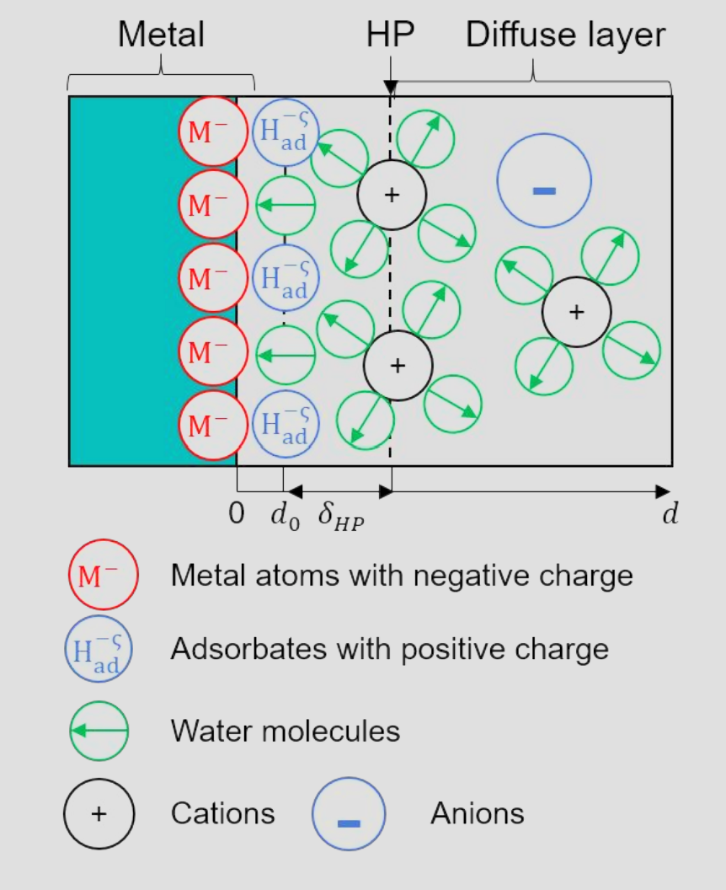
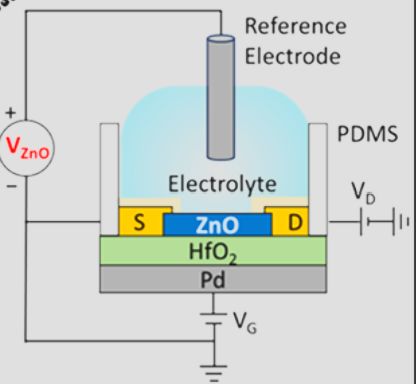

# 当我们改变电极电势的时候，我们在改变的是什么？

在研究金属/溶液界面电子转移理论和计算化学的过程中，我花了很长时间去研究一个基础问题：当我们改变电极电势时，我们在微观上到底改变了什么？这篇笔记顺着我的疑问和理解过程，将 Trasatti、厦门大学程俊、Schmickler、于利希黄俊的理论与最近的半导体四电极体系（李灿等 \[9\]、Frisbie 等 \[10\]）以及电子结构调控重组能的工作（Bediako & Limmer 等 \[11\]）整理在一起。

## 一、Trasatti 的电极电势定义 {#trasatti-definition}

把文献回溯到 1970–1980 年代 Trasatti 的工作 \[1\]，电极中电子的电化学势 $\tilde{\mu}_e$（即费米能级 $E_F$）定义为两部分之和：

$$
\boxed{\tilde{\mu}_e = \mu_e - e\phi}
$$

- $\tilde{\mu}_e$（电子电化学势）：恒电位仪控制和测量的热力学量，对应外加电极电势 $E$ 的变化（$\Delta\tilde{\mu}_e = -e\Delta E$）。
- $\mu_e$（电子化学势）：反映电极内部的电子结构与能带填充程度（即费米能级相对于能带底的位置）。
- $\phi$（内电势）：电子在空间某位置所处的局域静电势。

当我们改变外加电极电势 $\Delta E$ 时，变化量落在了化学势 $\Delta\mu_e$ 上，还是落在了界面静电势差 $\Delta(\phi^M-\phi^S)$ 上？

## 二、金属电极：态密度（DOS）不变 {#metal-electrodes}

对于传统金属电极（如 Pt, Au），金属在费米面附近具有很大的电子态密度（DOS）。给双电层充放电所增减的表面电荷，对金属内部能带填充的改变很小，因此 $\Delta\mu_e^M\approx 0$。于是：

$$
\Delta\tilde{\mu}_e^M=\Delta\mu_e^M-e\Delta(\phi^M-\phi^S)\approx-e\Delta(\phi^M-\phi^S)
$$

在金属电极上施加电极电势，改变的其实是金属与溶液界面的内电势差（双电层静电势分布 $\phi(z)$）。

### 1. 参考系的选择与能级移动 {#reference-frame}

{width="431"}

在阅读程俊 \[2\]、Schmickler \[3, 4\]、黄俊 \[5–7\] 的 Newns–Anderson 模型时，需要注意能量零点参考系的选择：

- **以本体溶液为能量零点**（固定 $\phi^S=0$，如程俊在第 5 章介绍的从头算分子动力学 cSHE 方法）：改变电极电势时，金属内电势 $\phi^M$ 改变，金属的费米能级和整个金属的 DOS 一起随 $-e\Delta\phi^M$ 平移。
- **以金属费米能级为能量零点**（固定 $\epsilon_F\equiv\tilde{\mu}_e^M=0$，即固定 $\phi^M=0$）：这是 Schmickler 和黄俊在 Newns–Anderson 哈密顿量中采用的视角。在这个参考系下，因为 $\Delta\mu_e^M=0$ 且人为固定了 $\epsilon_F=0$，所以金属的费米能级不变，金属的电子态密度（DOS）也不变。改变电极电势（过电势 $\eta$）只改变溶液侧的双电层静电势分布 $\phi(z)$。

### 2. 电极电势对分子与金属表面的影响 {#molecules-and-surface}

在固定 $\epsilon_F=0$（$\phi^M=0$）的参考系下，电极电势的作用通过溶液侧静电势 $\phi(z)$ 的改变来体现：

- **对反应分子的影响：** 处于双电层反应平面 $z_r$ 处的分子，直接感受到局域静电势 $\phi(z_r)$ 的变化。在 Schmickler 的模型中，外加电势表现为分子有效轨道能级 $\tilde{\epsilon}_a$ 相对于金属费米面的移动：

  $$
  \tilde{\epsilon}_a(q,\eta)=\epsilon_{a0}+e\eta-2\lambda q
  $$

  若分子在双电层内部，则只感受部分电势降。在黄俊的模型中 \[5\]，这个变化的 $\phi(z)$ 还会进一步改变分子杂化轨道的部分电荷占据数、反应物离子的静电功以及界面水偶极取向饱和导致的重组能变化。

- **对金属表面电子量子溢出（Electron Spillover）的影响：** 这里我曾有一个疑问：既然金属体相的化学势 $\mu_e^{\text{bulk}}$ 和内电势 $\phi^M=0$ 都不变，为什么在 Schmickler 的 Jellium 模型 \[3\] 和黄俊的密度-电势泛函理论（DPFT）\[8\] 中，金属表面的电子溢出还会随电极电势变化？

  原因在于体相与表面的区别：金属正离子背景在表面 $z=0$ 处截止，但电子具有波动性，为了避免密度梯度无穷大带来的动能惩罚，表面电子云会向溶液侧溢出 $1\sim2\ \text{\AA}$。在金属体相深处，由于静电屏蔽，体相保持电中性，$\mu_e^{\text{bulk}}$ 和 $\phi^M=0$ 不变；但在表面交界处（$z\approx0$），改变了的溶剂侧静电势 $\phi(z)$ 必须与金属内部为 0 的电势连续对齐。正是这个电势对齐所产生的界面电场 $-\nabla\phi(z)$，把金属表面溢出的电子云向溶液侧拉出或向晶格内推回。所以在黄俊的金属图像中，金属表面的电荷是由溶剂侧的静电势贡献的。

## 三、半导体电极与四电极体系 {#semiconductors}

### 1. 三电极体系的参比零点与半导体的不同 {#three-electrode-reference}

在常规电化学测量中使用三电极体系（工作电极 WE、对电极 CE、参比电极 RE），多出来的参比电极不通过电流，其作用是在溶液中提供一个固定的电势零点，用来准确测量和控制工作电极相对于溶液的电化学势变化 $\Delta V_W=-\Delta\tilde{\mu}_e/e$。

但半导体的行为与金属不同。对于石墨烯、$\text{MoS}_2$（李灿与范峰滔团队 \[9\]）或超薄 $\text{ZnO}$（Frisbie 团队 \[10\]）等低态密度半导体，其量子电容 $C_Q=e^2\cdot\text{DOS}$ 很小，与双电层电容 $C_{\text{EDL}}$ 大小相当。施加工作电极电势 $V_W$ 时，能量同时分配给内部化学势变化（$\Delta\mu_e$，Frisbie 文中记为 $\Delta\delta$）和界面双电层静电势变化（$e\Delta\phi_{\text{EDL}}$）：

$$
-e\Delta V_W=\Delta\mu_e+e\Delta\phi_{\text{EDL}}\quad(\text{即 }eV_W=\Delta\delta+e\Delta\phi_{\text{EDL}})
$$

在三电极体系下，改变电极电势时化学势部分的变化很大，不能被忽略，且与双电层静电势同时变化，无法单独控制。

### 2. 四电极如何改变 $\Delta\mu_e$ 和 $\Delta\phi_{\text{EDL}}$ {#four-electrode-control}

{width="415"}

在 Frisbie 的四电极体系中 \[10\]，他们在 $5\ \text{nm}$ 超薄 $\text{ZnO}$ 工作电极（厚度小于静电屏蔽长度，整层薄膜共享表面电荷）的背面，隔着绝缘层 $\text{HfO}_2$ 引入了第四个电极——背栅极（Back-Gate，施加电压 $V_G$）。

此时，$\text{ZnO}$ 的总电子电荷量 $Q$（决定了半导体的内部化学势 $\Delta\mu_e\equiv\Delta\delta=eQ/C_Q$）同时受 $V_W$ 和 $V_G$ 的影响：

$$
Q=-C_{\text{EDL}}V_W+C_GV_G
$$

- **工作电极（**$V_W$）： 从正面注入电子，反电荷在溶液双电层中，因此同时改变内部化学势 $\Delta\mu_e$ 和固液界面静电势 $\Delta\phi_{\text{EDL}}$。
- **背栅极（**$V_G$）： 相当于在背面施加了一个静电场。它把电子拉进 $\text{ZnO}$ 从而改变内部化学势 $\Delta\mu_e$，但配对的反电荷在背面金属栅极上，不给正面溶液双电层充电。

通过联合控制 $V_W$ 和 $V_G$，可以分别独立调节这两部分：

1.  **只改变内部化学势（**$\Delta\mu_e\ne0,\ \Delta\phi_{\text{EDL}}=0$）： 在调节 $V_W$ 时，利用背栅 $V_G$ 的静电场抵消掉 $V_W$ 导致的 $\text{ZnO}$ 表面双电层电势变化（或在正面开路下只调节 $V_G$），从而在不改变固液界面双电层电势的情况下，单独调整 $\text{ZnO}$ 内部的化学势。
2.  **只改变界面静电势（**$\Delta\phi_{\text{EDL}}\ne0,\ \Delta\mu_e=0$）： 按电容反比同步调节 $V_G$ 和 $V_W$（$\Delta V_G/\Delta V_W=C_{\text{EDL}}/C_G$），让背面 $V_G$ 拉入的电子数恰好抵消正面 $V_W$ 抽走的电子数（$\Delta Q=0$）。此时 $\text{ZnO}$ 内部的电子浓度和化学势 $\Delta\mu_e$ 保持不变，变化的只有固液界面的双电层静电势 $\Delta\phi_{\text{EDL}}$。

## 四、改变局域电荷和改变平均电场 {#local-charge-and-mean-field}

当我们用四电极把化学势（$\Delta\mu_e$）和界面静电势（$\Delta\phi_{\text{EDL}}$）拆开并独立调节时，它们对绝热内球反应和非绝热外球反应的作用，都能被看成一个问题。

### 1. 绝热内球电子转移反应 {#inner-sphere}

- 在紧束缚 Newns–Anderson 框架下，分子在氧化物或金属位点上的吸附取决于分子轨道与金属窄 d 带的吸引及与宽 sp 带的排斥。
- 当固定界面静电势 $\Delta\phi_{\text{EDL}}=0$、单独调节半导体的化学势 $\Delta\mu_e$ 时，费米能级的移动改变了这些杂化轨道的电子填充数 $\langle n_a\rangle$。这相当于改变了分子吸附时与表面共享的电荷，从而调整了分子吸附的强度。
- 当固定化学势 $\Delta\mu_e=0$、单独调节界面静电势 $\Delta\phi_{\text{EDL}}$ 时，改变的是固液界面的双电层电场，用来调整界面水的溶剂取向和电场强度，进而从溶剂端改变重组能 $\lambda$。

### 2. 非绝热外球电子转移反应（Nature 2026） {#outer-sphere}

最近 Bediako 与 Limmer 的工作 \[11\] 表明，改变电极的电子结构（化学势 $\Delta\mu_e$ / 态密度 DOS）同样会直接改变外球反应的重组能 $\lambda$。

原因如下：电极内部存在托马斯-费米静电屏蔽长度（Thomas–Fermi screening length，$\ell_{\text{TF}}$）。这个长度描述的是固体内部的自由电子在多大的空间距离内能够把外加电场或外电荷屏蔽掉。$\ell_{\text{TF}}$ 的大小与费米面处的电子态密度成反比：

$$
\ell_{\text{TF}}\propto\frac{1}{\text{DOS}(E_F)}
$$

当溶液中的反应分子发生瞬态电子转移（处于垂直激发态，周围慢速的水分子来不及转动）时，会在电极表面感应出镜像电荷（Image Charge）。如果调高电极的化学势 $\Delta\mu_e$ 使 $\text{DOS}(E_F)$ 增大，屏蔽长度 $\ell_{\text{TF}}$ 就会缩短，电极表面就能在电子转移中心正下方更小的空间范围内诱导出局域化的镜像电荷。镜像电荷通过库仑力影响激发态的能量，从而改变了重组能 $\lambda$。

### 3. 总结 {#summary}

对比上述两种反应，我们可以把改变化学势和改变静电势的物理图像总结为：

- **改变化学势（**$\Delta\mu_e$）相当于改变分子下方的“局域电荷”（产生局域场）： 在内球反应中，它改变的是分子吸附时与表面位点共享的局域成键电荷；在外球反应中，它改变的是电子转移中心正下方诱导出的局域镜像电荷。
- **改变静电势（**$\Delta\phi_{\text{EDL}}$）相当于改变整个界面的“平均电场”（平均表面电荷）： 它改变的是在整个电极表面均匀分布的双电层电容电荷，在固液界面产生一个宏观的平均电场，用来平移分子能级并调整整层界面水分子的取向。

## References {#references}

1.  Trasatti, S. *The Absolute Electrode Potential: An Explanatory Note (Recommendations 1986).* **Pure Appl. Chem.** **1986**, *58*, 955–966. https://doi.org/10.1351/pac198658070955
2.  Le, J.-B.; Yang, X.-H.; Zhuang, Y.-B.; Wang, F.; Cheng, J. *Ab Initio Modeling of Electrochemical Interfaces and Determination of Electrode Potentials.* In **Atomic-Scale Modelling of Electrochemical Systems**, Chapter 5; Wiley, 2021. https://doi.org/10.1002/9781119605652.ch5
3.  Schmickler, W.; Santos, E. **Interfacial Electrochemistry**, 2nd ed.; Springer, 2010. https://doi.org/10.1007/978-3-642-04937-8
4.  Santos, E.; Lundin, A.; Pötting, K.; Quaino, P.; Schmickler, W. *Model for the Electrocatalysis of Hydrogen Evolution.* **Phys. Rev. B** **2009**, *79*, 235436. https://doi.org/10.1103/PhysRevB.79.235436
5.  Huang, J.; Chen, S. *Interplay between Covalent and Noncovalent Interactions in Electrocatalysis.* **J. Phys. Chem. C** **2018**, *122*, 26910–26921. https://doi.org/10.1021/acs.jpcc.8b07534
6.  Huang, J.; Li, P.; Chen, S. *Quantitative Understanding of the Sluggish Kinetics of Hydrogen Reactions in Alkaline Media Based on a Microscopic Hamiltonian Model for the Volmer Step.* **J. Phys. Chem. C** **2019**, *123*, 17325–17334. https://doi.org/10.1021/acs.jpcc.9b03639
7.  Huang, J. *Mixed Quantum-Classical Treatment of Electron Transfer at Electrocatalytic Interfaces: Theoretical Framework and Conceptual Analysis.* **J. Chem. Phys.** **2020**, *153*, 164707. https://doi.org/10.1063/5.0009582
8.  Huang, J.; Chen, S.; Eikerling, M. *Grand-Canonical Model of Electrochemical Double Layers from a Hybrid Density–Potential Functional.* **J. Chem. Theory Comput.** **2021**, *17*, 2417–2430. https://doi.org/10.1021/acs.jctc.1c00098
9.  Wang, Z.; Chen, J.; Ni, C.; et al. *Visualizing the Role of Applied Voltage in Non-Metal Electrocatalysts.* **Natl. Sci. Rev.** **2023**, *10*, nwad166. https://doi.org/10.1093/nsr/nwad166
10. Wang, Y.; Frisbie, C. D. *Four-Terminal Electrochemistry: A Back-Gate Controls the Electrochemical Potential of a 2D Working Electrode.* **J. Phys. Chem. C** **2024**, *128*, 1819–1826. https://doi.org/10.1021/acs.jpcc.3c07198
11. Maroo, S.; Coello Escalante, L.; Wang, Y.; et al. *Electronic Origin of Reorganization Energy in Interfacial Electron Transfer.* **Nature** **2026**, *653*, 98–103. https://doi.org/10.1038/s41586-026-10311-2
